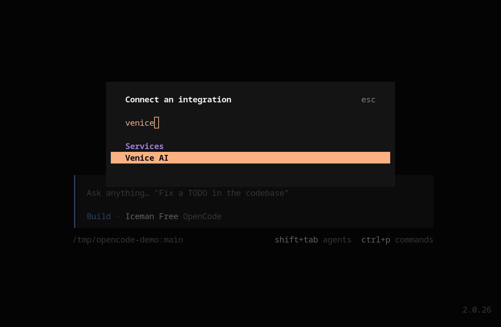

[OpenCode](https://opencode.ai/) هو وكيل برمجة بالذكاء الاصطناعي يعمل في الطرفية. يتضمن OpenCode موفّر Venice AI مسبقًا، لذا تتصل بأمر واحد وتختار نموذجًا من كتالوج Venice الكامل. لا حاجة إلى أي ملف تكوين.

<Note>
  يتبع هذا الدليل OpenCode 1، وهو الإصدار الذي يثبّته المثبّت القياسي. يتضمن OpenCode 2 أيضًا Venice AI مع بعض التغييرات في التسميات. راجع [OpenCode 2](#opencode-2).
</Note>

<CardGroup cols={3}>
  <Card title="موفّر مدمج" icon="plug">
    يظهر Venice AI في قائمة `/connect` في OpenCode
  </Card>
  <Card title="كتالوج النماذج الكامل" icon="list">
    كل نماذج Venice النصية متاحة في `/models`
  </Card>
  <Card title="لا حاجة إلى تكوين" icon="adjustments">
    أمر واحد يربط الحساب لكل المشاريع
  </Card>
</CardGroup>

---

## المتطلبات {#prerequisites}

- مفتاح Venice API من [venice.ai/settings/api](https://venice.ai/settings/api?utm_source=venice-api-documentation)
- OpenCode مثبَّت ويعمل على جهازك

---

## الإعداد {#setup}

<Steps>
  <Step title="اربط Venice AI">
    شغّل OpenCode ونفّذ أمر الاتصال:

    ```txt
    /connect
    ```

    ابحث عن **Venice AI** واختره.

    <Frame as="div">
      
    </Frame>
  </Step>

  <Step title="الصق مفتاح Venice API">
    الصق المفتاح في حقل **API key** واضغط Enter.

    يخزّن OpenCode بيانات الاعتماد في `~/.local/share/opencode/auth.json`، لذا تبقى متاحة في كل مشروع.
  </Step>

  <Step title="اختر نموذجًا">
    نفّذ أمر النماذج واختر نموذجًا من Venice:

    ```txt
    /models
    ```

    يُعد `z-ai-glm-5-3-flash` خيارًا افتراضيًا جيدًا للبرمجة: سريع ورخيص ونافذة سياقه 1M توكن. راجع [معرّفات النماذج](#model-ids) لخيارات أخرى.

    يعرض OpenCode أيضًا فئته المجانية المستضافة بأسماء مشابهة، مثل **GLM-5.3-Flash Free** من **OpenCode** بجوار **GLM 5.3 Flash** من **Venice AI**. يميّز اسم الموفّر في العمود الأيمن بينهما، وصف Venice AI هو الذي يستخدم مفتاحك ورصيدك.
  </Step>
</Steps>

أرسل مهمة صغيرة للتأكد من عمل الاتصال ذهابًا وإيابًا، على سبيل المثال:

```txt
Review the current file and suggest one safe improvement.
```

---

## تثبيت نموذج افتراضي {#pin-a-default-model}

بعد الاتصال، قد يبدأ OpenCode الجلسات الجديدة على نموذج موجَّه مثل Claude Sonnet 4.6، وهو أعلى تكلفة من النماذج في [معرّفات النماذج](#model-ids). لاختيار النموذج الذي يبدأ به OpenCode، أضفه إلى `opencode.json` في جذر مشروعك (أو إلى `~/.config/opencode/opencode.json` لإعداد افتراضي عام):

```json
{
  "$schema": "https://opencode.ai/config.json",
  "model": "venice/z-ai-glm-5-3-flash",
  "small_model": "venice/z-ai-glm-5-3-flash"
}
```

تستخدم مراجع النماذج الصيغة `venice/<model-id>`، ويحدد `small_model` النموذج الأرخص للمهام الخلفية.

---

## الاتصال بدون `/connect` {#connect-without-/connect}

يقرأ الموفّر المضمَّن أيضًا `VENICE_API_KEY` من البيئة. صدّره قبل تشغيل OpenCode، وستظهر نماذج Venice AI في `/models` دون تنفيذ `/connect`:

```bash
export VENICE_API_KEY="your-api-key"
```

على إصدار من OpenCode أقدم من الموفّر المضمَّن، أو لتثبيت قائمة النماذج التي يعرضها OpenCode، كوّن Venice كموفّر متوافق مع OpenAI في `opencode.json`. أبقِ `VENICE_API_KEY` مُصدَّرًا:

```json
{
  "$schema": "https://opencode.ai/config.json",
  "model": "venice/z-ai-glm-5-3-flash",
  "small_model": "venice/z-ai-glm-5-3-flash",
  "provider": {
    "venice": {
      "npm": "@ai-sdk/openai-compatible",
      "name": "Venice AI",
      "options": {
        "baseURL": "https://api.venice.ai/api/v1",
        "apiKey": "{env:VENICE_API_KEY}"
      },
      "models": {
        "z-ai-glm-5-3-flash": {
          "name": "GLM 5.3 Flash"
        },
        "kimi-k2-6": {
          "name": "Kimi K2.6"
        },
        "minimax-m25": {
          "name": "MiniMax M2.5"
        }
      }
    }
  }
}
```

أدرج النماذج التي تريدها داخل `models`. يعرض OpenCode فقط الإدخالات المعرّفة هنا لهذا الموفّر. في الإصدارات التي تتضمن الموفّر المضمَّن، يمنحك متغير البيئة وحده الكتالوج الكامل.

---

## OpenCode 2 {#opencode-2}

OpenCode 2 هو خط إصدارات منفصل وله مثبّت خاص به:

```bash
curl -fsSL https://opencode.ai/v2/install | bash
```

يأتي مع موفّر Venice AI أصلي، ويعمل الإعداد أعلاه مع بعض الاختلافات:

- يحمل مربع حوار `/connect` العنوان **Connect an integration**. ابحث عن **Venice AI** ضمن **Services**، ثم الصق مفتاحك في مربع الحوار **Connect Venice AI**.
- يؤدي تصدير `VENICE_API_KEY` قبل التشغيل أيضًا إلى تفعيل الموفّر دون `/connect`.
- عند عدم تثبيت نموذج، قد يبدأ OpenCode 2 أيضًا على نموذج موجَّه، مثل Claude Fable 5.2.
- تظل أمثلة `opencode.json` في هذه الصفحة تعمل، لأن OpenCode 2 لا يزال يقرأ صيغة تكوين OpenCode 1. في التكوين الأصلي لـ OpenCode 2، اضبط نموذج الخلفية باستخدام `agents.title.model` بدلًا من `small_model`. راجع [دليل الترحيل](https://opencode.ai/docs/migrate-v1) الخاص بـ OpenCode لبقية الصيغة الأصلية.

---

## معرّفات النماذج {#model-ids}

بعض نماذج Venice التي تعمل جيدًا في وكيل برمجة. يتغير الكتالوج، لذا استخدم [`GET /models?type=text`](/ar/api-reference/endpoint/models/list) للحصول على القائمة الحالية.

| النموذج | معرّف Venice |
|-------|-----------|
| GLM 5.3 Flash | `z-ai-glm-5-3-flash` |
| GLM 5.3 | `z-ai-glm-5-3` |
| Kimi K2.6 | `kimi-k2-6` |
| MiniMax M2.5 | `minimax-m25` |
| DeepSeek V4.1 Flash | `deepseek-v4-1-flash` |

تعمل النماذج مفتوحة الأوزان مثل هذه بخصوصية تامة. أما النماذج الموجَّهة من Anthropic وOpenAI وGoogle فتعمل بشكل مجهول الهوية، فلا يرى المختبر المصدر هويتك أبدًا.

---

## ملاحظات التكوين {#config-notes}

- أبقِ `baseURL` مضبوطًا على `https://api.venice.ai/api/v1` في كتلة الموفّر اليدوية. الموفّر المضمَّن يشير إليه مسبقًا.
- معرّف الموفّر هو `venice`، لذا تستخدم مراجع النماذج الصيغة `venice/<model-id>` في كلا المسارين.
- نفّذ `/connect` مرة أخرى في أي وقت لاستبدال مفتاح Venice المخزَّن.
- وسّع السياق عندما يدعمه النموذج: تقبل عدة نماذج من Venice ما يصل إلى 1M توكن.

---

## استكشاف الأخطاء وإصلاحها {#troubleshooting}

<AccordionGroup>
  <Accordion title="Venice AI غير موجود في /connect">
    حدّث OpenCode إلى أحدث إصدار 1.x باستخدام `opencode upgrade`. يأتي موفّر Venice AI مع الإصدارات الحالية، لذا قد لا يوفّر التثبيت الأقدم إلا مسار التكوين اليدوي أعلاه.
  </Accordion>
  <Accordion title="مفتاح API غير صالح أو 401">
    تأكد من أن المفتاح من [venice.ai/settings/api](https://venice.ai/settings/api?utm_source=venice-api-documentation)، ثم نفّذ `/connect` واختر **Venice AI** والصقه مرة أخرى. عندما يكون المفتاح المخزَّن قديمًا، يبلّغ OpenCode عن فشل في المصادقة بدلًا من الوصول إلى Venice.
  </Accordion>
  <Accordion title="النموذج غير متاح">
    انسخ المعرّف كما هو من [معرّفات النماذج](#model-ids) أو [كتالوج النماذج النصية](/ar/models/text) أو `GET /models`، وتأكد من أن حسابك في Venice لديه حق الوصول إليه.
  </Accordion>
  <Accordion title="ما زلت عالقًا؟ شاهد ما يرسله الوكيل">
    شغّل [وكيل التصحيح المحلي](/ar/learn/local-debug-proxy) بين OpenCode وVenice لتسجيل كل طلب واستجابة، بما في ذلك معرّف النموذج والأدوات ومتن الخطأ التي أرسلها الوكيل فعليًا، إضافةً إلى آخر أربعة أحرف من المفتاح الذي استخدمه.
  </Accordion>
</AccordionGroup>

---

## الموارد {#resources}

<CardGroup cols={3}>
  <Card title="نماذج Venice النصية" icon="list" href="/ar/models/text">
    معرّفات نماذج Venice المتاحة
  </Card>
  <Card title="وثائق موفّر OpenCode 1" icon="book" href="https://opencode.ai/v1/docs/providers/">
    قائمة الموفّرين ومرجع الموفّر المخصص
  </Card>
  <Card title="وثائق موفّر OpenCode 2" icon="book" href="https://opencode.ai/docs/providers/">
    تكوين الموفّر الأصلي لـ OpenCode 2
  </Card>
</CardGroup>
