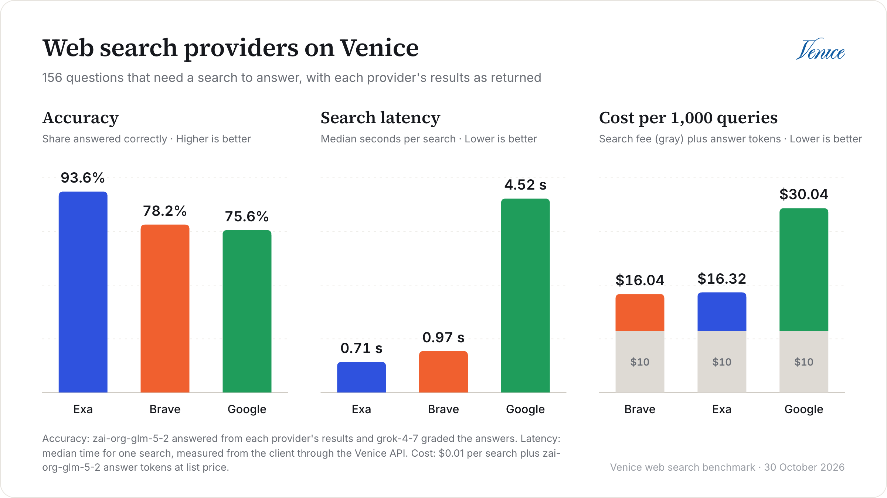
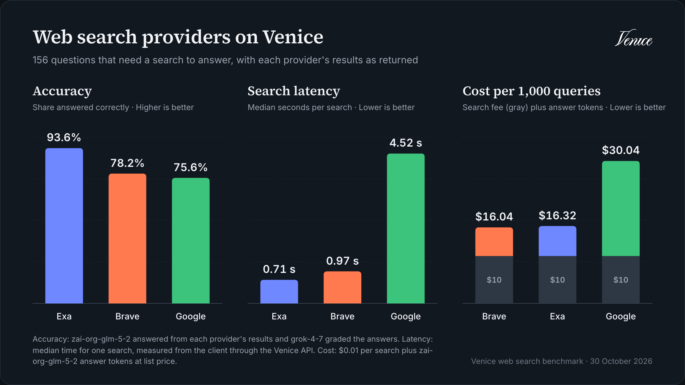
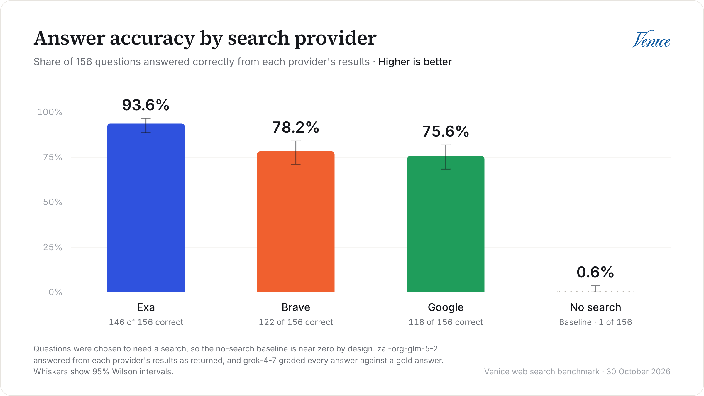
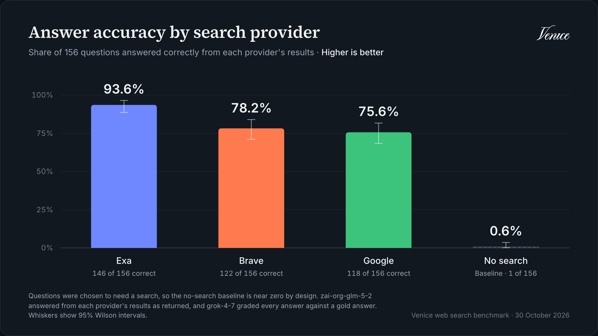
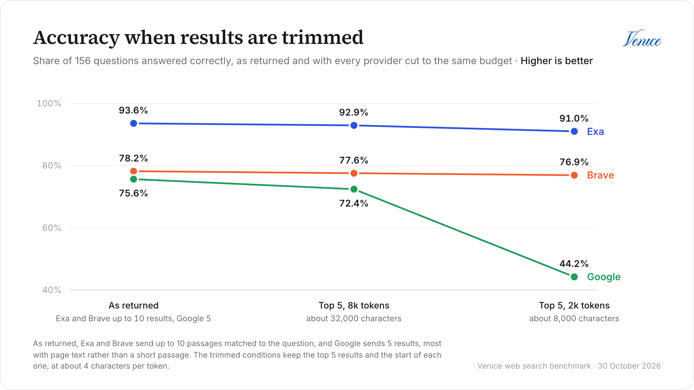
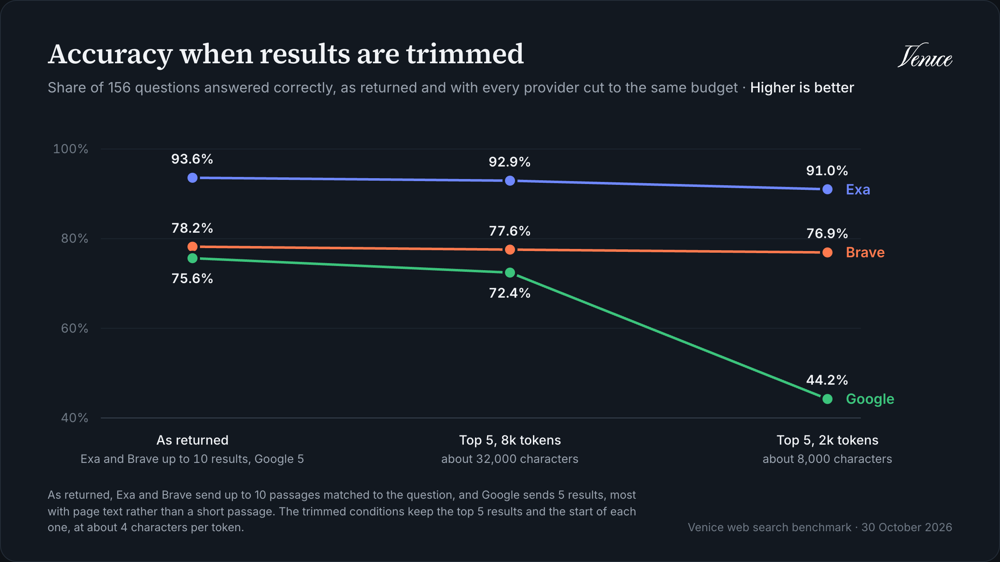
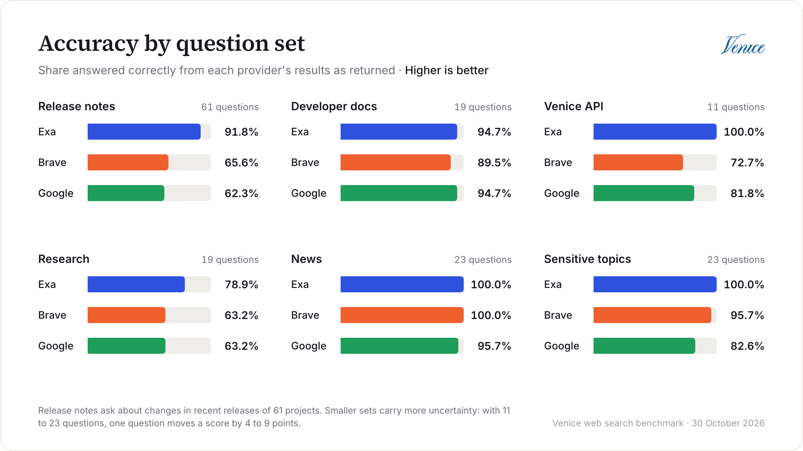
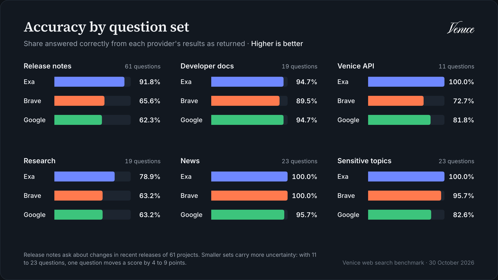
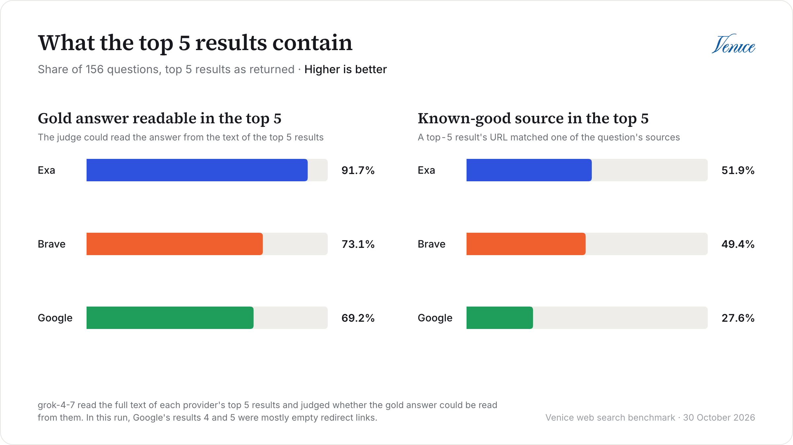
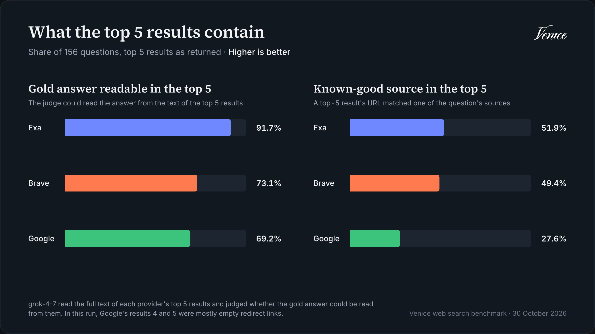

import { AuthorByline } from "/snippets/authorByline.jsx";

<AuthorByline name="Joshua Mo" date="30 October 2026"/>

Hallo! Mit dem [Websuche-Endpoint](/de/api-reference/endpoint/augment/search) von Venice wählst du über ein einziges Feld einen von drei Suchanbietern aus: `brave`, `google` oder `exa`. Alle kosten gleich viel, nämlich $0.01 pro Suche, also stellt sich die naheliegende Frage, welchen du tatsächlich verwenden solltest.

In diesem Artikel finden wir es heraus. Wir haben einen Benchmark gebaut, der dieselben 162 Fragen an jeden Anbieter schickt, dasselbe Modell auf Basis der Ergebnisse jedes Anbieters antworten lässt und sowohl die Ergebnisse als auch die Antworten bewertet. Wir gehen durch, wie wir die Fragen ausgewählt haben, was wir herausgefunden haben und wie du den Benchmark selbst ausführen kannst.

Interessiert am vollständigen Code? Schau dir [das GitHub-Repository](https://github.com/joshua-mo-143/venice-search-bench) an. Es enthält auch jede Antwort und die Ergebnisliste jedes Anbieters aus diesem Lauf, sodass du unsere Arbeit prüfen kannst, ohne für einen Lauf zu bezahlen.

## Was wir gemessen haben {#what-we-measured}

Ein Suchanbieter kann in zwei verschiedenen Dingen gut sein, und die gehen nicht immer Hand in Hand:

- **Retrieval:** Sind die Ergebnisse relevant, und enthalten sie tatsächlich die Antwort?
- **Antworten:** Wenn du diese Ergebnisse an ein Modell übergibst, antwortet es richtig?

Für jede Frage sendet das Harness die Frage im Wortlaut einmal pro Anbieter an `POST /augment/search`, mit `limit` auf 10. Dann antwortet `zai-org-glm-5-2` auf Basis der Ergebnisse jedes Anbieters, und `grok-4-7` bewertet alles bei Temperatur 0. Das Modell antwortet außerdem ganz ohne Suche, als Vergleichswert.

Beachte, dass die Anbieter nicht dieselbe Textmenge zurückgeben, nicht einmal dieselbe Art von Text. In unserem Lauf lieferte Exa 10 Ergebnisse pro Suche und Brave zwischen 7 und 10, bestehend aus zur Frage passenden Passagen mit jeweils etwa 1.500 bis 1.700 Zeichen. Google lieferte 5 Ergebnisse, was die Venice-API für `google` unabhängig vom Wert von `limit` zurückgibt. Die meisten davon waren der vollständige Seitentext ab dem Seitenanfang: Navigation, Cookie-Banner und alles. Aber nicht alle: Wenn eine Website Scraping blockiert, etwa Reddit, Facebook, Stack Overflow oder YouTube, besteht das Ergebnis nur aus dem Such-Snippet. In einem erneuten Lauf am 11. November hatte ein Viertel der Top-5-Ergebnisse von Google weniger als 300 Zeichen Text. Das ergab etwa 9.700 Zeichen pro Ergebnis oder 48.000 pro Suche, gegenüber etwa 14.000 bei Brave und Exa. Mehr Text kann bessere Antworten bedeuten, aber auch mehr Input-Tokens bei jeder Anfrage. Um zu sehen, wie viel die Menge ausmacht, antwortet das Modell auf drei Arten auf Basis der Ergebnisse jedes Anbieters:

| Bedingung | Was das Modell sieht |
| --- | --- |
| Nativ | Jedes Ergebnis, so wie der Anbieter es zurückgegeben hat |
| Top 5, 2k Tokens | Die Top-5-Ergebnisse, vom Ende her gekürzt auf etwa 2.000 Tokens |
| Top 5, 8k Tokens | Die Top-5-Ergebnisse, vom Ende her gekürzt auf etwa 8.000 Tokens |

In den beiden Bedingungen mit Budget erhält jeder Anbieter dieselbe Anzahl an Ergebnissen und denselben Platz. Da das Harness den Anfang jedes Ergebnisses behält, testen sie auch, wie gut die Ergebnisse jedes Anbieters das Kürzen überstehen, was viele echte Pipelines tun.

### Die Fragen {#the-questions}

Die erste Version dieses Benchmarks hatte ein Problem: Ohne Suche beantwortete das Modell bereits 72 % der Fragen, die wir bewerten konnten, sodass alle drei Anbieter ungefähr gleich aussahen. Wenn das Modell die Antwort schon kennt, kann die Suche kaum etwas bewirken, und sie kann dir auch nicht sagen, welcher Anbieter besser ist.

Für diesen Lauf haben wir daher 156 Fragen mit Referenzantworten zusammengestellt, deren Antwort aus einer Suche kommen muss:

| Set | Fragen | Worum es geht |
| --- | ---: | --- |
| Release Notes | 61 | Programmierfragen aus aktuellen Release Notes, eine pro Projekt, aus Projekten wie Rust, Node.js, uv und Helm |
| Entwicklerdokumentation | 19 | Limits, Kontingente und Tarifdetails, etwa Funktions-Timeouts und Rate Limits |
| Venice-API | 11 | Fragen zur Venice-API selbst, beantwortet aus dieser Dokumentation |
| Recherche | 19 | Fragen, die zwei Quellen erfordern, etwa wer die Promotion des Knuth-Preisträgers 2026 betreut hat |
| Nachrichten | 23 | Ereignisse vom 17. bis 28. Oktober 2026 |
| Sensible Themen | 23 | Sachfragen zu rechtlichen Themen, die manche Dienste filtern, etwa Drogenrecht, Abtreibung, Schusswaffen, Überwachung und Internetsperren |

Die Programmierfragen gibt es in verschiedenen Stilen, von eingefügten Fehlermeldungen bis zu versionsgebundenen Fragen wie "Which ripgrep version started respecting the GIT_CONFIG_GLOBAL environment variable?". Das ist Absicht: Eine Suchmaschine, die mit natürlicher Sprache hervorragend umgeht, kann bei einem Fehler-String trotzdem scheitern. Außerdem gibt es 6 allgemeine Fragen ohne Referenzantwort, etwa lange, gesprächsartige Fragen, auf die wir später zurückkommen.

Jede Frage mit Referenzantwort durchlief dieselben Prüfungen, bevor sie aufgenommen wurde. Wir haben jede mit KI-Agenten aus einer Primärquelle entworfen, etwa einer Release Note oder einer offiziellen Pressemitteilung, und ein Skript hat jede Quelle abgerufen, um zu bestätigen, dass das Zitat hinter der Referenzantwort tatsächlich auf der Seite stand. Dann beantwortete das Modell jede Frage zweimal ohne Suche, und wir haben jede Frage verworfen, die es bei einem der beiden Versuche richtig beantwortete.

Bei den Nachrichten- und sensiblen Fragen haben wir dem Modell außerdem die Quellzitate als Suchergebnisse gegeben und eine Frage nur behalten, wenn es beide Male richtig antwortete. So fallen mehrdeutige Fragen auf, und es wird geprüft, dass das Modell eine sensible Frage beantwortet, wenn es die Quelle hat. Zum Schluss hat ein weiterer Agent jede Frage und Referenzantwort noch einmal mit den Quellen abgeglichen, was zu 47 Änderungen und 3 weiteren Streichungen führte, und jede geänderte Frage durchlief den Test ohne Suche erneut.

Beachte, dass der Vergleichswert ohne Suche dadurch absichtlich nahe null liegt. Er sagt dir also nicht, wie oft Suche im Allgemeinen hilft. Er sagt dir aber, dass jede Frage im Set eine Suche braucht, und genau das wollen wir, wenn wir Suchanbieter vergleichen.

### Die Metriken {#the-metrics}

| Metrik | Was sie aussagt |
| --- | --- |
| Genauigkeit | Anteil der Fragen mit Referenzantwort, die der Judge als richtig bewertet |
| nDCG@5 und P@5 | Wie relevant der Text der Top-5-Ergebnisse ist, basierend auf der Bewertung von 0 bis 3, die der Judge jedem nach vollständigem Lesen gibt |
| nDCG@5 pro Seite | Dieselbe Bewertung, aber jede Seite erhält die beste Note, die irgendeine Kopie davon bei irgendeinem Anbieter bekam. So werden die ausgewählten Seiten verglichen statt des zurückgegebenen Texts |
| Antwort in Top 5 | Ob der Judge die Referenzantwort allein aus den Top-5-Ergebnissen ablesen kann |
| Gold URL hit@5 | Wie oft eine bekannte, verlässliche Quelle, etwa die offizielle Release-Seite, in den Top 5 erscheint |
| Latenz | Clientseitig gemessene Zeit für eine Suche über die Venice-API |
| Kosten pro 1.000 Anfragen | Die Suchen plus Antwort-Tokens zu Listenpreisen |

Die Genauigkeit wird mit einem 95-%-Konfidenzintervall angegeben, und Unterschiede zwischen Anbietern stammen aus gepaarten Vergleichen auf denselben Fragen: einem Bootstrap-Intervall und einem exakten McNemar-Test. Bei 156 Referenzantworten entspricht jede Frage etwa 0,6 Prozentpunkten, und die Intervalle für die Genauigkeit reichen bis etwa ±7 Punkte. Es lohnt sich also, die gepaarten Vergleiche anzusehen, bevor du viel in einen kleinen Abstand hineinliest.

## Ergebnisse {#results}

<div className="my-8">
  
  
</div>

### Exa hat die meisten Fragen richtig beantwortet {#exa-answered-the-most-questions-correctly}

<div className="my-8">
  
  
</div>

| Anbieter | Nativ | Top 5, 2k Tokens | Top 5, 8k Tokens |
| --- | ---: | ---: | ---: |
| Brave | 78.2% | 76.9% | 77.6% |
| Google | 75.6% | 44.2% | 72.4% |
| Exa | 93.6% | 91.0% | 92.9% |
| Ohne Suche | 0.6% | — | — |

Mit allen Ergebnissen in der zurückgegebenen Form beantwortete Exa 93,6 % der Fragen richtig, etwa 15 Punkte vor Brave und 18 vor Google. Diesmal ist der Abstand eindeutig: Exa beantwortete 28 Fragen richtig, die Brave verfehlte, bei nur 4 in die andere Richtung, und 33, die Google verfehlte, gegenüber 5 (McNemar p < 0.001 in beiden Fällen).

Um zu prüfen, dass das kein Einzelfall war, haben wir den gesamten Benchmark am 11. November mit denselben Einstellungen erneut ausgeführt, und auch diese Ergebnisse liegen im Repository. Exa lag wieder vorn, mit 93,6 % gegenüber 81,4 % bei Brave und 72,4 % bei Google, und führte vor Brave um 12,2 Punkte (24 Fragen zu 5, p = 0.001).

Brave gegen Google ist weniger eindeutig. In diesem Lauf lagen beide gleichauf, bei 22 Fragen zu 18, was klar im Rauschen liegt. Im erneuten Lauf zog Brave davon, mit 29 Fragen zu 15 (9,0 Punkte, p = 0.049). Brave lag also je nach Lauf gleichauf mit Google oder davor.

Wir wollten auch wissen, ob der Vorsprung von Exa an der Formulierung der Fragen lag, denn wir haben sie im Wortlaut gesucht, während echte Anwendungen sie meist zuerst in Suchanfragen umschreiben. Deshalb haben wir in einem weiteren Lauf am 10. November das Modell jede Frage einmal in eine Suchmaschinenanfrage umschreiben lassen, dieselbe Anfrage an alle drei Anbieter geschickt und die Antworten auf die ursprüngliche Frage bewertet. Exa führte weiterhin um 13,5 Punkte vor Brave (24 Fragen zu 3), und kein Anbieter veränderte sich signifikant. Die Formulierung erklärt den Vorsprung von Exa also nicht.

Auch die Antworten ohne Suche sind einen Blick wert. Ohne Suche riet uns das Modell, nach einem 429 einen `Retry-After`-Header zu lesen statt `x-ratelimit-reset-requests` von Venice, erfand ein Suffix `-web-search`, um die Websuche über den Modellnamen zu aktivieren, und nannte einen Suchanbieter `venice`, den es nicht gibt. Wenn deine Nutzer nach neuen oder Nischen-APIs fragen, reicht das eigene Wissen des Modells nicht aus.

In den Bedingungen mit Budget fällt Google zurück. Bei 2.000 Tokens sank seine Genauigkeit auf 44,2 %, und das Modell fand für 30 % der Fragen keine Antwort, gegenüber 10 % mit den vollständigen Google-Ergebnissen. Da die Ergebnisse von Google am Seitenanfang beginnen, blieben beim Kürzen Navigation und Banner erhalten, und der Teil, der die Frage beantwortete, fiel weg. Die Ergebnisse von Brave und Exa sind bereits zur Frage passende Passagen, deshalb machte das Kürzen kaum einen Unterschied. Bei 8.000 Tokens holte Google den Großteil wieder auf, auf 72,4 %.

<div className="my-8">
  
  
</div>

### Woher der Vorsprung von Exa kommt {#where-exa’s-lead-comes-from}

<div className="my-8">
  
  
</div>

| Set | Fragen | Brave | Google | Exa | Ohne Suche |
| --- | ---: | ---: | ---: | ---: | ---: |
| Release Notes | 61 | 65.6% | 62.3% | 91.8% | 1.6% |
| Entwicklerdokumentation | 19 | 89.5% | 94.7% | 94.7% | 0.0% |
| Venice-API | 11 | 72.7% | 81.8% | 100.0% | 0.0% |
| Recherche | 19 | 63.2% | 63.2% | 78.9% | 0.0% |
| Nachrichten | 23 | 100.0% | 95.7% | 100.0% | 0.0% |
| Sensible Themen | 23 | 95.7% | 82.6% | 100.0% | 0.0% |

Der Großteil des Abstands kommt aus einem Bereich: den Release Notes. Exa beantwortete 56 der 61 Release-Fragen richtig, Brave 40 und Google 38. Die Antwort steht hier meist in einer einzigen Zeile eines Changelogs, und die Ergebnisse von Exa enthielten sie deutlich häufiger. Bei Release-Fragen mit einem bekannten Bezeichner, etwa einem Flag oder einer Umgebungsvariable, enthielten die Ergebnisse von Exa 97 % davon wörtlich, gegenüber 76 % bei Brave und 68 % bei Google. Bei versionsgebundenen Fragen über alle Programmier-Sets hinweg lag Exa bei 95 % richtigen Antworten und die anderen beiden bei 55 %.

Die Recherchefragen waren für alle am schwierigsten, da sie zwei Fakten von zwei verschiedenen Seiten erfordern, und selbst Exa beantwortete nur 15 von 19 richtig. Bei Nachrichten und Entwicklerdokumentation hingegen beantworteten alle drei Anbieter fast alles. Wenn die Fragen deiner Nutzer so aussehen, spielt die Wahl des Anbieters eine viel kleinere Rolle.

### Was ist mit sensiblen Themen? {#what-about-sensitive-topics}

Manche Suchdienste filtern oder verstecken Ergebnisse zu sensiblen Themen, deshalb haben wir 23 Fragen hinzugefügt, um zu prüfen, ob einer der drei Anbieter das tut. Sie decken Themen wie Drogenrecht, Abtreibung, Sexarbeit, Schusswaffen, Überwachung und Internetsperren ab, und jede hat eine sachliche Antwort aus einer offiziellen Quelle, etwa einem Gerichtsurteil oder einer behördlichen Mitteilung.

Kein Anbieter lieferte bei einer davon ein leeres Ergebnis oder einen Fehler, und das Modell verweigerte nie eine Antwort wegen des Themas. Exa beantwortete alle 23 richtig, Brave 22 und Google 19. Die Fehler waren gewöhnliche Suchfehler, bei denen die Ergebnisse den Fakt nicht enthielten oder ein anderes Datum nannten, abgesehen von einer Google-Antwort, die vage blieb, aber das richtige Datum nannte und vom Judge zu streng bewertet wurde. Beachte, dass 23 Fragen nur zeigen können, dass wir keine Filterung gesehen haben, nicht dass es nirgends welche gibt.

### Exa lieferte den nützlichsten Text {#exa-returned-the-most-useful-text}

| Anbieter | nDCG@5 | nDCG@5 pro Seite | P@5 | Antwort in Top 5 | Gold URL hit@5 |
| --- | ---: | ---: | ---: | ---: | ---: |
| Brave | 0.60 | 0.68 | 0.63 | 73.1% | 49.4% |
| Google | 0.43 | 0.48 | 0.39 | 69.2% | 27.6% |
| Exa | 0.75 | 0.77 | 0.79 | 91.7% | 51.9% |

Die Ergebnisse von Exa waren auch die relevantesten. Sein nDCG@5 lag 0,15 über dem von Brave (95-%-KI 0,11 bis 0,19) und 0,32 über dem von Google (95-%-KI 0,28 bis 0,36), und Brave lag 0,17 vor Google.

Die Google-Zahlen enthalten hier allerdings ein Problem, das inzwischen behoben ist. In diesem Lauf waren die Ergebnisse 4 und 5 von Google in 144 der 162 Suchen Weiterleitungslinks `google.com/goto?url=…`, und die meisten enthielten fast keinen Text, sodass etwa ein Drittel der Top-5-Ergebnisse von Google nahezu leer war. Im erneuten Lauf am 11. November waren sie verschwunden, und der nDCG@5 von Google stieg von 0,43 auf 0,47 und sein Gold URL hit@5 von 27,6 % auf 31,4 %. Exa und Brave lagen weiterhin vorn.

Dieser Wert bewertet allerdings den Text, den jeder Anbieter zurückgab, nicht nur die ausgewählten Seiten. Wenn zwei Anbieter dieselbe Seite lieferten, gab der Judge beiden Kopien in 71 % der Fälle dieselbe Bewertung, und wenn die Bewertungen abwichen, schnitt die kürzere Kopie in 69 % der Fälle schlechter ab. Um beides zu trennen, bewertet das Harness jede Seite zusätzlich mit der besten Note, die irgendeine Kopie davon bei irgendeinem Anbieter erhielt. Mit diesem Maß pro Seite schrumpft der Vorsprung von Exa vor Brave auf 0,09 (95-%-KI 0,05 bis 0,13), verschwindet aber nicht, und beide wählten bessere Seiten als Google. Beachte, dass dies nur bei Seiten ausgleicht, die mehr als ein Anbieter lieferte. Alles andere wird weiterhin anhand des Texts des jeweiligen Anbieters bewertet.

<div className="my-8">
  
  
</div>

Interessant sind die letzten beiden Spalten. Brave fand eine bekannte, verlässliche Quelle, etwa die offizielle Release-Seite, fast so oft wie Exa, aber der Judge konnte die Referenzantwort bei 92 % der Fragen aus den Top 5 von Exa ablesen, gegenüber 73 % bei Brave. Das deutet darauf hin, dass der Unterschied weniger darin liegt, die richtige Seite zu finden, als darin, welcher Teil davon zurückkommt.

Beachte, dass der Judge jedes Ergebnis vollständig liest. Wenn du einem Judge nur den Anfang jedes Ergebnisses zeigst, wirken die Google-Ergebnisse viel weniger relevant, als sie sind, da der nützliche Teil oft weiter unten auf der Seite steht. Das solltest du prüfen, wenn du eigene Evals baust.

### Brave und Exa kosten ungefähr gleich viel, Google am meisten {#brave-and-exa-cost-about-the-same-and-google-costs-the-most}

| Anbieter | p50-Latenz | p90-Latenz | Antwort-Prompt-Tokens | Kosten pro 1.000 Anfragen |
| --- | ---: | ---: | ---: | ---: |
| Brave | 0.97 s | 1.14 s | 3,868 | $16.04 |
| Google | 4.52 s | 7.02 s | 13,901 | $30.04 |
| Exa | 0.71 s | 0.83 s | 4,027 | $16.32 |
| Ohne Suche | — | — | 40 | $1.56 |

Die Suche selbst kostet bei jedem Anbieter gleich viel, nämlich $10 pro 1.000 Anfragen. Der Kostenunterschied entsteht also durch die Tokens, die du danach an das Modell sendest. Brave und Exa lagen ungefähr gleichauf, während der Seitentext von Google die Antwort-Prompts etwa 3,6-mal so groß machte wie bei Brave, was die Kosten pro Anfrage fast verdoppelte. Diese Kosten basieren auf den Listenpreisen von `zai-org-glm-5-2` ohne Cache-Rabatt. Die genauen Zahlen hängen also von deinem Modell ab, aber die Verhältnisse zwischen den Anbietern bleiben bestehen.

Exa war diesmal im Median am schnellsten, mit 0,71 Sekunden gegenüber 0,97 bei Brave, aber wir würden diese beiden nicht in eine Rangfolge bringen: Brave war in unserem ersten Lauf am Vortag schneller, als der Median von Exa bei 1,73 Sekunden lag, und erneut im Lauf vom 11. November, mit 0,99 gegenüber 1,54 Sekunden. Die Latenz wird clientseitig über die Venice-API gemessen. Sie enthält also Netzwerkzeit und den eigenen Overhead von Venice und schwankt zwischen Läufen. Über alle drei Läufe hinweg blieb gleich, dass Brave und Exa im Median unter 2 Sekunden lagen und Google jedes Mal am langsamsten war, hier mit 4,52 Sekunden und im erneuten Lauf mit 5,36.

### Die allgemeinen Fragen {#the-general-questions}

Die 6 allgemeinen Fragen haben keine Referenzantwort. Deshalb hat der Judge stattdessen die Antworten jedes Anbieterpaars direkt miteinander verglichen, zweimal mit vertauschter Reihenfolge. Die Antworten von Exa schlugen die von Google bei 4 davon, aber bei nur 6 Fragen würden wir uns darauf nicht stützen. Die vollständige Aufschlüsselung steht im Bericht.

## Welchen solltest du also verwenden? {#so-which-one-should-you-use}

Auf Basis dieses Laufs würden wir so wählen:

- **Exa** für die meisten Workloads, die Ergebnisse direkt an ein Modell übergeben, besonders für Coding-Assistenten und Recherche-Agenten. Exa hatte in jedem Fragen-Set die beste oder eine gleich gute Genauigkeit und die relevantesten Ergebnisse, zu ungefähr denselben Kosten pro Anfrage wie Brave.
- **Brave**, wenn deine Fragen eher unseren Nachrichten- und Doku-Fragen ähneln, bei denen es gleichauf mit Exa lag, oder wenn du hauptsächlich die offizielle Seite zu etwas finden musst, was Brave fast so oft schaffte wie Exa. Es ist der Standard und ist schnell und günstig.
- **Google**, wenn du Seitentext direkt in der Suchantwort haben willst, ohne separaten Scrape. Die meisten Ergebnisse sind die vollständige Seite, aber etwa ein Viertel ist nur das Snippet, wenn die Website Scraping blockiert. Du musst die zusätzlichen Tokens und die Latenz einplanen, und wenn du die Ergebnisse kürzt, behalte die zur Frage passenden Passagen statt des Anfangs jeder Seite.

Egal, welchen du wählst: Begrenze, wie viele Ergebnisse in deine Prompts gehen und wie viel Text jedes beiträgt. Brave und Exa verloren bei einem Budget von 2.000 Tokens kaum etwas.

Exa, Brave und Google unterscheiden sich auch beim Datenschutz: Brave und Exa laufen mit Zero Data Retention, während Google-Anfragen anonymisiert und über Venice weitergeleitet werden. [Websuche und Scraping](/de/guides/tools/web-retrieval) erklärt, was das jeweils bedeutet.

## Einschränkungen {#caveats}

Ein paar Dinge solltest du beachten, bevor du zu viel in diese Zahlen hineinliest:

- **Die Fragen wurden so ausgewählt, dass sie eine Suche erfordern.** Wir haben jede Frage verworfen, die das Modell selbst beantworten konnte, daher ist das Set schwieriger als alltäglicher Traffic.
- **KI-Agenten haben die Fragen geschrieben.** Jede wurde mit ihren Quellen abgeglichen und geprüft, aber eine Referenzantwort kann trotzdem falsch sein. Wenn dir eine auffällt, eröffne ein Issue im Repository.
- **Release Notes machen einen großen Teil des Sets aus.** Sie stellen 61 der 156 Referenzantworten, und daher kommt der Großteil des Vorsprungs von Exa. Vergleiche die Tabelle nach Fragen-Set also mit deinem eigenen Workload.
- **Die Bewertungen stammen von einem Modell.** Wir haben jede Antwort durchgesehen, die der Judge mit unveränderten Ergebnissen nicht als richtig markiert hat, insgesamt 82, plus 30, die er als richtig markiert hat. Wir würden 6 davon ändern, alle von falsch zu richtig: 3 für Brave, 2 für Google und 1 für Exa. Damit läge Brave bei 80,1 %, Google bei 76,9 % und Exa bei 94,2 %. Die Rangfolge ändert sich also nicht, aber der Judge ist etwas streng.
- **Suchergebnisse ändern sich.** Diese Zahlen sind eine Momentaufnahme vom Oktober 2026, und zeitabhängige Referenzantworten, besonders die Nachrichtenfragen, veralten. Unser Lauf vom 11. November bestätigte die Rangfolge für Exa, verschob aber Brave gegenüber Google und die Relevanzwerte von Google.
- **Unser Hauptlauf hat jede Frage im Wortlaut gesucht.** Das Umschreiben der Fragen in Suchanfragen änderte die Rangfolge in unserem Lauf vom 10. November nicht, aber das Umschreiben in deiner eigenen Anwendung könnte es.
- **Wir haben die Anbieter über die Venice-API getestet.** Jeder liefert sein eigenes Format, daher beschreiben diese Zahlen die drei Optionen so, wie die API sie zurückgibt, nicht die Suchmaschinen im Allgemeinen.
- **Relevanzwerte hängen davon ab, wie viel Text zurückkommt.** Ein kurzer Auszug kann schlechter abschneiden als eine längere Kopie derselben Seite. Der Wert pro Seite korrigiert das bei Seiten, die mehr als ein Anbieter lieferte, aber nicht beim Rest.
- **Die Bedingungen mit Budget kürzen vom Ende her.** Eine Pipeline, die Passagen nach Relevanz auswählt, würde die Ergebnisse von Google besser behandeln als unsere.
- **Ein einziges Modell hat jede Antwort geschrieben, und dasselbe Modell hat die Fragen gefiltert.** Ein anderes Modell könnte lange Ergebnisse besser (oder schlechter) nutzen und einige Antworten womöglich schon kennen.

## Selbst ausführen {#running-it-yourself}

Das Harness ist ein kleines Bun- und TypeScript-Projekt ohne Laufzeitabhängigkeiten. Nachdem du das Repository geklont hast, installiere die Dev-Abhängigkeiten und führe die Tests aus:

```bash
bun install
bun test
```

Du kannst die gesamte Pipeline zuerst offline ausprobieren. Das Mock-Backend ist deterministisch und kostet nichts:

```bash
bun run bench run --mock
```

Wenn du für einen echten Lauf bereit bist, füge deinen Venice-API-Key in eine `.env`-Datei im Repository ein:

```bash
VENICE_API_KEY=your-key
```

Führe dann das vollständige Anfrage-Set aus:

```bash
bun run bench run --budget 55
```

Das Harness gibt vor dem Start eine Kostenschätzung aus und überschreitet `--budget` nicht, das standardmäßig bei $5 liegt. Unser vollständiger Lauf kostete $36.10: $4.86 für 486 Suchen plus Antwort- und Judge-Tokens. Die Schätzung berücksichtigt keine Cache-Rabatte und fällt daher höher aus, bei etwa $50. Jeder Lauf schreibt eine `report.md` mit den vollständigen Tabellen hinter diesem Artikel, eine `results.csv` mit einer Zeile pro Frage, Anbieter und Bedingung, eine `summary.json` und zwei Dateien mit jeder Antwort und der Ergebnisliste jedes Anbieters.

Wenn du nur unsere Zahlen durchsehen willst, musst du gar nichts ausführen, denn der Ordner `results` im Repository enthält all das aus diesem Lauf.

Der eigentliche Nutzen liegt aber darin, den Benchmark mit deinen eigenen Fragen auszuführen. Schreibe sie als JSON Lines, mit einem Objekt pro Frage:

```json
{"id": "my-1", "slice": "coding", "query": "How do I pin a Python version with uv?", "goldAnswer": "Run uv python pin with the version, which writes a .python-version file"}
```

Prüfe dann die Datei und führe sie aus:

```bash
bun run bench validate --dataset my-questions.jsonl
bun run bench run --dataset my-questions.jsonl
```

Fragen ohne `goldAnswer` erhalten trotzdem Retrieval-Werte. Du kannst also mit einer Liste echter Anfragen aus deinen Logs beginnen und Referenzantworten später ergänzen. Bevor du den Genauigkeitszahlen vertraust, prüfe aber mit `--arms none`, wie viele deiner Fragen das Modell richtig beantwortet, denn Fragen, deren Antwort es schon kennt, unterscheiden deine Anbieter nicht.

## Zum Abschluss {#finishing-up}

Danke fürs Lesen! Hoffentlich hat dir das bei der Wahl eines Suchanbieters geholfen oder dir zumindest eine Möglichkeit gegeben, die Wahl an deinem eigenen Workload zu überprüfen.

Kurz gesagt: Bei Fragen, die wirklich eine Suche brauchen, waren die Ergebnisse von Exa am nützlichsten für die Übergabe an ein Modell, besonders bei aktuellen Release Notes und Recherchefragen, und sie kosten ungefähr so viel wie die von Brave. Brave lag bei Nachrichten und Dokumentation gleichauf und fand die offizielle Seite fast genauso oft, während der Seitentext von Google mehr Tokens und Zeit kostet und beim Kürzen mehr Sorgfalt erfordert. Die Suchqualität hängt allerdings stark davon ab, welche Art von Fragen du stellst. Das Nützlichste, was du tun kannst, ist daher, den Benchmark mit deinen eigenen Fragen auszuführen.
