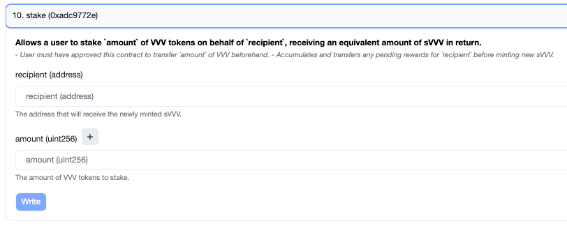

Un agent IA qui contrôle un portefeuille sur Base peut générer sa propre clé API d'inférence Venice sans intervention humaine. L'agent acquiert du VVV, le stake, obtient une demande de clé à courte durée de vie pour son portefeuille, signe le message lisible de la demande, et renvoie la signature pour recevoir une nouvelle clé API liée au portefeuille de staking. Le même flux peut générer une clé ADMIN lorsque le portefeuille signe un message qui indique le type de clé ADMIN.

Ce guide parcourt l'ensemble du flux de bout en bout et couvre les options de financement pour effectivement payer l'inférence une fois la clé créée.

## Prérequis {#prerequisites}

* Un portefeuille EVM sur Base contrôlé par l'agent (clé privée dans une variable d'environnement ou un gestionnaire de secrets).
* Une petite quantité d'ETH sur Base pour les frais de gas (le staking est constitué de deux transactions : `approve` puis `stake`).
* Une quantité non nulle de VVV à staker. L'endpoint de création requiert seulement que le portefeuille ait un solde sVVV non nul, donc 1 VVV suffit pour générer une clé. Voir [Payer pour l'inférence](#paying-for-inference) pour ce dont vous avez réellement besoin pour appeler les endpoints payants.

<Tip>
  Utilisez un portefeuille agent dédié plutôt qu'un portefeuille de trésorerie. La clé privée du portefeuille signe chaque demande de token Venice, son rayon d'impact doit donc être limité.
</Tip>

## Étapes {#steps}

<Steps>
  <Step title="Acquérir du VVV">
    Envoyez du VVV au portefeuille de l'agent, ou faites en sorte que l'agent le swap sur un DEX comme [Aerodrome](https://aerodrome.finance/swap?from=eth\&to=0xacfe6019ed1a7dc6f7b508c02d1b04ec88cc21bf\&chain0=8453\&chain1=8453) ou [Uniswap](https://app.uniswap.org/swap?chain=base\&inputCurrency=NATIVE\&outputCurrency=0xacfe6019ed1a7dc6f7b508c02d1b04ec88cc21bf).

    Contrat du token VVV sur Base : `0xacfE6019Ed1A7Dc6f7B508C02d1b04ec88cC21bf`
  </Step>

  <Step title="Staker du VVV avec Venice">
    Stakez le VVV dans le [Smart Contract de Staking Venice](https://basescan.org/address/0x321b7ff75154472b18edb199033ff4d116f340ff#code) à l'adresse `0x321b7ff75154472B18EDb199033fF4D116F340Ff`. Il s'agit de deux transactions :

    1. `approve(spender, amount)` sur le token VVV, où `spender` est le contrat de staking.
    2. `stake(amount)` sur le contrat de staking.

    <Frame as="div">
      
    </Frame>

    Lorsque la deuxième transaction est confirmée, le solde VVV du portefeuille diminue et son solde sVVV augmente du même montant. L'endpoint de création lit le solde sVVV pour confirmer que le portefeuille est staké.
  </Step>

  <Step title="Obtenir une demande de clé pour le portefeuille">
    Appelez `GET /api/v1/api_keys/generate_web3_key` avec l'adresse du portefeuille de staking. L'endpoint n'est pas authentifié.

    ```bash
    curl --request GET \
      --url 'https://api.venice.ai/api/v1/api_keys/generate_web3_key?address=<wallet address>'
    ```

    Le paramètre de requête facultatif `apiKeyType` définit le type de clé que le portefeuille autorise : `INFERENCE` (par défaut) ou `ADMIN`. Le type est fixé dans le token et indiqué dans le message, demandez donc le type que vous allez générer. Voir [Générer une clé ADMIN](#minting-an-admin-key).

    La réponse contient deux champs :

    - `token`, un token signé par Venice et lié à ce portefeuille. Il expire 15 minutes après son émission, signez-le donc et soumettez-le bien avant.
    - `message`, le texte lisible que le portefeuille signe. Il indique le portefeuille, le type de clé (`INFERENCE`, sauf si vous avez demandé `ADMIN`), l'émetteur, la chaîne, un nonce à usage unique, ainsi que les heures d'émission et d'expiration :

    ```text
    Venice API key request

    Sign this only if you are creating a Venice inference API key for this wallet. The key spends from this wallet's Venice account.

    Wallet: <wallet address>
    Key type: INFERENCE
    Issued by: api.venice.ai
    Chain ID: 8453
    Nonce: <random hex>
    Issued At: <ISO 8601 time>
    Expiration Time: <ISO 8601 time>
    ```
  </Step>

  <Step title="Signer le message avec le portefeuille de staking">
    Signez la chaîne `message` exacte avec le portefeuille qui détient le VVV staké. Il s'agit d'un `personal_sign` standard (EIP-191). À la fois `ethers.Wallet.signMessage(message)` et `account.signMessage({ message })` de `viem` produisent la signature correcte. Ne modifiez pas le message : Venice le reconstruit à partir du token, et la signature doit lui correspondre exactement.
  </Step>

  <Step title="Créer la clé API">
    Faites un `POST` de l'adresse, de la signature et du token au même endpoint.

    ```bash
    curl --request POST \
      --url https://api.venice.ai/api/v1/api_keys/generate_web3_key \
      --header 'Content-Type: application/json' \
      --data '{
        "address": "<wallet address>",
        "signature": "<signature of message>",
        "token": "<token>",
        "apiKeyType": "INFERENCE",
        "description": "Agent key minted on <date>"
      }'
    ```

    Champs requis : `address`, `signature`, `token`, `apiKeyType`. `apiKeyType` doit correspondre au type de clé indiqué dans le message signé : `INFERENCE` pour un token demandé sans `apiKeyType`, ou `ADMIN` pour un token demandé avec `apiKeyType=ADMIN`.

    Champs optionnels :

    - `description`, `expiresAt`
    - `consumptionLimit` — le plafond de dépense pour cette clé, libellé en `usd` ou `diem` (`vcu` est obsolète ; utilisez `diem` à la place)
    - `limitPeriod` — la fenêtre sur laquelle le plafond est mesuré : `EPOCH` (réinitialisé chaque jour UTC), `MONTH` (réinitialisé le 1er de chaque mois UTC) ou `LIFETIME` (jamais réinitialisé, le plafond est donc permanent)
    - `modelPrivacy` — les modèles que la clé peut appeler, par niveau de confidentialité : `ALL`, `PRIVATE_TEXT` ou `PRIVATE_ONLY`
    - `ipAllowlist` — les adresses IPv4 ou IPv6 et les sous-réseaux CIDR autorisés à utiliser la clé (jusqu'à 100 entrées) ; une liste vide autorise toute adresse IP

    <Warning>
    `limitPeriod` vaut `EPOCH` par défaut lorsqu'il est omis, ce qui signifie que le plafond **se réinitialise chaque jour** au lieu d'être un total à vie. Une clé créée avec `consumptionLimit: {"usd": 50}` et sans `limitPeriod` peut dépenser 50 $ par jour. Pour une clé d'agent sans surveillance, définissez explicitement `limitPeriod: "LIFETIME"` afin que la limite soit un plafond permanent.
    </Warning>

    En cas de succès, la réponse contient la chaîne `apiKey` créée. Stockez-la dans le secret store de l'agent et utilisez-la comme un token Bearer normal (`Authorization: Bearer <key>`).
  </Step>
</Steps>

## Exemple de bout en bout {#end-to-end-example}

L'exemple ci-dessous utilise un vrai portefeuille depuis une variable d'environnement plutôt qu'un portefeuille généré aléatoirement. Un portefeuille aléatoire n'a pas de VVV staké et la création sera rejetée avec une erreur `Wallet 0x… has no staked VVV on Base`.

```typescript
import { ethers } from "ethers"

const wallet = new ethers.Wallet(process.env.WALLET_PRIVATE_KEY!)
const address = wallet.address

const tokenResponse = await fetch(
  `https://api.venice.ai/api/v1/api_keys/generate_web3_key?address=${address}`,
)
const { data: { token, message } } = await tokenResponse.json()

const signature = await wallet.signMessage(message)

const mintResponse = await fetch("https://api.venice.ai/api/v1/api_keys/generate_web3_key", {
  method: "POST",
  headers: { "Content-Type": "application/json" },
  body: JSON.stringify({
    address,
    signature,
    token,
    apiKeyType: "INFERENCE",
    description: "Agent key",
    // Un plafond permanent de 50 $. Sans limitPeriod, il se réinitialiserait chaque jour.
    consumptionLimit: { usd: 50 },
    limitPeriod: "LIFETIME",
  }),
})

const result = await mintResponse.json()
if (!mintResponse.ok) {
  throw new Error(`Mint failed: ${result.error}`)
}

console.log("Minted key:", result.data.apiKey)
```

## Générer une clé ADMIN {#minting-an-admin-key}

Une clé ADMIN peut créer et supprimer d'autres clés API et consulter la facturation du compte Venice du portefeuille, et elle dépense depuis ce compte. Pour en générer une, demandez un token avec `apiKeyType=ADMIN`, signez son message, puis envoyez un `POST` avec `apiKeyType: "ADMIN"` :

```bash
curl --request GET \
  --url 'https://api.venice.ai/api/v1/api_keys/generate_web3_key?address=<wallet address>&apiKeyType=ADMIN'
```

Le `message` renvoyé indique qu'il crée une clé ADMIN et ce que cette clé peut faire :

```text
Venice API key request

Sign this only if you are creating a Venice ADMIN API key for this wallet. An ADMIN key can create and delete other API keys and read billing for this wallet's Venice account, and it spends from this wallet's Venice account.

Wallet: <wallet address>
Key type: ADMIN
Issued by: api.venice.ai
Chain ID: 8453
Nonce: <random hex>
Issued At: <ISO 8601 time>
Expiration Time: <ISO 8601 time>
```

Signez-le et soumettez-le comme dans les étapes ci-dessus, avec `"apiKeyType": "ADMIN"` dans le corps du `POST`. Le type de clé d'un token ne peut pas être modifié : un token `INFERENCE` ne peut pas générer de clé ADMIN, et un token `ADMIN` ne peut pas générer de clé INFERENCE. Les clés ADMIN nécessitent le message lisible, donc les [tokens hérités](#legacy-tokens) ne peuvent pas les générer.

<Warning>
  Ne faites signer un message ADMIN par un portefeuille que lorsque l'agent doit gérer des clés ou consulter la facturation. Quiconque détient la clé ADMIN peut créer de nouvelles clés pour le compte. Conservez-la donc au moins aussi soigneusement que la clé privée du portefeuille.
</Warning>

## Référence des erreurs {#error-reference}

L'endpoint renvoie des messages d'erreur spécifiques et exploitables. Mappez-les dans l'agent pour qu'il puisse décider de réessayer, demander un nouveau token ou s'arrêter.

| Statut | Le message d'erreur contient | Ce que cela signifie | Que faire |
| --- | --- | --- | --- |
| `400` | `Invalid wallet address` | Le paramètre de requête ou le champ `address` n'est pas une adresse EVM valide. | Corrigez l'adresse et resoumettez. |
| `400` | `Invalid "apiKeyType"` | Le paramètre de requête `apiKeyType` ne vaut ni `INFERENCE` ni `ADMIN`. | Utilisez `INFERENCE` ou `ADMIN`. |
| `400` | `ADMIN keys require a readable key request` | Le `GET` a demandé `apiKeyType=ADMIN` sans `?address=`. | Demandez le token avec à la fois `address` et `apiKeyType=ADMIN`. |
| `400` | `This token was issued for an` | Le `apiKeyType` du corps du `POST` diffère du type de clé indiqué dans le message signé. | Envoyez le type pour lequel le token a été émis, ou demandez un nouveau token avec le `apiKeyType` souhaité. L'erreur indique le bon `GET`. |
| `400` | `ADMIN keys cannot be created with a token that has no wallet address` | Un token hérité (demandé sans `?address=`) a été utilisé avec `apiKeyType: "ADMIN"`. | Demandez un token avec `?address=<wallet>&apiKeyType=ADMIN` et signez son `message`. |
| `400` | `issued for a different wallet` | Le token a été demandé pour une autre `address` que celle du corps du `POST`. | Demandez un token avec `?address=` défini sur le portefeuille qui signe. |
| `400` | `JWT has expired` | Le token de validation a expiré avant que vous ne le signiez et le soumettiez. | Demandez un nouveau token, signez-le et soumettez-le immédiatement. |
| `400` | `JWT signature is invalid` | Le token n'a pas été signé par Venice (probablement modifié ou fabriqué). | Utilisez toujours un nouveau token de l'endpoint `GET`. |
| `400` | `JWT claims are invalid` | L'émetteur ou l'audience du token ne correspond pas à ce que Venice attend. | Utilisez le token non modifié renvoyé par l'endpoint `GET`. |
| `400` | `JWT is malformed` | Le `token` soumis n'est pas un JWT. | Assurez-vous d'envoyer exactement la chaîne `token` renvoyée par l'endpoint `GET`. |
| `400` | `Wallet signature does not match` | La `signature` n'est pas la signature, par le portefeuille `address`, du `message` du token. | Signez le `message` exact renvoyé avec le token, avec le portefeuille qui possède `address`. |
| `400` | `Tokens without a wallet address are no longer accepted` | Le token a été demandé sans `?address=`. Ces tokens hérités cessent de fonctionner le 26 décembre 2026. | Demandez un token avec `?address=` et signez son `message`. |
| `400` | `Could not verify wallet signature` | L'appel RPC pour vérifier la signature a échoué (transitoire). | Réessayez avec backoff. |
| `400` | `has no staked VVV` | Le portefeuille a un solde sVVV nul. Le message complet est `Wallet 0x… has no staked VVV on Base`, avec l'adresse de votre portefeuille à la place de `0x…`, suivi d'un lien ; faites donc la correspondance sur `has no staked VVV` plutôt que sur le texte complet. | Stakez d'abord du VVV, puis réessayez. |

## Tokens hérités {#legacy-tokens}

Avant novembre 2026, l'endpoint émettait des tokens sans adresse de portefeuille, et le portefeuille signait la chaîne brute du token. Ces tokens permettent encore de générer des clés INFERENCE jusqu'au **26 décembre 2026 à 00:00 UTC**, et leurs réponses portent les en-têtes `Deprecation`, `Sunset` et `Link`. Après cette date, `POST` les rejette. Passez à `?address=` et signez `message` avant cette date.

## Payer pour l'inférence {#paying-for-inference}

Générer une clé et pouvoir appeler des endpoints payants avec elle sont deux choses distinctes. Une clé fraîchement créée s'authentifie correctement mais ne peut pas appeler les endpoints payants (comme `/chat/completions`) tant que le compte du portefeuille n'a pas un solde dépensable.

La clé créée peut dépenser depuis le compte utilisateur dans cet ordre de priorité : DIEM, puis crédits gagnés, puis crédits groupés, puis USD.

| Source de financement | Autonome ? | Comment |
| --- | --- | --- |
| **DIEM depuis le staking VVV** | Oui | L'allocation quotidienne de DIEM du portefeuille est proportionnelle à sa part dans le pool de staking. Le compte a besoin d'au moins 0,1 DIEM staké pour que tout DIEM soit dépensable. Les enjeux plus importants rapportent proportionnellement plus de DIEM quotidiens, rafraîchis à chaque epoch (00:00 UTC). |
| **USD via Stripe** | Non (navigateur) | Connectez-vous à venice.ai avec le même portefeuille (Sign-In-With-Ethereum). Le tableau de bord trouve l'enregistrement utilisateur existant. Ajoutez des crédits dans Settings, API. |
| **Abonnement crypto Coinbase** | Non (navigateur) | Même connexion par portefeuille, puis abonnez-vous via le tableau de bord. Le flux redirige vers Coinbase Commerce pour le paiement effectif, il ne peut donc pas être piloté depuis un script. |
| **Onramp Coinbase** | Non (navigateur) | Même connexion par portefeuille, puis utilisez le widget onramp dans le tableau de bord. Hébergé sur l'UI de Coinbase. |

Si l'agent a besoin d'un chemin de financement entièrement crypto-natif et headless, les options les plus propres sont :

1. **Staker plus de VVV** pour que l'allocation quotidienne de DIEM couvre la dépense de l'agent. La clé créée le récupère automatiquement.
2. **Utiliser le [flux portefeuille x402](/fr/guides/integrations/x402-venice-api) au lieu de la clé API.** Avec x402, l'agent signe un message Sign-In-With-X par requête, recharge directement avec de l'USDC sur Base ou Solana via `POST /api/v1/x402/top-up`, et paie par requête. Le solde USDC x402 est lié au portefeuille, pas à l'utilisateur, donc il n'apparaît pas comme solde pour la clé Bearer créée, mais cela permet au même portefeuille de payer l'inférence de manière programmatique.

## Ressources connexes {#related-resources}

<CardGroup cols={2}>
  <Card title="Crypto et agents" icon="link" href="/fr/guides/integrations/crypto-rpc-agents">
    Utilisez Venice à la fois comme fournisseur de modèle et comme couche RPC blockchain pour les agents autonomes.
  </Card>

  <Card title="Authentification par portefeuille x402" icon="wallet" href="/fr/guides/integrations/x402-venice-api">
    Payez par requête avec de l'USDC sur Base ou Solana, sans clé API requise.
  </Card>

  <Card title="Endpoint de génération de clé API Web3" icon="code" href="/fr/api-reference/endpoint/api_keys/generate_web3_key/post">
    Référence de l'endpoint pour l'endpoint de création.
  </Card>

  <Card title="Guide de clé API standard" icon="key" href="/fr/guides/getting-started/generating-api-key">
    Pour les utilisateurs qui préfèrent générer une clé depuis le tableau de bord.
  </Card>
</CardGroup>
