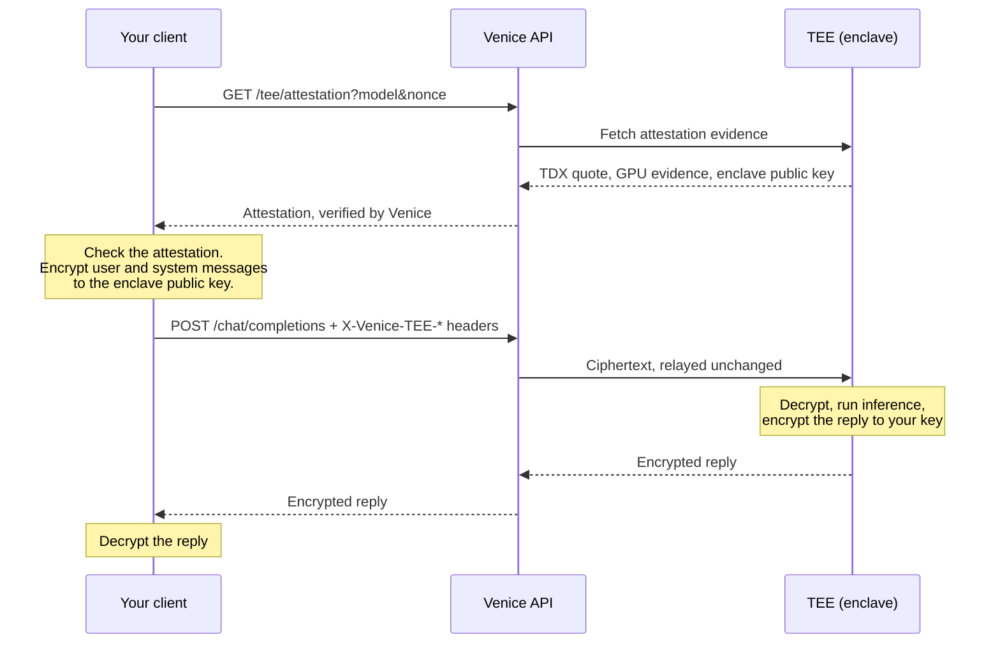

TEE and E2EE models run inside a Trusted Execution Environment (TEE): a hardware-isolated enclave whose identity and configuration can be proven with remote attestation. The enclaves use Intel TDX and NVIDIA Confidential Computing. During inference, the model weights and your data stay inside the enclave, isolated from the host system. E2EE adds client-side encryption on top, so your prompts stay encrypted until they reach that enclave.

<Info>
For how TEE and E2EE compare with Venice's other privacy modes, see [Privacy](/overview/privacy).
</Info>

<Note>
TEE and E2EE are currently available on text models only.
</Note>

## TEE mode and E2EE mode

The same models support both modes. What you send decides which one you get.

| | TEE mode | E2EE mode |
| --- | --- | --- |
| How you call it | A normal `/chat/completions` request | Encrypt messages, add the `X-Venice-TEE-*` headers, and decrypt the response |
| Where inference runs | Inside an attested enclave | Inside an attested enclave |
| Who can read your prompt | The Venice API receives it in plaintext over TLS, then forwards it to the enclave | Only the enclave. Venice relays ciphertext |
| Who can read the reply | The Venice API relays it in plaintext | Only you. The enclave encrypts it to your key |
| Client work | None | Key generation, encryption, decryption, attestation checks |

Choose TEE mode when you want hardware-isolated inference and are comfortable with your prompt passing through the Venice API, which doesn't store prompt or response content. Choose E2EE mode when nothing outside the enclave should be able to read your prompt or the reply.

## How a request flows



In TEE mode, skip the attestation and encryption steps and send a normal request. The prompt then reaches the Venice API in plaintext.

## What stays visible in E2EE mode

E2EE protects message content, not the shape of the request. Venice and anyone else who can see the request outside the enclave can still see:

| Visible | Why |
| --- | --- |
| Your account, API key, IP address and request timing | Needed to authenticate, bill and route the request |
| Model ID and request parameters such as `temperature`, `max_tokens` and `stop` | Sent as normal JSON fields. Stop sequences are sent in plaintext |
| Message roles and the number of messages | Only message content is encrypted |
| Anything your client sends in plaintext, such as earlier `assistant` replies in the history | Venice forwards E2EE messages unchanged and never encrypts on your behalf. The examples encrypt `user` and `system` messages only |
| Tool definitions, tool calls and tool results | Not encrypted |
| Token usage and finish reasons | Returned as normal response fields |
| Approximate length of each message and reply chunk | Ciphertext is a fixed size larger than the plaintext |

If a conversation history contains sensitive replies, keep in mind that sending earlier `assistant` messages back in plaintext exposes them.

## Find TEE and E2EE models

Check capabilities on `GET /models` rather than relying on the model ID. Every TEE model currently also supports E2EE and uses an `e2ee-` prefix, but that's a naming convention, not a guarantee.

- `model_spec.capabilities.supportsTeeAttestation`: the model runs inside an attested TEE.
- `model_spec.capabilities.supportsE2EE`: the model accepts encrypted prompts. Implies `supportsTeeAttestation`.

<CodeGroup>
```bash cURL
curl -s https://api.venice.ai/api/v1/models \
  -H "Authorization: Bearer $VENICE_API_KEY" |
  jq '.data[]
    | select(.model_spec.capabilities.supportsTeeAttestation)
    | {id, e2ee: .model_spec.capabilities.supportsE2EE}'
```

```python Python
import os
import requests

res = requests.get(
    "https://api.venice.ai/api/v1/models",
    headers={"Authorization": f"Bearer {os.environ['VENICE_API_KEY']}"},
)
for model in res.json()["data"]:
    caps = model["model_spec"]["capabilities"]
    if caps.get("supportsTeeAttestation"):
        print(model["id"], "E2EE" if caps.get("supportsE2EE") else "TEE only")
```

```bash Venice CLI
venice models --e2ee
```
</CodeGroup>

You can also filter by **Privacy: E2EE** on the [Models page](/overview/models).

## TEE models

TEE mode works like any other model. No client changes are needed:

<CodeGroup>
```python Python
import os
from openai import OpenAI

client = OpenAI(
    api_key=os.environ["VENICE_API_KEY"],
    base_url="https://api.venice.ai/api/v1",
)

response = client.chat.completions.create(
    model="e2ee-qwen3-6-35b-a3b",
    messages=[{"role": "user", "content": "Explain quantum computing"}],
)
print(response.choices[0].message.content)
```

```javascript Node.js
import OpenAI from 'openai'

const client = new OpenAI({
  apiKey: process.env.VENICE_API_KEY,
  baseURL: 'https://api.venice.ai/api/v1',
})

const response = await client.chat.completions.create({
  model: 'e2ee-qwen3-6-35b-a3b',
  messages: [{ role: 'user', content: 'Explain quantum computing' }],
})
console.log(response.choices[0].message.content)
```

```bash cURL
curl https://api.venice.ai/api/v1/chat/completions \
  -H "Authorization: Bearer $VENICE_API_KEY" \
  -H "Content-Type: application/json" \
  -d '{
    "model": "e2ee-qwen3-6-35b-a3b",
    "messages": [{"role": "user", "content": "Explain quantum computing"}]
  }'
```
</CodeGroup>

To check that the model really runs in an enclave, fetch its attestation and verify it. See [Verifying TEE attestation](#verifying-tee-attestation).

## E2EE models

E2EE needs client-side cryptography, so a stock OpenAI SDK can't do it on its own. The quickest way to try it is the [Venice CLI](/guides/integrations/venice-cli), which encrypts for any E2EE model and refuses to fall back to plaintext:

```bash
venice chat -m e2ee-qwen3-6-35b-a3b "This message is end-to-end encrypted"
```

To build E2EE into your own client, follow the steps below. [E2EE protocol](#e2ee-protocol) has the wire format, and [Build an E2EE client](#build-an-e2ee-client) has complete examples in JavaScript and Python.

### How E2EE works

<Steps>
  <Step title="Fetch the enclave's public key">
    Call `GET /tee/attestation` with the model ID and a fresh 32-byte nonce. Check the response, then take the enclave's public key from `signing_key`.
  </Step>
  <Step title="Generate a client key pair">
    Create a secp256k1 key pair. The enclave encrypts the reply to its public key.
  </Step>
  <Step title="Encrypt user and system messages">
    Encrypt the `content` of every `user` and `system` message to the enclave's public key.
  </Step>
  <Step title="Send the request">
    Call `POST /chat/completions` with the three `X-Venice-TEE-*` headers. Streaming is optional.
  </Step>
  <Step title="Decrypt the response">
    Decrypt `content` and `reasoning_content` with your client private key. Stop if any value isn't encrypted or fails to decrypt.
  </Step>
</Steps>

### Turning E2EE off for a request

E2EE is on by default when a request to an E2EE model includes the E2EE headers. Set `venice_parameters.enable_e2ee` to `false` to run the request in TEE mode even if the headers are present. Your messages must then be plaintext.

### Feature support in E2EE mode

| Feature | E2EE mode |
| --- | --- |
| Streaming | Optional. Streamed and non-streamed replies are both encrypted. When streaming, each chunk is encrypted separately |
| Reasoning output | Encrypted, in `reasoning_content` |
| `/responses` endpoint | Not supported. Use `/chat/completions` |
| Web search and web scraping | Disabled |
| Venice system prompt | Not added. Send your own system message, encrypted |
| File and image inputs | Not supported. Encrypted `content` must be a string |
| Structured output (`response_format`) | Not supported |
| `reasoning_effort` | Not supported |
| Prompt caching options | Not supported |
| Stop sequences | Sent in plaintext |
| Function calling | Depends on the model (`supportsFunctionCalling`). Tool definitions, calls and results are not encrypted |

## E2EE protocol

### Keys

| Key | Where it comes from | Used for |
| --- | --- | --- |
| Enclave public key | `signing_key` in the `GET /tee/attestation` response | Encrypting request fields |
| Client key pair | Generated by your client, one per request | The enclave encrypts reply chunks to its public key |
| Ephemeral key pair | Generated for every encrypted field, by whichever side encrypts | ECDH with the recipient's public key |

All keys are on the secp256k1 curve. Public keys are sent as uncompressed points: 65 bytes starting with `0x04`, hex-encoded to 130 characters. Some attestation responses return the enclave key as 64 bytes without the `04` prefix. Add the prefix before you use it.

### Encrypting a field

Each field is encrypted independently:

1. Generate an ephemeral secp256k1 key pair.
2. Compute the ECDH shared point between the ephemeral private key and the recipient's public key. Take its 32-byte X coordinate.
3. Derive a 32-byte key with HKDF-SHA256: no salt, `info` set to the ASCII string `ecdsa_encryption`.
4. Encrypt the UTF-8 plaintext with AES-256-GCM, a random 12-byte nonce and no additional authenticated data.
5. Concatenate the parts below and hex-encode the result.

| Bytes | Content |
| --- | --- |
| 0–64 | Ephemeral public key, uncompressed (65 bytes) |
| 65–76 | AES-GCM nonce (12 bytes) |
| 77– | Ciphertext, followed by the 16-byte GCM tag |

An encrypted field is therefore at least 93 bytes, or 186 hex characters. Decryption reverses these steps with the recipient's private key and the ephemeral public key from the first 65 bytes.

The enclave encrypts reply chunks the same way, to the client public key you send in the request.

### Request headers

| Header | Value |
| --- | --- |
| `X-Venice-TEE-Client-Pub-Key` | Your client public key, uncompressed hex (130 characters) |
| `X-Venice-TEE-Model-Pub-Key` | The enclave public key from attestation |
| `X-Venice-TEE-Signing-Algo` | `ecdsa` |

When these headers are present on a request to an E2EE model, Venice treats the request as E2EE unless `venice_parameters.enable_e2ee` is `false`.

### What is encrypted

| Direction | Encrypted | Not encrypted |
| --- | --- | --- |
| Request | `content` of every `user` and `system` message. It must be a string | Model ID, parameters, tool definitions and message roles |
| Response | `content` and `reasoning_content`: in `choices[].delta` when streaming, or in `choices[].message` otherwise. Each streamed chunk is encrypted separately | IDs, roles, finish reasons and token usage |

When E2EE is active, every `user` and `system` message must be encrypted. A plaintext message in either role fails with `Encrypted field is not valid hex`.

Venice forwards E2EE messages unchanged and never encrypts anything on your behalf. Anything your client sends in plaintext, such as earlier `assistant` replies in the history, stays readable to Venice.

### Security properties

- **Confidentiality depends on the enclave key.** Encryption only helps if the public key you encrypt to belongs to an attested enclave. Venice verifies the attestation server-side and reports the result in `verified`. To check it yourself, see [Verifying TEE attestation](#verifying-tee-attestation).
- **Each field is authenticated on its own.** AES-GCM detects any change to a single field, but the protocol doesn't bind fields to each other, to their order, or to the request. A missing chunk can't be detected cryptographically, so treat a stream that ends without a `finish_reason` as incomplete.
- **Use a new client key pair for every request.** Reply chunks are encrypted to the client key from the request headers. A fresh key per request means chunks from any other response can't be decrypted by your client.
- **Never fall back to plaintext.** If a chunk isn't hex-encoded ciphertext, or fails to decrypt, stop and report an error. Showing it anyway would let a plaintext reply pass as encrypted.

## Build an E2EE client

The examples below are complete and tested. They use established libraries rather than hand-written curve arithmetic: the [noble](https://paulmillr.com/noble/) libraries in JavaScript and [`cryptography`](https://cryptography.io/) in Python.

### Install dependencies

<CodeGroup>
```bash JavaScript
# Node.js 20.19 or later
npm install @noble/curves @noble/ciphers @noble/hashes
```

```bash Python
# Python 3.10 or later
pip install cryptography requests
```
</CodeGroup>

### Encryption helpers

Save this module next to your client. It implements the field encryption described above.

<CodeGroup>
```javascript e2ee.mjs
import { secp256k1 } from '@noble/curves/secp256k1.js'
import { gcm } from '@noble/ciphers/aes.js'
import { hkdf } from '@noble/hashes/hkdf.js'
import { sha256 } from '@noble/hashes/sha2.js'
import { bytesToHex, hexToBytes, randomBytes, utf8ToBytes } from '@noble/hashes/utils.js'

const HKDF_INFO = utf8ToBytes('ecdsa_encryption')
const PUBLIC_KEY_BYTES = 65
const NONCE_BYTES = 12
const TAG_BYTES = 16
const MIN_ENCRYPTED_HEX = 2 * (PUBLIC_KEY_BYTES + NONCE_BYTES + TAG_BYTES)

// ECDH on secp256k1, then HKDF-SHA256 over the shared point's X coordinate.
function deriveKey(privateKey, publicKey) {
  const shared = secp256k1.getSharedSecret(privateKey, publicKey) // 0x02/0x03 || X
  return hkdf(sha256, shared.subarray(1), undefined, HKDF_INFO, 32)
}

export function generateClientKeyPair() {
  const privateKey = secp256k1.utils.randomSecretKey()
  const publicKeyHex = bytesToHex(secp256k1.getPublicKey(privateKey, false))
  return { privateKey, publicKeyHex }
}

// Accepts 65-byte uncompressed keys, or 64-byte keys without the 0x04 prefix.
export function parsePublicKey(hex) {
  const bytes = hexToBytes(hex.replace(/^0x/, ''))
  const key = bytes.length === 64 ? Uint8Array.of(0x04, ...bytes) : bytes
  if (key.length !== PUBLIC_KEY_BYTES || !secp256k1.utils.isValidPublicKey(key, false)) {
    throw new Error('Not a valid uncompressed secp256k1 public key')
  }
  return key
}

export function encryptField(plaintext, modelPublicKey) {
  const ephemeralKey = secp256k1.utils.randomSecretKey()
  const nonce = randomBytes(NONCE_BYTES)
  const ciphertext = gcm(deriveKey(ephemeralKey, modelPublicKey), nonce).encrypt(utf8ToBytes(plaintext))

  const out = new Uint8Array(PUBLIC_KEY_BYTES + NONCE_BYTES + ciphertext.length)
  out.set(secp256k1.getPublicKey(ephemeralKey, false), 0)
  out.set(nonce, PUBLIC_KEY_BYTES)
  out.set(ciphertext, PUBLIC_KEY_BYTES + NONCE_BYTES)
  ephemeralKey.fill(0)
  return bytesToHex(out)
}

export function decryptField(hex, clientPrivateKey) {
  if (hex.length < MIN_ENCRYPTED_HEX || !/^(?:[0-9a-fA-F]{2})+$/.test(hex)) {
    throw new Error('Expected encrypted content but received plaintext')
  }
  const raw = hexToBytes(hex)
  const key = deriveKey(clientPrivateKey, raw.subarray(0, PUBLIC_KEY_BYTES))
  const nonce = raw.subarray(PUBLIC_KEY_BYTES, PUBLIC_KEY_BYTES + NONCE_BYTES)
  const plaintext = gcm(key, nonce).decrypt(raw.subarray(PUBLIC_KEY_BYTES + NONCE_BYTES))
  return new TextDecoder().decode(plaintext)
}
```

```python venice_e2ee.py
import os
import re

from cryptography.hazmat.primitives import hashes, serialization
from cryptography.hazmat.primitives.asymmetric import ec
from cryptography.hazmat.primitives.ciphers.aead import AESGCM
from cryptography.hazmat.primitives.kdf.hkdf import HKDF

CURVE = ec.SECP256K1()
HKDF_INFO = b"ecdsa_encryption"
PUBLIC_KEY_BYTES = 65
NONCE_BYTES = 12
TAG_BYTES = 16
MIN_ENCRYPTED_HEX = 2 * (PUBLIC_KEY_BYTES + NONCE_BYTES + TAG_BYTES)
HEX_BYTES = re.compile(r"(?:[0-9a-fA-F]{2})+")


def _derive_key(private_key: ec.EllipticCurvePrivateKey, public_key: ec.EllipticCurvePublicKey) -> bytes:
    shared_x = private_key.exchange(ec.ECDH(), public_key)  # X coordinate of the shared point
    return HKDF(algorithm=hashes.SHA256(), length=32, salt=None, info=HKDF_INFO).derive(shared_x)


def public_key_hex(private_key: ec.EllipticCurvePrivateKey) -> str:
    return private_key.public_key().public_bytes(
        serialization.Encoding.X962, serialization.PublicFormat.UncompressedPoint
    ).hex()


def generate_client_key() -> ec.EllipticCurvePrivateKey:
    return ec.generate_private_key(CURVE)


def parse_public_key(hex_key: str) -> ec.EllipticCurvePublicKey:
    """Accepts 65-byte uncompressed keys, or 64-byte keys without the 0x04 prefix."""
    raw = bytes.fromhex(hex_key.removeprefix("0x"))
    if len(raw) == 64:
        raw = b"\x04" + raw
    if len(raw) != PUBLIC_KEY_BYTES:
        raise ValueError("Not a valid uncompressed secp256k1 public key")
    return ec.EllipticCurvePublicKey.from_encoded_point(CURVE, raw)


def encrypt_field(plaintext: str, model_key: ec.EllipticCurvePublicKey) -> str:
    ephemeral_key = ec.generate_private_key(CURVE)
    nonce = os.urandom(NONCE_BYTES)
    ciphertext = AESGCM(_derive_key(ephemeral_key, model_key)).encrypt(nonce, plaintext.encode("utf-8"), None)
    return (bytes.fromhex(public_key_hex(ephemeral_key)) + nonce + ciphertext).hex()


def decrypt_field(hex_text: str, client_key: ec.EllipticCurvePrivateKey) -> str:
    if len(hex_text) < MIN_ENCRYPTED_HEX or not HEX_BYTES.fullmatch(hex_text):
        raise ValueError("Expected encrypted content but received plaintext")
    raw = bytes.fromhex(hex_text)
    sender_key = ec.EllipticCurvePublicKey.from_encoded_point(CURVE, raw[:PUBLIC_KEY_BYTES])
    nonce = raw[PUBLIC_KEY_BYTES : PUBLIC_KEY_BYTES + NONCE_BYTES]
    plaintext = AESGCM(_derive_key(client_key, sender_key)).decrypt(nonce, raw[PUBLIC_KEY_BYTES + NONCE_BYTES :], None)
    return plaintext.decode("utf-8", errors="replace")
```
</CodeGroup>

### Complete example

This script checks the attestation, encrypts the prompt, sends a streaming request and decrypts the reply and any reasoning. It prints the completion ID at the end, which you can use to [fetch a response signature](#verify-a-response-signature).

<CodeGroup>
```javascript e2ee-chat.mjs
// Usage: VENICE_API_KEY=... node e2ee-chat.mjs "Your prompt"
import { bytesToHex, randomBytes } from '@noble/hashes/utils.js'
import { decryptField, encryptField, generateClientKeyPair, parsePublicKey } from './e2ee.mjs'

const BASE_URL = 'https://api.venice.ai/api/v1'
const API_KEY = process.env.VENICE_API_KEY
const MODEL = 'e2ee-qwen3-6-35b-a3b'

async function fetchModelKey(model) {
  const nonce = bytesToHex(randomBytes(32))
  const res = await fetch(`${BASE_URL}/tee/attestation?${new URLSearchParams({ model, nonce })}`, {
    headers: { Authorization: `Bearer ${API_KEY}` },
  })
  if (!res.ok) throw new Error(`Attestation request failed: ${res.status} ${await res.text()}`)
  const attestation = await res.json()

  // Minimum checks. See "Verifying TEE attestation" for stronger ones.
  if (attestation.verified !== true) throw new Error('Venice did not verify the attestation')
  if (attestation.nonce !== nonce) throw new Error('Attestation does not echo the nonce you sent')
  if (attestation.model !== model) throw new Error('Attestation is for a different model')

  const keyHex = attestation.signing_key ?? attestation.signing_public_key
  if (!keyHex) throw new Error('Attestation has no signing key')
  return { keyHex, key: parsePublicKey(keyHex) }
}

async function e2eeChat(model, messages) {
  const modelKey = await fetchModelKey(model)
  const client = generateClientKeyPair()

  try {
    const res = await fetch(`${BASE_URL}/chat/completions`, {
      method: 'POST',
      headers: {
        Authorization: `Bearer ${API_KEY}`,
        'Content-Type': 'application/json',
        'X-Venice-TEE-Client-Pub-Key': client.publicKeyHex,
        'X-Venice-TEE-Model-Pub-Key': modelKey.keyHex,
        'X-Venice-TEE-Signing-Algo': 'ecdsa',
      },
      body: JSON.stringify({
        model,
        stream: true,
        messages: messages.map((m) =>
          m.role === 'user' || m.role === 'system' ? { ...m, content: encryptField(m.content, modelKey.key) } : m
        ),
      }),
    })
    if (!res.ok) throw new Error(`Chat request failed: ${res.status} ${await res.text()}`)

    const decoder = new TextDecoder()
    let buffer = ''
    let reply = ''
    let reasoning = ''
    let id
    let finishReason

    for await (const bytes of res.body) {
      buffer += decoder.decode(bytes, { stream: true })
      let end
      while ((end = buffer.indexOf('\n')) !== -1) {
        const line = buffer.slice(0, end).trim()
        buffer = buffer.slice(end + 1)
        if (!line.startsWith('data:')) continue
        const data = line.slice(5).trim()
        if (data === '[DONE]') continue

        const event = JSON.parse(data)
        if (event.error) throw new Error(`Stream error: ${JSON.stringify(event.error)}`)
        id ??= event.id
        const choice = event.choices?.[0]
        if (choice?.delta?.reasoning_content) {
          reasoning += decryptField(choice.delta.reasoning_content, client.privateKey)
        }
        if (choice?.delta?.content) {
          const text = decryptField(choice.delta.content, client.privateKey)
          reply += text
          process.stdout.write(text)
        }
        finishReason = choice?.finish_reason ?? finishReason
      }
    }

    if (!finishReason) throw new Error('Stream ended without a finish reason, so the reply may be truncated')
    return { id, reply, reasoning }
  } finally {
    client.privateKey.fill(0)
  }
}

const prompt = process.argv[2] ?? 'What is 2+2? Answer briefly.'
const { id, reasoning } = await e2eeChat(MODEL, [{ role: 'user', content: prompt }])
if (reasoning) console.log(`\n\nReasoning: ${reasoning}`)
console.log(`\n\nCompletion ID: ${id}`)
```

```python e2ee_chat.py
# Usage: VENICE_API_KEY=... python e2ee_chat.py "Your prompt"
import json
import os
import secrets
import sys

import requests

from venice_e2ee import decrypt_field, encrypt_field, generate_client_key, parse_public_key, public_key_hex

BASE_URL = "https://api.venice.ai/api/v1"
API_KEY = os.environ["VENICE_API_KEY"]
MODEL = "e2ee-qwen3-6-35b-a3b"
HEADERS = {"Authorization": f"Bearer {API_KEY}"}


def fetch_model_key(model: str) -> str:
    nonce = secrets.token_hex(32)  # 32 bytes = 64 hex characters
    res = requests.get(f"{BASE_URL}/tee/attestation", params={"model": model, "nonce": nonce}, headers=HEADERS, timeout=30)
    res.raise_for_status()
    attestation = res.json()

    # Minimum checks. See "Verifying TEE attestation" for stronger ones.
    if attestation.get("verified") is not True:
        raise RuntimeError("Venice did not verify the attestation")
    if attestation.get("nonce") != nonce:
        raise RuntimeError("Attestation does not echo the nonce you sent")
    if attestation.get("model") != model:
        raise RuntimeError("Attestation is for a different model")

    key_hex = attestation.get("signing_key") or attestation.get("signing_public_key")
    if not key_hex:
        raise RuntimeError("Attestation has no signing key")
    return key_hex


def e2ee_chat(model: str, messages: list[dict]) -> tuple[str | None, str, str]:
    model_key_hex = fetch_model_key(model)
    model_key = parse_public_key(model_key_hex)
    client_key = generate_client_key()

    body = {
        "model": model,
        "stream": True,
        "messages": [
            {**m, "content": encrypt_field(m["content"], model_key)} if m["role"] in ("user", "system") else m
            for m in messages
        ],
    }
    headers = {
        **HEADERS,
        "X-Venice-TEE-Client-Pub-Key": public_key_hex(client_key),
        "X-Venice-TEE-Model-Pub-Key": model_key_hex,
        "X-Venice-TEE-Signing-Algo": "ecdsa",
    }

    reply, reasoning, completion_id, finish_reason = "", "", None, None
    with requests.post(f"{BASE_URL}/chat/completions", json=body, headers=headers, stream=True, timeout=120) as res:
        res.raise_for_status()
        res.encoding = "utf-8"
        for line in res.iter_lines(decode_unicode=True):
            if not line or not line.startswith("data:"):
                continue
            data = line[5:].strip()
            if data == "[DONE]":
                continue

            event = json.loads(data)
            if "error" in event:
                raise RuntimeError(f"Stream error: {event['error']}")
            completion_id = completion_id or event.get("id")
            choice = (event.get("choices") or [{}])[0]
            delta = choice.get("delta") or {}
            if delta.get("reasoning_content"):
                reasoning += decrypt_field(delta["reasoning_content"], client_key)
            content = delta.get("content")
            if content:
                text = decrypt_field(content, client_key)
                reply += text
                print(text, end="", flush=True)
            finish_reason = choice.get("finish_reason") or finish_reason

    if not finish_reason:
        raise RuntimeError("Stream ended without a finish reason, so the reply may be truncated")
    return completion_id, reply, reasoning


if __name__ == "__main__":
    prompt = sys.argv[1] if len(sys.argv) > 1 else "What is 2+2? Answer briefly."
    completion_id, _, reasoning = e2ee_chat(MODEL, [{"role": "user", "content": prompt}])
    if reasoning:
        print(f"\n\nReasoning: {reasoning}")
    print(f"\n\nCompletion ID: {completion_id}")
```
</CodeGroup>

Run it with your API key:

<CodeGroup>
```bash JavaScript
VENICE_API_KEY=your-key node e2ee-chat.mjs "What is 2+2?"
```

```bash Python
VENICE_API_KEY=your-key python e2ee_chat.py "What is 2+2?"
```
</CodeGroup>

### Non-streaming responses

With `stream: false`, the reply arrives in one response. Its `content` and `reasoning_content` are each encrypted as a single field:

<CodeGroup>
```javascript decrypt-completion.mjs
import { decryptField } from './e2ee.mjs'

// For a request sent with stream: false.
export function decryptCompletion(completion, clientPrivateKey) {
  const { message, finish_reason: finishReason } = completion.choices[0]
  return {
    finishReason,
    reply: message.content ? decryptField(message.content, clientPrivateKey) : '',
    reasoning: message.reasoning_content ? decryptField(message.reasoning_content, clientPrivateKey) : '',
  }
}
```

```python decrypt_completion.py
from venice_e2ee import decrypt_field


def decrypt_completion(completion: dict, client_key) -> dict:
    """For a request sent with "stream": False."""
    choice = completion["choices"][0]
    message = choice["message"]
    return {
        "finish_reason": choice.get("finish_reason"),
        "reply": decrypt_field(message["content"], client_key) if message.get("content") else "",
        "reasoning": decrypt_field(message["reasoning_content"], client_key) if message.get("reasoning_content") else "",
    }
```
</CodeGroup>

### Multi-turn conversations

Keep the conversation history in plaintext on your side. For each new request, fetch or reuse a recently checked enclave key, generate a new client key pair, and encrypt every `user` and `system` message again. The examples send earlier `assistant` replies as plaintext, which Venice can read, so leave them out of the history if Venice shouldn't see them.

### Production checklist

- Check the attestation before trusting its key: `verified` is `true`, the nonce matches the one you sent, and the model matches the one you asked for. For stronger guarantees, follow [Verifying TEE attestation](#verifying-tee-attestation).
- Generate a fresh 32-byte nonce for every attestation request.
- Generate a new client key pair for every request, and discard the private key afterwards. JavaScript can overwrite the key bytes, as the example does. Python can't reliably wipe memory, so keep keys short-lived.
- Stop on any `content` or `reasoning_content` value that isn't encrypted or fails to decrypt.
- When streaming, treat a stream without a `finish_reason` as incomplete.
- Don't log plaintext prompts or decrypted replies.

## Verifying TEE attestation

Attestation is how a TEE proves what it is. Venice exposes two endpoints for this, for any model with `supportsTeeAttestation`:

- **`GET /tee/attestation`** returns hardware evidence for the enclave serving a model, and the public key bound to that enclave. It proves which enclave you're talking to.
- **`GET /tee/signature`** returns the enclave's signature over a specific completion. It proves that a reply came from that enclave.

### Fetch an attestation

```bash
NONCE=$(openssl rand -hex 32)

curl "https://api.venice.ai/api/v1/tee/attestation?model=e2ee-qwen3-6-35b-a3b&nonce=$NONCE" \
  -H "Authorization: Bearer $VENICE_API_KEY"
```

| Parameter | Description |
| --- | --- |
| `model` | Required. A model ID with `supportsTeeAttestation`. |
| `nonce` | A fresh random value: 32 bytes, hex-encoded to 64 characters. The enclave includes it in its evidence, which proves the attestation was produced for your request and isn't a replay. Some enclaves reject nonces of any other length. |

#### Response fields

| Field | Description |
| --- | --- |
| `verified` | `true` if the evidence passed Venice's server-side verification. |
| `nonce` | The nonce the evidence was produced for. It should equal the one you sent. |
| `model` | The attested model ID. |
| `signing_key` | The enclave's secp256k1 public key, hex-encoded. E2EE clients encrypt to this key, and the enclave signs replies with it. May be omitted for some TEE-only models. |
| `signing_address` | The Ethereum-style address of `signing_key`: the last 20 bytes of the Keccak-256 hash of the uncompressed key without its `04` prefix. |
| `intel_quote` | The Intel TDX quote, hex-encoded. It contains the enclave's measurements and 64 bytes of report data. |
| `nvidia_payload` | NVIDIA GPU attestation evidence, as a JSON string with `nonce`, `arch` and `evidence_list`, when the enclave uses a confidential-computing GPU. |
| `server_verification` | The individual results of Venice's checks: `tdx.valid`, `nvidia.valid`, `signingAddressBinding.bound`, `nonceBinding.bound` and `verifiedAt`. |
| `tee_provider` | An identifier for the operator running the enclave. |

### Levels of verification

How much you verify yourself decides how much you rely on Venice.

| Level | What you check | What you still rely on Venice for |
| --- | --- | --- |
| 1. Venice's result | `verified` is `true`, and `nonce` and `model` match your request | Everything about the evidence |
| 2. Local consistency | Level 1, plus the TDX quote: debug mode is off, the signing key is bound to the quote's report data, and `signing_address` matches the key | The quote's signature and certificate chain, the GPU evidence, and the nonce binding |
| 3. Independent verification | Level 2, plus the quote signature and certificate chain, the GPU evidence, and the enclave measurements against reference values | Nothing about the attestation itself |

The [E2EE examples](#complete-example) do level 1. The code below does level 2, the same checks as `venice tee verify` in the [Venice CLI](/guides/integrations/venice-cli).

#### Check the quote locally

An Intel TDX quote starts with a 48-byte header. Version 5 quotes add a 6-byte body descriptor after it. The TD report follows, and the fields used here sit at these offsets from its start:

| Offset | Size | Field | What to check |
| --- | --- | --- | --- |
| 120 | 8 | `TDATTRIBUTES` | Bit 0 of the first byte is the debug flag. It must be `0`: a debug enclave can be inspected by its host. |
| 136 | 48 | `MRTD` | Measurement of the initial enclave image. Compare against reference values for level 3. |
| 328 | 4 × 48 | `RTMR0`–`RTMR3` | Runtime measurements. Compare against reference values for level 3. |
| 520 | 64 | `REPORTDATA` | The first 20 bytes must equal `signing_address`, which proves the signing key was created inside this enclave. |

Install the dependencies:

<CodeGroup>
```bash JavaScript
npm install @noble/curves @noble/hashes
```

```bash Python
pip install requests eth-account
```
</CodeGroup>

This module checks an attestation and, [further down](#verify-a-response-signature), a response signature:

<CodeGroup>
```javascript verify.mjs
import { secp256k1 } from '@noble/curves/secp256k1.js'
import { keccak_256 } from '@noble/hashes/sha3.js'
import { bytesToHex, concatBytes, hexToBytes, utf8ToBytes } from '@noble/hashes/utils.js'

const strip0x = (hex) => hex.replace(/^0x/, '').toLowerCase()

// Ethereum-style address of an uncompressed secp256k1 public key.
export function addressOf(publicKeyHex) {
  let key = hexToBytes(strip0x(publicKeyHex))
  if (key.length === 64) key = Uint8Array.of(0x04, ...key)
  if (key.length !== 65 || key[0] !== 0x04) throw new Error('Expected an uncompressed public key')
  return bytesToHex(keccak_256(key.subarray(1)).subarray(12))
}

// Reads the TD report fields from an Intel TDX quote (version 4 or 5).
export function parseTdxQuote(hex) {
  const quote = hexToBytes(strip0x(hex))
  const view = new DataView(quote.buffer, quote.byteOffset, quote.byteLength)
  if (quote.length < 48 || view.getUint32(4, true) !== 0x81) throw new Error('Not a TDX quote')

  const version = view.getUint16(0, true)
  if (version !== 4 && version !== 5) throw new Error(`Unsupported quote version ${version}`)
  const body = version === 5 ? 54 : 48 // v5 adds a 6-byte body descriptor
  if (quote.length < body + 584) throw new Error('Quote is truncated')

  const field = (offset, length) => quote.subarray(body + offset, body + offset + length)
  return {
    tdAttributes: field(120, 8),
    mrtd: bytesToHex(field(136, 48)),
    rtmr: [328, 376, 424, 472].map((offset) => bytesToHex(field(offset, 48))),
    reportData: field(520, 64),
  }
}

// Returns a list of failed checks. An empty list means every check passed.
export function checkAttestation(attestation, { model, nonce }) {
  const failures = []
  if (attestation.verified !== true) failures.push('Venice did not verify the attestation')
  if (attestation.nonce !== nonce) failures.push('Attestation does not echo the nonce you sent')
  if (attestation.model !== model) failures.push('Attestation is for a different model')
  if (attestation.server_verification?.nonceBinding?.bound !== true) {
    failures.push('Nonce is not bound to the attestation evidence')
  }

  const signingKey = attestation.signing_key ?? attestation.signing_public_key
  if (!signingKey) return [...failures, 'Attestation has no signing key']
  if (!attestation.intel_quote) return [...failures, 'Attestation has no TDX quote']

  const quote = parseTdxQuote(attestation.intel_quote)
  if (quote.tdAttributes[0] & 0x01) failures.push('Enclave is running in debug mode')

  const address = addressOf(signingKey)
  if (bytesToHex(quote.reportData.subarray(0, 20)) !== address) {
    failures.push('Signing key is not bound to the quote REPORTDATA')
  }
  if (attestation.signing_address && strip0x(attestation.signing_address) !== address) {
    failures.push('signing_address does not match the signing key')
  }
  return failures
}

// Recovers the address that produced an EIP-191 (personal_sign) signature over `text`.
export function recoverSigner(text, signatureHex) {
  const sig = hexToBytes(strip0x(signatureHex))
  if (sig.length !== 65) throw new Error('Expected a 65-byte r || s || v signature')
  const message = utf8ToBytes(text)
  const digest = keccak_256(concatBytes(utf8ToBytes(`\x19Ethereum Signed Message:\n${message.length}`), message))
  const recovery = sig[64] >= 27 ? sig[64] - 27 : sig[64]
  const publicKey = secp256k1.Signature.fromBytes(sig.subarray(0, 64), 'compact')
    .addRecoveryBit(recovery)
    .recoverPublicKey(digest)
    .toBytes(false)
  return bytesToHex(keccak_256(publicKey.subarray(1)).subarray(12))
}

// Checks a /tee/signature response against the attested signer and the reply you received.
// For E2EE requests, `reply` is the decrypted reply text.
// `covers` is 'reply' when the signed text is the reply itself, or 'hashes' when it is a
// request and response hash pair reported by the enclave.
export function checkSignature(signatureResponse, { signingAddress, reply }) {
  const { text } = signatureResponse
  const signature = typeof signatureResponse.signature === 'string'
    ? signatureResponse.signature
    : signatureResponse.signature?.value
  if (!text || !signature) {
    const reason = signatureResponse.receipt
      ? 'This model returns a receipt instead of a signed text'
      : 'Signature response has no signed text or signature'
    return { covers: null, failures: [reason] }
  }

  const failures = []
  if (recoverSigner(text, signature) !== strip0x(signingAddress)) {
    failures.push('Signature was not made by the attested signing key')
  }
  // Either "requestHash:responseHash" or "model:requestHash:responseHash".
  if (/(^|:)[0-9a-f]{64}:[0-9a-f]{64}$/.test(text)) return { covers: 'hashes', failures }
  if (text !== reply) failures.push('Signed text does not match the reply')
  return { covers: 'reply', failures }
}
```

```python venice_verify.py
import re
import struct

from eth_account import Account
from eth_account.messages import encode_defunct
from eth_utils import keccak


def _strip0x(value: str) -> str:
    return value.lower().removeprefix("0x")


def address_of(public_key_hex: str) -> str:
    """Ethereum-style address of an uncompressed secp256k1 public key."""
    key = bytes.fromhex(_strip0x(public_key_hex))
    if len(key) == 64:
        key = b"\x04" + key
    if len(key) != 65 or key[0] != 0x04:
        raise ValueError("Expected an uncompressed public key")
    return keccak(key[1:])[12:].hex()


def parse_tdx_quote(hex_quote: str) -> dict:
    """Reads the TD report fields from an Intel TDX quote (version 4 or 5)."""
    quote = bytes.fromhex(_strip0x(hex_quote))
    if len(quote) < 48 or struct.unpack_from("<I", quote, 4)[0] != 0x81:
        raise ValueError("Not a TDX quote")
    version = struct.unpack_from("<H", quote, 0)[0]
    if version not in (4, 5):
        raise ValueError(f"Unsupported quote version {version}")
    body = 54 if version == 5 else 48  # v5 adds a 6-byte body descriptor
    if len(quote) < body + 584:
        raise ValueError("Quote is truncated")

    def field(offset: int, length: int) -> bytes:
        return quote[body + offset : body + offset + length]

    return {
        "td_attributes": field(120, 8),
        "mrtd": field(136, 48).hex(),
        "rtmr": [field(offset, 48).hex() for offset in (328, 376, 424, 472)],
        "report_data": field(520, 64),
    }


def check_attestation(attestation: dict, model: str, nonce: str) -> list[str]:
    """Returns a list of failed checks. An empty list means every check passed."""
    failures = []
    if attestation.get("verified") is not True:
        failures.append("Venice did not verify the attestation")
    if attestation.get("nonce") != nonce:
        failures.append("Attestation does not echo the nonce you sent")
    if attestation.get("model") != model:
        failures.append("Attestation is for a different model")
    nonce_binding = (attestation.get("server_verification") or {}).get("nonceBinding") or {}
    if nonce_binding.get("bound") is not True:
        failures.append("Nonce is not bound to the attestation evidence")

    signing_key = attestation.get("signing_key") or attestation.get("signing_public_key")
    if not signing_key:
        return failures + ["Attestation has no signing key"]
    if not attestation.get("intel_quote"):
        return failures + ["Attestation has no TDX quote"]

    quote = parse_tdx_quote(attestation["intel_quote"])
    if quote["td_attributes"][0] & 0x01:
        failures.append("Enclave is running in debug mode")

    address = address_of(signing_key)
    if quote["report_data"][:20].hex() != address:
        failures.append("Signing key is not bound to the quote REPORTDATA")
    if attestation.get("signing_address") and _strip0x(attestation["signing_address"]) != address:
        failures.append("signing_address does not match the signing key")
    return failures


def recover_signer(text: str, signature_hex: str) -> str:
    """Recovers the address that produced an EIP-191 (personal_sign) signature over `text`."""
    return _strip0x(Account.recover_message(encode_defunct(text=text), signature=signature_hex))


def check_signature(signature_response: dict, signing_address: str, reply: str) -> tuple[str | None, list[str]]:
    """Checks a /tee/signature response against the attested signer and the reply you received.

    For E2EE requests, `reply` is the decrypted reply text. Returns (covers, failures):
    covers is "reply" when the signed text is the reply itself, or "hashes" when it is a
    request and response hash pair reported by the enclave.
    """
    text = signature_response.get("text")
    signature = signature_response.get("signature")
    if isinstance(signature, dict):
        signature = signature.get("value")
    if not text or not signature:
        if signature_response.get("receipt"):
            return None, ["This model returns a receipt instead of a signed text"]
        return None, ["Signature response has no signed text or signature"]

    failures = []
    if recover_signer(text, signature) != _strip0x(signing_address):
        failures.append("Signature was not made by the attested signing key")
    # Either "requestHash:responseHash" or "model:requestHash:responseHash".
    if re.search(r"(^|:)[0-9a-f]{64}:[0-9a-f]{64}$", text):
        return "hashes", failures
    if text != reply:
        failures.append("Signed text does not match the reply")
    return "reply", failures
```
</CodeGroup>

Use it to check a live attestation:

<CodeGroup>
```javascript check-attestation.mjs
import { bytesToHex, randomBytes } from '@noble/hashes/utils.js'
import { checkAttestation, parseTdxQuote } from './verify.mjs'

const BASE_URL = 'https://api.venice.ai/api/v1'
const MODEL = 'e2ee-qwen3-6-35b-a3b'

const nonce = bytesToHex(randomBytes(32))
const res = await fetch(`${BASE_URL}/tee/attestation?${new URLSearchParams({ model: MODEL, nonce })}`, {
  headers: { Authorization: `Bearer ${process.env.VENICE_API_KEY}` },
})
const attestation = await res.json()

const failures = checkAttestation(attestation, { model: MODEL, nonce })
if (failures.length) throw new Error(`Attestation rejected:\n- ${failures.join('\n- ')}`)

const quote = parseTdxQuote(attestation.intel_quote)
console.log('Attestation passed local checks')
console.log('Signing address:', attestation.signing_address)
console.log('MRTD:', quote.mrtd)
```

```python check_attestation.py
import os
import secrets

import requests

from venice_verify import check_attestation, parse_tdx_quote

BASE_URL = "https://api.venice.ai/api/v1"
MODEL = "e2ee-qwen3-6-35b-a3b"

nonce = secrets.token_hex(32)
attestation = requests.get(
    f"{BASE_URL}/tee/attestation",
    params={"model": MODEL, "nonce": nonce},
    headers={"Authorization": f"Bearer {os.environ['VENICE_API_KEY']}"},
    timeout=30,
).json()

failures = check_attestation(attestation, MODEL, nonce)
if failures:
    raise SystemExit("Attestation rejected:\n- " + "\n- ".join(failures))

quote = parse_tdx_quote(attestation["intel_quote"])
print("Attestation passed local checks")
print("Signing address:", attestation["signing_address"])
print("MRTD:", quote["mrtd"])
```
</CodeGroup>

#### Verify independently

Level 3 removes Venice from the trust path for attestation:

- **TDX quote**: verify the quote signature and its certificate chain back to Intel, using Intel's DCAP quote verification tooling. See the [Intel TDX documentation](https://www.intel.com/content/www/us/en/developer/tools/trust-domain-extensions/documentation.html).
- **GPU evidence**: verify `nvidia_payload` with NVIDIA's attestation tooling. See [NVIDIA Confidential Computing](https://developer.nvidia.com/confidential-computing).
- **Nonce binding**: confirm your nonce is part of the signed evidence, not just echoed in the response.
- **Measurements**: compare `MRTD` and `RTMR0`–`RTMR3` with reference values for the enclave image.

<Note>
Reference measurements and the enclave's report-data layout for the nonce aren't published in these docs yet. Until they are, level 2 is the strongest check you can do from this page.
</Note>

### Verify a response signature

After a completion finishes, fetch the enclave's signature for it with the completion ID: the `id` field of the response or of any streamed chunk.

```bash
curl "https://api.venice.ai/api/v1/tee/signature?model=e2ee-qwen3-6-35b-a3b&request_id=chatcmpl-abc123" \
  -H "Authorization: Bearer $VENICE_API_KEY"
```

| Field | Description |
| --- | --- |
| `text` | The exact text the enclave signed. |
| `signature` | An [EIP-191](https://eips.ethereum.org/EIPS/eip-191) (`personal_sign`) signature over `text`: 65 bytes, `r ‖ s ‖ v`, hex-encoded. |
| `signing_address` | The address of the signing key, as reported by the enclave. |
| `payload` | `request_hash`, `response_hash` and `timestamp`, as reported by the enclave. |
| `request_id` | The completion ID the signature belongs to. |

Some models return a `receipt` object instead of `text` and `signature`. The steps and code below don't cover receipts.

To verify a signature:

1. Recover the signer's address from `signature` over `text`.
2. Check that it equals the `signing_address` from an attestation that passed your checks. Don't rely on the `signing_address` in the signature response for this.
3. Check what `text` covers. It takes one of two forms:
   - **The reply text itself.** It must equal the reply you received exactly. For E2EE requests, compare it with the decrypted reply.
   - **Two hex digests joined by a colon,** sometimes after a model name, as in `model:requestHash:responseHash`. These are request and response hashes reported by the enclave. The signature proves the enclave signed them, but the exact bytes it hashed aren't documented, so you can't recompute them yourself yet. Treat them as reported values, not as proof about your request.

`request_id` isn't covered by the signature, so it doesn't prove by itself that a signature belongs to your request. Only the signed text ties the two together.

The module above includes `checkSignature` (`check_signature` in Python). It also reports which form the signed text took:

<CodeGroup>
```javascript check-signature.mjs
import { checkSignature } from './verify.mjs'

const BASE_URL = 'https://api.venice.ai/api/v1'
const MODEL = 'e2ee-qwen3-6-35b-a3b'

// From your own records: the completion ID, the full (decrypted) reply text, and
// the signing address from an attestation that passed your checks.
const [completionId, reply, signingAddress] = process.argv.slice(2)

const res = await fetch(`${BASE_URL}/tee/signature?${new URLSearchParams({ model: MODEL, request_id: completionId })}`, {
  headers: { Authorization: `Bearer ${process.env.VENICE_API_KEY}` },
})
const signature = await res.json()

const { covers, failures } = checkSignature(signature, { signingAddress, reply })
if (failures.length) throw new Error(`Signature rejected:\n- ${failures.join('\n- ')}`)
console.log(
  covers === 'reply'
    ? 'The attested enclave key signed this exact reply'
    : `The attested enclave key signed request and response hashes it reported: ${signature.text}`
)
```

```python check_signature.py
import os
import sys

import requests

from venice_verify import check_signature

BASE_URL = "https://api.venice.ai/api/v1"
MODEL = "e2ee-qwen3-6-35b-a3b"

# From your own records: the completion ID, the full (decrypted) reply text, and
# the signing address from an attestation that passed your checks.
completion_id, reply, signing_address = sys.argv[1:4]

signature = requests.get(
    f"{BASE_URL}/tee/signature",
    params={"model": MODEL, "request_id": completion_id},
    headers={"Authorization": f"Bearer {os.environ['VENICE_API_KEY']}"},
    timeout=30,
).json()

covers, failures = check_signature(signature, signing_address, reply)
if failures:
    raise SystemExit("Signature rejected:\n- " + "\n- ".join(failures))
if covers == "reply":
    print("The attested enclave key signed this exact reply")
else:
    print(f"The attested enclave key signed request and response hashes it reported: {signature['text']}")
```
</CodeGroup>

### Verify with the Venice CLI

The [Venice CLI](/guides/integrations/venice-cli) wraps both endpoints:

```bash
# Show the attestation report
venice tee attestation e2ee-qwen3-6-35b-a3b --verbose

# Run the level 2 checks
venice tee verify e2ee-qwen3-6-35b-a3b

# Check a response signature against a signing address you trust and the (decrypted) reply you received
venice tee signature e2ee-qwen3-6-35b-a3b <completion-id> \
  --verify-signer <signing-address> \
  --expect-content reply.txt
```

## Errors and troubleshooting

| Error | Cause | Fix |
| --- | --- | --- |
| `Encrypted field is not valid hex` | A `user` or `system` message was sent in plaintext with the E2EE headers | Encrypt every message in both roles |
| `Failed to decrypt field` | The enclave couldn't decrypt a field | Check that you encrypted to the key from the latest attestation, and that the field follows the wire format above |
| `Invalid public key` | A key header has the wrong format | Send uncompressed keys: 130 hex characters starting with `04` |
| `Nonce must be exactly 32 bytes` | The attestation nonce has the wrong length | Use 32 random bytes, hex-encoded to 64 characters. `secrets.token_hex(16)` is only 16 bytes |
| `502` with `TEE_ATTESTATION_FAILED` or `TEE_SIGNATURE_FAILED` | The request to the enclave failed. Some enclaves fail this way on a nonce of the wrong length. Otherwise, the TEE provider may be temporarily unavailable | Check that the nonce is 32 bytes, then retry. See [Error codes](/api-reference/error-codes) |
| `TEE attestation verification failed` | The attestation didn't pass Venice's checks | Retry. If it keeps failing, contact support |
| Decryption fails on the client | The chunk was encrypted to a different key, or isn't ciphertext | Decrypt with the private key that matches `X-Venice-TEE-Client-Pub-Key` on the same request |
