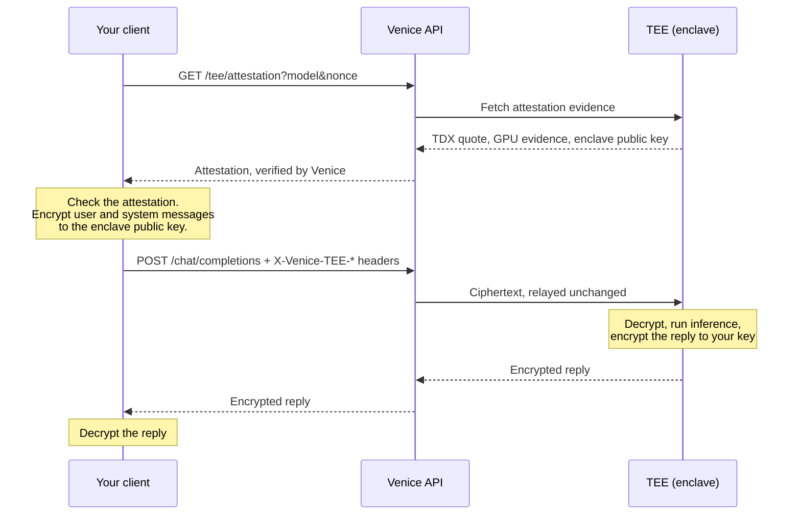

TEE and E2EE models run inside a Trusted Execution Environment (TEE): a hardware-isolated enclave whose identity and configuration can be proven with remote attestation. E2EE adds client-side encryption on top, so your prompts stay encrypted until they reach that enclave.

<Info>
For how TEE and E2EE compare with Venice's other privacy modes, see [Privacy](/overview/privacy).
</Info>

<Note>
TEE and E2EE are currently available on text models only.
</Note>

## TEE mode and E2EE mode

The same models support both modes. What you send decides which one you get.

| | TEE mode | E2EE mode |
| --- | --- | --- |
| How you call it | A normal `/chat/completions` request | Encrypt messages, add the `X-Venice-TEE-*` headers, and decrypt the response |
| Where inference runs | Inside an attested enclave | Inside an attested enclave |
| Who can read your prompt | The Venice API receives it in plaintext over TLS, then forwards it to the enclave | Only the enclave. Venice relays ciphertext |
| Who can read the reply | The Venice API relays it in plaintext | Only you. The enclave encrypts it to your key |
| Client work | None | Key generation, encryption, decryption, attestation checks |

Choose TEE mode when you want hardware-isolated inference and are comfortable with your prompt passing through the Venice API, which doesn't store prompt or response content. Choose E2EE mode when nothing outside the enclave should be able to read your prompt or the reply.

## How a request flows



In TEE mode, skip the attestation and encryption steps and send a normal request. The prompt then reaches the Venice API in plaintext.

## What stays visible in E2EE mode

E2EE protects message content, not the shape of the request. Venice and anyone else who can see the request outside the enclave can still see:

| Visible | Why |
| --- | --- |
| Your account, API key, IP address and request timing | Needed to authenticate, bill and route the request |
| Model ID and request parameters such as `temperature`, `max_tokens` and `stop` | Sent as normal JSON fields. Stop sequences are sent in plaintext |
| Message roles and the number of messages | Only message content is encrypted |
| Anything your client sends in plaintext, such as earlier `assistant` replies in the history | Venice forwards E2EE messages unchanged and never encrypts on your behalf. The examples encrypt `user` and `system` messages only |
| Tool definitions, tool calls and tool results | Not encrypted |
| Token usage and finish reasons | Returned as normal response fields |
| Approximate length of each message and reply chunk | Ciphertext is a fixed size larger than the plaintext |

If a conversation history contains sensitive replies, keep in mind that sending earlier `assistant` messages back in plaintext exposes them.

## Find TEE and E2EE models

Check capabilities on `GET /models` rather than relying on the model ID. Every TEE model currently also supports E2EE and uses an `e2ee-` prefix, but that's a naming convention, not a guarantee.

- `model_spec.capabilities.supportsTeeAttestation`: the model runs inside an attested TEE.
- `model_spec.capabilities.supportsE2EE`: the model accepts encrypted prompts. Implies `supportsTeeAttestation`.

<CodeGroup>
```bash cURL
curl -s https://api.venice.ai/api/v1/models \
  -H "Authorization: Bearer $VENICE_API_KEY" |
  jq '.data[]
    | select(.model_spec.capabilities.supportsTeeAttestation)
    | {id, e2ee: .model_spec.capabilities.supportsE2EE}'
```

```python Python
import os
import requests

res = requests.get(
    "https://api.venice.ai/api/v1/models",
    headers={"Authorization": f"Bearer {os.environ['VENICE_API_KEY']}"},
)
for model in res.json()["data"]:
    caps = model["model_spec"]["capabilities"]
    if caps.get("supportsTeeAttestation"):
        print(model["id"], "E2EE" if caps.get("supportsE2EE") else "TEE only")
```

```bash Venice CLI
venice models --e2ee
```
</CodeGroup>

You can also filter by **Privacy: E2EE** on the [Models page](/overview/models).

## Use TEE mode

TEE mode works like any other model. No client changes are needed:

<CodeGroup>
```python Python
import os
from openai import OpenAI

client = OpenAI(
    api_key=os.environ["VENICE_API_KEY"],
    base_url="https://api.venice.ai/api/v1",
)

response = client.chat.completions.create(
    model="e2ee-qwen3-6-35b-a3b",
    messages=[{"role": "user", "content": "Explain quantum computing"}],
)
print(response.choices[0].message.content)
```

```javascript Node.js
import OpenAI from 'openai'

const client = new OpenAI({
  apiKey: process.env.VENICE_API_KEY,
  baseURL: 'https://api.venice.ai/api/v1',
})

const response = await client.chat.completions.create({
  model: 'e2ee-qwen3-6-35b-a3b',
  messages: [{ role: 'user', content: 'Explain quantum computing' }],
})
console.log(response.choices[0].message.content)
```

```bash cURL
curl https://api.venice.ai/api/v1/chat/completions \
  -H "Authorization: Bearer $VENICE_API_KEY" \
  -H "Content-Type: application/json" \
  -d '{
    "model": "e2ee-qwen3-6-35b-a3b",
    "messages": [{"role": "user", "content": "Explain quantum computing"}]
  }'
```
</CodeGroup>

To check that the model really runs in an enclave, fetch its attestation and verify it. See [Verifying TEE attestation](/guides/features/tee-attestation).

## Use E2EE mode

E2EE needs client-side cryptography, so a stock OpenAI SDK can't do it on its own. The quickest way to try it is the [Venice CLI](/guides/integrations/venice-cli), which encrypts for any E2EE model and refuses to fall back to plaintext:

```bash
venice chat -m e2ee-qwen3-6-35b-a3b "This message is end-to-end encrypted"
```

To build E2EE into your own client, follow the [E2EE protocol guide](/guides/features/e2ee-protocol). It has the wire format and complete examples in JavaScript and Python.

### Turning E2EE off for a request

E2EE is on by default when a request to an E2EE model includes the E2EE headers. Set `venice_parameters.enable_e2ee` to `false` to run the request in TEE mode even if the headers are present. Your messages must then be plaintext.

## Feature support in E2EE mode

| Feature | E2EE mode |
| --- | --- |
| Streaming | Optional. Streamed and non-streamed replies are both encrypted. When streaming, each chunk is encrypted separately |
| Reasoning output | Encrypted, in `reasoning_content` |
| `/responses` endpoint | Not supported. Use `/chat/completions` |
| Web search and web scraping | Disabled |
| Venice system prompt | Not added. Send your own system message, encrypted |
| File and image inputs | Not supported. Encrypted `content` must be a string |
| Structured output (`response_format`) | Not supported |
| `reasoning_effort` | Not supported |
| Prompt caching options | Not supported |
| Stop sequences | Sent in plaintext |
| Function calling | Depends on the model (`supportsFunctionCalling`). Tool definitions, calls and results are not encrypted |

## Next steps

<CardGroup cols={2}>
  <Card title="E2EE protocol" icon="lock" href="/guides/features/e2ee-protocol">
    Wire format, headers and complete client examples.
  </Card>
  <Card title="Verifying TEE attestation" icon="shield-check" href="/guides/features/tee-attestation">
    Check enclave evidence and response signatures yourself.
  </Card>
</CardGroup>
