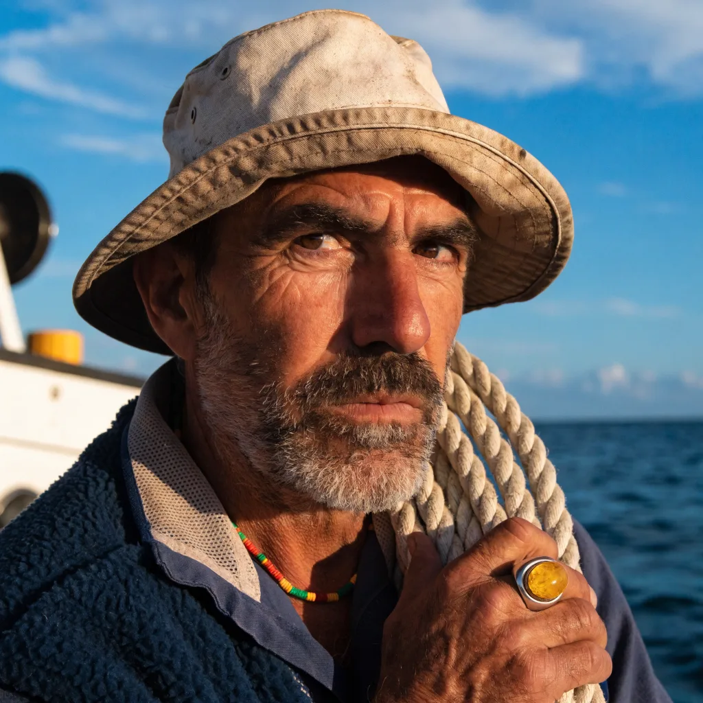

{/* GENERATED by scripts/model-hub-prerender.js. Edit the generator, not this file. */}

<Visibility for="humans">
<link rel="preload" href="https://venice.ai/fonts/Aeonik-Regular.otf" as="font" type="font/otf" crossOrigin="anonymous" /><link rel="preload" href="https://venice.ai/fonts/AeonikFono-Regular.otf" as="font" type="font/otf" crossOrigin="anonymous" /><link rel="preload" href="/data/model-hub.bundle.json?v=e14614f340a2" as="fetch" crossOrigin="anonymous" /><link rel="preload" href="/data/model-catalog.json?v=43ed361f68cf" as="fetch" crossOrigin="anonymous" />

<aside id="vx-filters" className="vx-side vx-filters" aria-label="Filters">

Filters<button type="button" className="vx-btn vx-btn-sm vx-rail-done">Done</button>

<button type="button" className="vx-fgroup-head" aria-expanded="true"><svg className="vx-icon" width="16" height="16" viewBox="0 0 24 24" fill="none" stroke="currentColor" strokeWidth="1.8" strokeLinecap="round" strokeLinejoin="round" aria-hidden="true"><path d="m12 2 10 5-10 5L2 7zM2 17l10 5 10-5M2 12l10 5 10-5"></path></svg>Modality<svg className="vx-icon vx-fgroup-chevron" width="14" height="14" viewBox="0 0 24 24" fill="none" stroke="currentColor" strokeWidth="1.8" strokeLinecap="round" strokeLinejoin="round" aria-hidden="true"><path d="m6 9 6 6 6-6"></path></svg></button>
<label className="vx-check vx-scope"><input type="radio" name="vx-modality" />All303</label><label className="vx-check vx-scope"><input type="radio" name="vx-modality" />Text144</label><label className="vx-check vx-scope is-checked"><input type="radio" name="vx-modality" defaultChecked />Image54</label><label className="vx-check vx-scope"><input type="radio" name="vx-modality" />Video59</label><label className="vx-check vx-scope"><input type="radio" name="vx-modality" />Text to speech15</label><label className="vx-check vx-scope"><input type="radio" name="vx-modality" />Speech to text5</label><label className="vx-check vx-scope"><input type="radio" name="vx-modality" />Music &amp; sound effects15</label><label className="vx-check vx-scope"><input type="radio" name="vx-modality" />Embeddings9</label><label className="vx-check vx-scope"><input type="radio" name="vx-modality" />Decisions2</label>

<button type="button" className="vx-fgroup-head" aria-expanded="true"><svg className="vx-icon" width="16" height="16" viewBox="0 0 24 24" fill="none" stroke="currentColor" strokeWidth="1.8" strokeLinecap="round" strokeLinejoin="round" aria-hidden="true"><path d="M12 22s8-4 8-10V5l-8-3-8 3v7c0 6 8 10 8 10z"></path></svg>Privacy<svg className="vx-icon vx-fgroup-chevron" width="14" height="14" viewBox="0 0 24 24" fill="none" stroke="currentColor" strokeWidth="1.8" strokeLinecap="round" strokeLinejoin="round" aria-hidden="true"><path d="m6 9 6 6 6-6"></path></svg></button>
<label className="vx-check is-disabled" title="This model supports end-to-end encryption (E2EE) and runs in a Trusted Execution Environment (TEE). Your prompt is encrypted on your client and decrypted on the GPU within the TEE. The response is then encrypted and sent back to your client for decryption. Venice's system prompt and web search are disabled to preserve end-to-end encryption. Attestation evidence is available for independent verification."><input type="checkbox" disabled /><svg className="vx-icon" width="12" height="12" viewBox="0 0 24 24" fill="none" stroke="currentColor" strokeWidth="1.8" strokeLinecap="round" strokeLinejoin="round" aria-hidden="true"><path d="M20 6 9 17l-5-5"></path></svg>E2EE0</label><label className="vx-check is-disabled" title="This model runs in a Trusted Execution Environment (TEE). Attestation evidence is available for independent verification."><input type="checkbox" disabled /><svg className="vx-icon" width="12" height="12" viewBox="0 0 24 24" fill="none" stroke="currentColor" strokeWidth="1.8" strokeLinecap="round" strokeLinejoin="round" aria-hidden="true"><path d="M20 6 9 17l-5-5"></path></svg>TEE0</label><label className="vx-check" title="This model is private and no prompt data is stored in any capacity."><input type="checkbox" /><svg className="vx-icon" width="12" height="12" viewBox="0 0 24 24" fill="none" stroke="currentColor" strokeWidth="1.8" strokeLinecap="round" strokeLinejoin="round" aria-hidden="true"><path d="M20 6 9 17l-5-5"></path></svg>Private14</label><label className="vx-check" title="The provider of this model may retain prompt data (though it is anonymized by Venice). For sensitive content, use a private model."><input type="checkbox" /><svg className="vx-icon" width="12" height="12" viewBox="0 0 24 24" fill="none" stroke="currentColor" strokeWidth="1.8" strokeLinecap="round" strokeLinejoin="round" aria-hidden="true"><path d="M20 6 9 17l-5-5"></path></svg>Anonymized40</label>

<button type="button" className="vx-fgroup-head" aria-expanded="true"><svg className="vx-icon" width="16" height="16" viewBox="0 0 24 24" fill="none" stroke="currentColor" strokeWidth="1.8" strokeLinecap="round" strokeLinejoin="round" aria-hidden="true"><path d="m15 4 5 5M4 20 16 8M18 2v4M20 4h-4M8 2v2M9 3H7"></path></svg>Task<svg className="vx-icon vx-fgroup-chevron" width="14" height="14" viewBox="0 0 24 24" fill="none" stroke="currentColor" strokeWidth="1.8" strokeLinecap="round" strokeLinejoin="round" aria-hidden="true"><path d="m6 9 6 6 6-6"></path></svg></button>
<label className="vx-check"><input type="checkbox" /><svg className="vx-icon" width="12" height="12" viewBox="0 0 24 24" fill="none" stroke="currentColor" strokeWidth="1.8" strokeLinecap="round" strokeLinejoin="round" aria-hidden="true"><path d="M20 6 9 17l-5-5"></path></svg>Generate51</label><label className="vx-check"><input type="checkbox" /><svg className="vx-icon" width="12" height="12" viewBox="0 0 24 24" fill="none" stroke="currentColor" strokeWidth="1.8" strokeLinecap="round" strokeLinejoin="round" aria-hidden="true"><path d="M20 6 9 17l-5-5"></path></svg>Edit36</label><label className="vx-check"><input type="checkbox" /><svg className="vx-icon" width="12" height="12" viewBox="0 0 24 24" fill="none" stroke="currentColor" strokeWidth="1.8" strokeLinecap="round" strokeLinejoin="round" aria-hidden="true"><path d="M20 6 9 17l-5-5"></path></svg>Upscale1</label><label className="vx-check is-disabled"><input type="checkbox" disabled /><svg className="vx-icon" width="12" height="12" viewBox="0 0 24 24" fill="none" stroke="currentColor" strokeWidth="1.8" strokeLinecap="round" strokeLinejoin="round" aria-hidden="true"><path d="M20 6 9 17l-5-5"></path></svg>Remove background0</label>

<button type="button" className="vx-fgroup-head" aria-expanded="true"><svg className="vx-icon" width="16" height="16" viewBox="0 0 24 24" fill="none" stroke="currentColor" strokeWidth="1.8" strokeLinecap="round" strokeLinejoin="round" aria-hidden="true"><path d="M8 3H5a2 2 0 0 0-2 2v3M21 8V5a2 2 0 0 0-2-2h-3M3 16v3a2 2 0 0 0 2 2h3M16 21h3a2 2 0 0 0 2-2v-3"></path></svg>Output resolution<svg className="vx-icon vx-fgroup-chevron" width="14" height="14" viewBox="0 0 24 24" fill="none" stroke="currentColor" strokeWidth="1.8" strokeLinecap="round" strokeLinejoin="round" aria-hidden="true"><path d="m6 9 6 6 6-6"></path></svg></button>

<button type="button" role="radio" aria-checked="true" className="vx-seg-btn is-active">Any</button><button type="button" role="radio" aria-checked="false" className="vx-seg-btn" title="2K available">2K</button><button type="button" role="radio" aria-checked="false" className="vx-seg-btn" title="4K available">4K</button>

<button type="button" className="vx-fgroup-head" aria-expanded="true"><svg className="vx-icon" width="16" height="16" viewBox="0 0 24 24" fill="none" stroke="currentColor" strokeWidth="1.8" strokeLinecap="round" strokeLinejoin="round" aria-hidden="true"><path d="M13 2 3 14h9l-1 8 10-12h-9z"></path></svg>Features<svg className="vx-icon vx-fgroup-chevron" width="14" height="14" viewBox="0 0 24 24" fill="none" stroke="currentColor" strokeWidth="1.8" strokeLinecap="round" strokeLinejoin="round" aria-hidden="true"><path d="m6 9 6 6 6-6"></path></svg></button>
<label className="vx-check"><input type="checkbox" /><svg className="vx-icon" width="12" height="12" viewBox="0 0 24 24" fill="none" stroke="currentColor" strokeWidth="1.8" strokeLinecap="round" strokeLinejoin="round" aria-hidden="true"><path d="M20 6 9 17l-5-5"></path></svg>Web-grounded generation3</label><label className="vx-check"><input type="checkbox" /><svg className="vx-icon" width="12" height="12" viewBox="0 0 24 24" fill="none" stroke="currentColor" strokeWidth="1.8" strokeLinecap="round" strokeLinejoin="round" aria-hidden="true"><path d="M20 6 9 17l-5-5"></path></svg>Multi-image editing26</label>

<button type="button" className="vx-fgroup-head" aria-expanded="true"><svg className="vx-icon" width="16" height="16" viewBox="0 0 24 24" fill="none" stroke="currentColor" strokeWidth="1.8" strokeLinecap="round" strokeLinejoin="round" aria-hidden="true"><path d="M4 21v-7M4 10V3M12 21v-9M12 8V3M20 21v-5M20 12V3M1 14h6M9 8h6M17 16h6"></path></svg>Attributes<svg className="vx-icon vx-fgroup-chevron" width="14" height="14" viewBox="0 0 24 24" fill="none" stroke="currentColor" strokeWidth="1.8" strokeLinecap="round" strokeLinejoin="round" aria-hidden="true"><path d="m6 9 6 6 6-6"></path></svg></button>
<label className="vx-check"><input type="checkbox" /><svg className="vx-icon" width="12" height="12" viewBox="0 0 24 24" fill="none" stroke="currentColor" strokeWidth="1.8" strokeLinecap="round" strokeLinejoin="round" aria-hidden="true"><path d="M20 6 9 17l-5-5"></path></svg>Open weights7</label><label className="vx-check"><input type="checkbox" /><svg className="vx-icon" width="12" height="12" viewBox="0 0 24 24" fill="none" stroke="currentColor" strokeWidth="1.8" strokeLinecap="round" strokeLinejoin="round" aria-hidden="true"><path d="M20 6 9 17l-5-5"></path></svg>Uncensored15</label>

<button type="button" className="vx-fgroup-head" aria-expanded="true"><svg className="vx-icon" width="16" height="16" viewBox="0 0 24 24" fill="none" stroke="currentColor" strokeWidth="1.8" strokeLinecap="round" strokeLinejoin="round" aria-hidden="true"><rect x="2" y="3" width="20" height="8" rx="2"></rect><rect x="2" y="13" width="20" height="8" rx="2"></rect><path d="M6 7h.01M6 17h.01"></path></svg>Provider<svg className="vx-icon vx-fgroup-chevron" width="14" height="14" viewBox="0 0 24 24" fill="none" stroke="currentColor" strokeWidth="1.8" strokeLinecap="round" strokeLinejoin="round" aria-hidden="true"><path d="m6 9 6 6 6-6"></path></svg></button>
<label className="vx-check"><input type="checkbox" /><svg className="vx-icon" width="12" height="12" viewBox="0 0 24 24" fill="none" stroke="currentColor" strokeWidth="1.8" strokeLinecap="round" strokeLinejoin="round" aria-hidden="true"><path d="M20 6 9 17l-5-5"></path></svg>Alibaba Qwen11</label><label className="vx-check"><input type="checkbox" /><svg className="vx-icon" width="12" height="12" viewBox="0 0 24 24" fill="none" stroke="currentColor" strokeWidth="1.8" strokeLinecap="round" strokeLinejoin="round" aria-hidden="true"><path d="M20 6 9 17l-5-5"></path></svg>OpenAI6</label><label className="vx-check"><input type="checkbox" /><svg className="vx-icon" width="12" height="12" viewBox="0 0 24 24" fill="none" stroke="currentColor" strokeWidth="1.8" strokeLinecap="round" strokeLinejoin="round" aria-hidden="true"><path d="M20 6 9 17l-5-5"></path></svg>CCommunity5</label><label className="vx-check"><input type="checkbox" /><svg className="vx-icon" width="12" height="12" viewBox="0 0 24 24" fill="none" stroke="currentColor" strokeWidth="1.8" strokeLinecap="round" strokeLinejoin="round" aria-hidden="true"><path d="M20 6 9 17l-5-5"></path></svg>ByteDance Seed4</label><label className="vx-check"><input type="checkbox" /><svg className="vx-icon" width="12" height="12" viewBox="0 0 24 24" fill="none" stroke="currentColor" strokeWidth="1.8" strokeLinecap="round" strokeLinejoin="round" aria-hidden="true"><path d="M20 6 9 17l-5-5"></path></svg>Google4</label><label className="vx-check"><input type="checkbox" /><svg className="vx-icon" width="12" height="12" viewBox="0 0 24 24" fill="none" stroke="currentColor" strokeWidth="1.8" strokeLinecap="round" strokeLinejoin="round" aria-hidden="true"><path d="M20 6 9 17l-5-5"></path></svg>Krea4</label><label className="vx-check"><input type="checkbox" /><svg className="vx-icon" width="12" height="12" viewBox="0 0 24 24" fill="none" stroke="currentColor" strokeWidth="1.8" strokeLinecap="round" strokeLinejoin="round" aria-hidden="true"><path d="M20 6 9 17l-5-5"></path></svg>Black Forest Labs3</label><label className="vx-check"><input type="checkbox" /><svg className="vx-icon" width="12" height="12" viewBox="0 0 24 24" fill="none" stroke="currentColor" strokeWidth="1.8" strokeLinecap="round" strokeLinejoin="round" aria-hidden="true"><path d="M20 6 9 17l-5-5"></path></svg>Ideogram2</label><label className="vx-check"><input type="checkbox" /><svg className="vx-icon" width="12" height="12" viewBox="0 0 24 24" fill="none" stroke="currentColor" strokeWidth="1.8" strokeLinecap="round" strokeLinejoin="round" aria-hidden="true"><path d="M20 6 9 17l-5-5"></path></svg>Luma AI2</label><label className="vx-check"><input type="checkbox" /><svg className="vx-icon" width="12" height="12" viewBox="0 0 24 24" fill="none" stroke="currentColor" strokeWidth="1.8" strokeLinecap="round" strokeLinejoin="round" aria-hidden="true"><path d="M20 6 9 17l-5-5"></path></svg>MMAI2</label><button type="button" className="vx-link-btn vx-more">Show all 19</button>

</aside>
<header className="vx-hero">
<h1 className="vx-h1">Image Models</h1>
Image generation, editing, upscaling and background removal, priced per image.

<a className="vx-btn vx-btn-tertiary" href="/api-reference/endpoint/models/list">Models API</a>
</header>
<button type="button" className="vx-btn vx-rail-toggle" aria-expanded="false" aria-controls="vx-filters">Filters</button>
<svg className="vx-icon" width="16" height="16" viewBox="0 0 24 24" fill="none" stroke="currentColor" strokeWidth="1.8" strokeLinecap="round" strokeLinejoin="round" aria-hidden="true"><circle cx="11" cy="11" r="7"></circle><path d="m20 20-3.5-3.5"></path></svg><input type="search" defaultValue="" placeholder="Search by name, ID or provider" aria-label="Search models" /><kbd aria-hidden="true">/</kbd>
<select className="vx-select" defaultValue="newest" aria-label="Sort"><option value="newest">Newest</option><option value="name">Name A–Z</option><option value="price">Price, low to high</option></select>
<button type="button" role="radio" aria-checked="false" className="vx-seg-btn">List</button><button type="button" role="radio" aria-checked="false" className="vx-seg-btn">Table</button><button type="button" role="radio" aria-checked="true" className="vx-seg-btn is-active">Gallery</button>

<label className="vx-tab"><input type="radio" name="vx-modality-tab" />All303</label><label className="vx-tab"><input type="radio" name="vx-modality-tab" />Text144</label><label className="vx-tab is-checked"><input type="radio" name="vx-modality-tab" defaultChecked />Image54</label><label className="vx-tab"><input type="radio" name="vx-modality-tab" />Video59</label><label className="vx-tab" title="Text to speech"><input type="radio" name="vx-modality-tab" />Speech15</label><label className="vx-tab" title="Speech to text"><input type="radio" name="vx-modality-tab" />Transcription5</label><label className="vx-tab" title="Music &amp; sound effects"><input type="radio" name="vx-modality-tab" />Music15</label><label className="vx-tab"><input type="radio" name="vx-modality-tab" />Embeddings9</label><label className="vx-tab"><input type="radio" name="vx-modality-tab" />Decisions2</label>
<section className="vx-results" aria-label="Models">
<strong>54 families</strong>&#32;·&#32;88 model IDsUpdated&#32;Nov 20, 2026

Prompt<q>Photorealistic close-up portrait of a weathered fisherman at golden hour, 85mm lens, shallow depth of field, natural skin texture</q>Models that edit, extend or upscale start from a render of it.

<article className="vx-card">

<a className="vx-card-name" href="/models/kling-image-4-0" title="Kling Image 4.0">Kling Image 4.0</a><button type="button" className="vx-icon-btn vx-row-copy" aria-label="Copy model ID kling-v4-text-to-image" title="Copy model ID kling-v4-text-to-image"><svg className="vx-icon" width="14" height="14" viewBox="0 0 24 24" fill="none" stroke="currentColor" strokeWidth="1.8" strokeLinecap="round" strokeLinejoin="round" aria-hidden="true"><rect x="9" y="9" width="13" height="13" rx="2"></rect><path d="M5 15H4a2 2 0 0 1-2-2V4a2 2 0 0 1 2-2h9a2 2 0 0 1 2 2v1"></path></svg></button>New

+1&#32;variant

<button type="button" className="vx-tip-anchor" aria-describedby="vx-tip-23">from&#32;<strong>&#36;0.08</strong>&#32;/ image2K&#36;0.08 / image4K&#36;0.12 / image</button>Anonymized

</article><article className="vx-card">

<a className="vx-card-name" href="/models/mai-image-2-7-flash" title="MAI Image 2.7 Flash">MAI Image 2.7 Flash</a><button type="button" className="vx-icon-btn vx-row-copy" aria-label="Copy model ID mai-image-2-7-flash" title="Copy model ID mai-image-2-7-flash"><svg className="vx-icon" width="14" height="14" viewBox="0 0 24 24" fill="none" stroke="currentColor" strokeWidth="1.8" strokeLinecap="round" strokeLinejoin="round" aria-hidden="true"><rect x="9" y="9" width="13" height="13" rx="2"></rect><path d="M5 15H4a2 2 0 0 1-2-2V4a2 2 0 0 1 2-2h9a2 2 0 0 1 2 2v1"></path></svg></button>New

+1&#32;variant

<button type="button" className="vx-tip-anchor" aria-describedby="vx-tip-24">from&#32;<strong>&#36;0.02</strong>&#32;/ image1K&#36;0.02 / image2K&#36;0.05 / image</button>Anonymized

</article><article className="vx-card">

<a className="vx-card-name" href="/models/minimax-h3-image" title="MiniMax H3 Image">MiniMax H3 Image</a><button type="button" className="vx-icon-btn vx-row-copy" aria-label="Copy model ID minimax-h3-image" title="Copy model ID minimax-h3-image"><svg className="vx-icon" width="14" height="14" viewBox="0 0 24 24" fill="none" stroke="currentColor" strokeWidth="1.8" strokeLinecap="round" strokeLinejoin="round" aria-hidden="true"><rect x="9" y="9" width="13" height="13" rx="2"></rect><path d="M5 15H4a2 2 0 0 1-2-2V4a2 2 0 0 1 2-2h9a2 2 0 0 1 2 2v1"></path></svg></button>New

+1&#32;variant

<button type="button" className="vx-tip-anchor" aria-describedby="vx-tip-25">from&#32;<strong>&#36;0.04</strong>&#32;/ image1K&#36;0.04 / image2K&#36;0.04 / image4K&#36;0.10 / image</button>Anonymized

</article><article className="vx-card">

<a className="vx-card-name" href="/models/seedream-v5-5" title="Seedream V5.5">Seedream V5.5</a><button type="button" className="vx-icon-btn vx-row-copy" aria-label="Copy model ID seedream-v5-5" title="Copy model ID seedream-v5-5"><svg className="vx-icon" width="14" height="14" viewBox="0 0 24 24" fill="none" stroke="currentColor" strokeWidth="1.8" strokeLinecap="round" strokeLinejoin="round" aria-hidden="true"><rect x="9" y="9" width="13" height="13" rx="2"></rect><path d="M5 15H4a2 2 0 0 1-2-2V4a2 2 0 0 1 2-2h9a2 2 0 0 1 2 2v1"></path></svg></button>New

+1&#32;variant

<button type="button" className="vx-tip-anchor" aria-describedby="vx-tip-26">from&#32;<strong>&#36;0.0255</strong>&#32;/ image1K&#36;0.0255 / image2K&#36;0.051 / image</button>Anonymized

</article><article className="vx-card">

<a className="vx-card-name" href="/models/gpt-image-2-6-flare" title="GPT Image 2.6 Flare">GPT Image 2.6 Flare</a><button type="button" className="vx-icon-btn vx-row-copy" aria-label="Copy model ID gpt-image-2-6-flare" title="Copy model ID gpt-image-2-6-flare"><svg className="vx-icon" width="14" height="14" viewBox="0 0 24 24" fill="none" stroke="currentColor" strokeWidth="1.8" strokeLinecap="round" strokeLinejoin="round" aria-hidden="true"><rect x="9" y="9" width="13" height="13" rx="2"></rect><path d="M5 15H4a2 2 0 0 1-2-2V4a2 2 0 0 1 2-2h9a2 2 0 0 1 2 2v1"></path></svg></button>New

+1&#32;variant

<button type="button" className="vx-tip-anchor" aria-describedby="vx-tip-27">from&#32;<strong>&#36;0.09</strong>&#32;/ image1K&#36;0.09 / image2K&#36;0.15 / image4K&#36;0.24 / image</button>Anonymized

</article><article className="vx-card">

<a className="vx-card-name" href="/models/gpt-image-2-6-sunburst" title="GPT Image 2.6 Sunburst">GPT Image 2.6 Sunburst</a><button type="button" className="vx-icon-btn vx-row-copy" aria-label="Copy model ID gpt-image-2-6-sunburst" title="Copy model ID gpt-image-2-6-sunburst"><svg className="vx-icon" width="14" height="14" viewBox="0 0 24 24" fill="none" stroke="currentColor" strokeWidth="1.8" strokeLinecap="round" strokeLinejoin="round" aria-hidden="true"><rect x="9" y="9" width="13" height="13" rx="2"></rect><path d="M5 15H4a2 2 0 0 1-2-2V4a2 2 0 0 1 2-2h9a2 2 0 0 1 2 2v1"></path></svg></button>New

+1&#32;variant

<button type="button" className="vx-tip-anchor" aria-describedby="vx-tip-28">from&#32;<strong>&#36;0.09</strong>&#32;/ image1K&#36;0.09 / image2K&#36;0.15 / image4K&#36;0.24 / image</button>Anonymized

</article><article className="vx-card">

<a className="vx-card-name" href="/models/krea-3" title="Krea 3">Krea 3</a><button type="button" className="vx-icon-btn vx-row-copy" aria-label="Copy model ID krea-3" title="Copy model ID krea-3"><svg className="vx-icon" width="14" height="14" viewBox="0 0 24 24" fill="none" stroke="currentColor" strokeWidth="1.8" strokeLinecap="round" strokeLinejoin="round" aria-hidden="true"><rect x="9" y="9" width="13" height="13" rx="2"></rect><path d="M5 15H4a2 2 0 0 1-2-2V4a2 2 0 0 1 2-2h9a2 2 0 0 1 2 2v1"></path></svg></button>New

+1&#32;variant

<button type="button" className="vx-tip-anchor" aria-describedby="vx-tip-29">from&#32;<strong>&#36;0.07</strong>&#32;/ image1K&#36;0.07 / image2K&#36;0.10 / image4K&#36;0.15 / image</button>Anonymized

</article><article className="vx-card">

<a className="vx-card-name" href="/models/qwen-image-2-1-turbo" title="Qwen Image 2.1 Turbo">Qwen Image 2.1 Turbo</a><button type="button" className="vx-icon-btn vx-row-copy" aria-label="Copy model ID qwen-image-2-1-turbo" title="Copy model ID qwen-image-2-1-turbo"><svg className="vx-icon" width="14" height="14" viewBox="0 0 24 24" fill="none" stroke="currentColor" strokeWidth="1.8" strokeLinecap="round" strokeLinejoin="round" aria-hidden="true"><rect x="9" y="9" width="13" height="13" rx="2"></rect><path d="M5 15H4a2 2 0 0 1-2-2V4a2 2 0 0 1 2-2h9a2 2 0 0 1 2 2v1"></path></svg></button>

+1&#32;variant

<strong>&#36;0.02</strong>&#32;/ imageAnonymized

</article><article className="vx-card">

<a className="vx-card-name" href="/models/nano-banana-2-1" title="Nano Banana 2.1">Nano Banana 2.1</a><button type="button" className="vx-icon-btn vx-row-copy" aria-label="Copy model ID nano-banana-2-1" title="Copy model ID nano-banana-2-1"><svg className="vx-icon" width="14" height="14" viewBox="0 0 24 24" fill="none" stroke="currentColor" strokeWidth="1.8" strokeLinecap="round" strokeLinejoin="round" aria-hidden="true"><rect x="9" y="9" width="13" height="13" rx="2"></rect><path d="M5 15H4a2 2 0 0 1-2-2V4a2 2 0 0 1 2-2h9a2 2 0 0 1 2 2v1"></path></svg></button>

+1&#32;variant

<button type="button" className="vx-tip-anchor" aria-describedby="vx-tip-31">from&#32;<strong>&#36;0.10</strong>&#32;/ image1K&#36;0.10 / image2K&#36;0.14 / image4K&#36;0.19 / image</button>Anonymized

</article><article className="vx-card">

<a className="vx-card-name" href="/models/flux-3-image" title="Flux 3">Flux 3</a><button type="button" className="vx-icon-btn vx-row-copy" aria-label="Copy model ID flux-3-image" title="Copy model ID flux-3-image"><svg className="vx-icon" width="14" height="14" viewBox="0 0 24 24" fill="none" stroke="currentColor" strokeWidth="1.8" strokeLinecap="round" strokeLinejoin="round" aria-hidden="true"><rect x="9" y="9" width="13" height="13" rx="2"></rect><path d="M5 15H4a2 2 0 0 1-2-2V4a2 2 0 0 1 2-2h9a2 2 0 0 1 2 2v1"></path></svg></button>

+1&#32;variant

<button type="button" className="vx-tip-anchor" aria-describedby="vx-tip-32">from&#32;<strong>&#36;0.12</strong>&#32;/ image1K&#36;0.12 / image2K&#36;0.29 / image4K&#36;0.98 / image</button>Anonymized

</article><article className="vx-card">

<a className="vx-card-name" href="/models/ideogram-v4-5" title="Ideogram V4.5">Ideogram V4.5</a><button type="button" className="vx-icon-btn vx-row-copy" aria-label="Copy model ID ideogram-v4-5" title="Copy model ID ideogram-v4-5"><svg className="vx-icon" width="14" height="14" viewBox="0 0 24 24" fill="none" stroke="currentColor" strokeWidth="1.8" strokeLinecap="round" strokeLinejoin="round" aria-hidden="true"><rect x="9" y="9" width="13" height="13" rx="2"></rect><path d="M5 15H4a2 2 0 0 1-2-2V4a2 2 0 0 1 2-2h9a2 2 0 0 1 2 2v1"></path></svg></button>

+1&#32;variant

<strong>&#36;0.26</strong>&#32;/ imageAnonymized

</article><article className="vx-card">

<a className="vx-card-name" href="/models/qwen-image-2-1-pro" title="Qwen Image 2.1 Pro">Qwen Image 2.1 Pro</a><button type="button" className="vx-icon-btn vx-row-copy" aria-label="Copy model ID qwen-image-2-1-pro" title="Copy model ID qwen-image-2-1-pro"><svg className="vx-icon" width="14" height="14" viewBox="0 0 24 24" fill="none" stroke="currentColor" strokeWidth="1.8" strokeLinecap="round" strokeLinejoin="round" aria-hidden="true"><rect x="9" y="9" width="13" height="13" rx="2"></rect><path d="M5 15H4a2 2 0 0 1-2-2V4a2 2 0 0 1 2-2h9a2 2 0 0 1 2 2v1"></path></svg></button>

+1&#32;variant

<strong>&#36;0.05</strong>&#32;/ imageAnonymized

</article><article className="vx-card">

<a className="vx-card-name" href="/models/gpt-image-2-5-flare" title="GPT Image 2.5 Flare">GPT Image 2.5 Flare</a><button type="button" className="vx-icon-btn vx-row-copy" aria-label="Copy model ID gpt-image-2-5-flare" title="Copy model ID gpt-image-2-5-flare"><svg className="vx-icon" width="14" height="14" viewBox="0 0 24 24" fill="none" stroke="currentColor" strokeWidth="1.8" strokeLinecap="round" strokeLinejoin="round" aria-hidden="true"><rect x="9" y="9" width="13" height="13" rx="2"></rect><path d="M5 15H4a2 2 0 0 1-2-2V4a2 2 0 0 1 2-2h9a2 2 0 0 1 2 2v1"></path></svg></button>

+1&#32;variant

<button type="button" className="vx-tip-anchor" aria-describedby="vx-tip-35">from&#32;<strong>&#36;0.07</strong>&#32;/ image1K&#36;0.07 / image2K&#36;0.15 / image4K&#36;0.23 / image</button>Anonymized

</article><article className="vx-card">

<a className="vx-card-name" href="/models/gpt-image-2-5-sunburst" title="GPT Image 2.5 Sunburst">GPT Image 2.5 Sunburst</a><button type="button" className="vx-icon-btn vx-row-copy" aria-label="Copy model ID gpt-image-2-5-sunburst" title="Copy model ID gpt-image-2-5-sunburst"><svg className="vx-icon" width="14" height="14" viewBox="0 0 24 24" fill="none" stroke="currentColor" strokeWidth="1.8" strokeLinecap="round" strokeLinejoin="round" aria-hidden="true"><rect x="9" y="9" width="13" height="13" rx="2"></rect><path d="M5 15H4a2 2 0 0 1-2-2V4a2 2 0 0 1 2-2h9a2 2 0 0 1 2 2v1"></path></svg></button>

+1&#32;variant

<button type="button" className="vx-tip-anchor" aria-describedby="vx-tip-36">from&#32;<strong>&#36;0.07</strong>&#32;/ image1K&#36;0.07 / image2K&#36;0.15 / image4K&#36;0.23 / image</button>Anonymized

</article><article className="vx-card">

<a className="vx-card-name" href="/models/muse-image" title="Muse Image">Muse Image</a><button type="button" className="vx-icon-btn vx-row-copy" aria-label="Copy model ID muse-image" title="Copy model ID muse-image"><svg className="vx-icon" width="14" height="14" viewBox="0 0 24 24" fill="none" stroke="currentColor" strokeWidth="1.8" strokeLinecap="round" strokeLinejoin="round" aria-hidden="true"><rect x="9" y="9" width="13" height="13" rx="2"></rect><path d="M5 15H4a2 2 0 0 1-2-2V4a2 2 0 0 1 2-2h9a2 2 0 0 1 2 2v1"></path></svg></button>

+1&#32;variant

<strong>&#36;0.02</strong>&#32;/ imageAnonymized

</article><article className="vx-card">

<a className="vx-card-name" href="/models/grok-imagine-2-0" title="Grok Imagine 2.0">Grok Imagine 2.0</a><button type="button" className="vx-icon-btn vx-row-copy" aria-label="Copy model ID grok-imagine-image-2-0" title="Copy model ID grok-imagine-image-2-0"><svg className="vx-icon" width="14" height="14" viewBox="0 0 24 24" fill="none" stroke="currentColor" strokeWidth="1.8" strokeLinecap="round" strokeLinejoin="round" aria-hidden="true"><rect x="9" y="9" width="13" height="13" rx="2"></rect><path d="M5 15H4a2 2 0 0 1-2-2V4a2 2 0 0 1 2-2h9a2 2 0 0 1 2 2v1"></path></svg></button>

+1&#32;variant

<button type="button" className="vx-tip-anchor" aria-describedby="vx-tip-38">from&#32;<strong>&#36;0.07</strong>&#32;/ image1K&#36;0.07 / image2K&#36;0.10 / image</button>Private

</article><article className="vx-card">

<a className="vx-card-name" href="/models/qwen-image-3" title="Qwen Image 3">Qwen Image 3</a><button type="button" className="vx-icon-btn vx-row-copy" aria-label="Copy model ID qwen-image-3" title="Copy model ID qwen-image-3"><svg className="vx-icon" width="14" height="14" viewBox="0 0 24 24" fill="none" stroke="currentColor" strokeWidth="1.8" strokeLinecap="round" strokeLinejoin="round" aria-hidden="true"><rect x="9" y="9" width="13" height="13" rx="2"></rect><path d="M5 15H4a2 2 0 0 1-2-2V4a2 2 0 0 1 2-2h9a2 2 0 0 1 2 2v1"></path></svg></button>

+1&#32;variant

<strong>&#36;0.04</strong>&#32;/ imageAnonymized

</article><article className="vx-card">

<a className="vx-card-name" href="/models/qwen-image-3-pro" title="Qwen Image 3 Pro">Qwen Image 3 Pro</a><button type="button" className="vx-icon-btn vx-row-copy" aria-label="Copy model ID qwen-image-3-pro" title="Copy model ID qwen-image-3-pro"><svg className="vx-icon" width="14" height="14" viewBox="0 0 24 24" fill="none" stroke="currentColor" strokeWidth="1.8" strokeLinecap="round" strokeLinejoin="round" aria-hidden="true"><rect x="9" y="9" width="13" height="13" rx="2"></rect><path d="M5 15H4a2 2 0 0 1-2-2V4a2 2 0 0 1 2-2h9a2 2 0 0 1 2 2v1"></path></svg></button>

+1&#32;variant

<button type="button" className="vx-tip-anchor" aria-describedby="vx-tip-40">from&#32;<strong>&#36;0.05</strong>&#32;/ image1K&#36;0.05 / image2K&#36;0.09 / image</button>Anonymized

</article><article className="vx-card">

<a className="vx-card-name" href="/models/seedream-v5-pro" title="Seedream V5 Pro">Seedream V5 Pro</a><button type="button" className="vx-icon-btn vx-row-copy" aria-label="Copy model ID seedream-v5-pro" title="Copy model ID seedream-v5-pro"><svg className="vx-icon" width="14" height="14" viewBox="0 0 24 24" fill="none" stroke="currentColor" strokeWidth="1.8" strokeLinecap="round" strokeLinejoin="round" aria-hidden="true"><rect x="9" y="9" width="13" height="13" rx="2"></rect><path d="M5 15H4a2 2 0 0 1-2-2V4a2 2 0 0 1 2-2h9a2 2 0 0 1 2 2v1"></path></svg></button>

+1&#32;variant

<button type="button" className="vx-tip-anchor" aria-describedby="vx-tip-41">from&#32;<strong>&#36;0.06</strong>&#32;/ image1K&#36;0.06 / image2K&#36;0.11 / image</button>Anonymized

</article><article className="vx-card">

<a className="vx-card-name" href="/models/krea-2-turbo" title="Krea 2 Turbo">Krea 2 Turbo</a><button type="button" className="vx-icon-btn vx-row-copy" aria-label="Copy model ID krea-2-turbo" title="Copy model ID krea-2-turbo"><svg className="vx-icon" width="14" height="14" viewBox="0 0 24 24" fill="none" stroke="currentColor" strokeWidth="1.8" strokeLinecap="round" strokeLinejoin="round" aria-hidden="true"><rect x="9" y="9" width="13" height="13" rx="2"></rect><path d="M5 15H4a2 2 0 0 1-2-2V4a2 2 0 0 1 2-2h9a2 2 0 0 1 2 2v1"></path></svg></button>

<button type="button" className="vx-tip-anchor" aria-describedby="vx-tip-42">from&#32;<strong>&#36;0.04</strong>&#32;/ image1K&#36;0.04 / image2K&#36;0.06 / image</button>Private

</article><article className="vx-card">

<a className="vx-card-name" href="/models/nano-banana-2-lite" title="Nano Banana 2 Lite">Nano Banana 2 Lite</a><button type="button" className="vx-icon-btn vx-row-copy" aria-label="Copy model ID nano-banana-2-lite" title="Copy model ID nano-banana-2-lite"><svg className="vx-icon" width="14" height="14" viewBox="0 0 24 24" fill="none" stroke="currentColor" strokeWidth="1.8" strokeLinecap="round" strokeLinejoin="round" aria-hidden="true"><rect x="9" y="9" width="13" height="13" rx="2"></rect><path d="M5 15H4a2 2 0 0 1-2-2V4a2 2 0 0 1 2-2h9a2 2 0 0 1 2 2v1"></path></svg></button>

+1&#32;variant

<strong>&#36;0.06</strong>&#32;/ imageAnonymized

</article><article className="vx-card">

<a className="vx-card-name" href="/models/luma-uni-1" title="Luma Uni-1">Luma Uni-1</a><button type="button" className="vx-icon-btn vx-row-copy" aria-label="Copy model ID luma-uni-1" title="Copy model ID luma-uni-1"><svg className="vx-icon" width="14" height="14" viewBox="0 0 24 24" fill="none" stroke="currentColor" strokeWidth="1.8" strokeLinecap="round" strokeLinejoin="round" aria-hidden="true"><rect x="9" y="9" width="13" height="13" rx="2"></rect><path d="M5 15H4a2 2 0 0 1-2-2V4a2 2 0 0 1 2-2h9a2 2 0 0 1 2 2v1"></path></svg></button>

+1&#32;variant

<strong>&#36;0.05</strong>&#32;/ imageAnonymized

</article><article className="vx-card">

<a className="vx-card-name" href="/models/luma-uni-1-max" title="Luma Uni-1 Max">Luma Uni-1 Max</a><button type="button" className="vx-icon-btn vx-row-copy" aria-label="Copy model ID luma-uni-1-max" title="Copy model ID luma-uni-1-max"><svg className="vx-icon" width="14" height="14" viewBox="0 0 24 24" fill="none" stroke="currentColor" strokeWidth="1.8" strokeLinecap="round" strokeLinejoin="round" aria-hidden="true"><rect x="9" y="9" width="13" height="13" rx="2"></rect><path d="M5 15H4a2 2 0 0 1-2-2V4a2 2 0 0 1 2-2h9a2 2 0 0 1 2 2v1"></path></svg></button>

+1&#32;variant

<strong>&#36;0.12</strong>&#32;/ imageAnonymized

</article><article className="vx-card">

<a className="vx-card-name" href="/models/qwen-edit-uncensored" title="Qwen Edit Uncensored">Qwen Edit Uncensored</a><button type="button" className="vx-icon-btn vx-row-copy" aria-label="Copy model ID qwen-edit-uncensored" title="Copy model ID qwen-edit-uncensored"><svg className="vx-icon" width="14" height="14" viewBox="0 0 24 24" fill="none" stroke="currentColor" strokeWidth="1.8" strokeLinecap="round" strokeLinejoin="round" aria-hidden="true"><rect x="9" y="9" width="13" height="13" rx="2"></rect><path d="M5 15H4a2 2 0 0 1-2-2V4a2 2 0 0 1 2-2h9a2 2 0 0 1 2 2v1"></path></svg></button>

<strong>&#36;0.04</strong>&#32;/ editPrivate

</article><article className="vx-card">

<a className="vx-card-name" href="/models/ideogram-v4" title="Ideogram V4">Ideogram V4</a><button type="button" className="vx-icon-btn vx-row-copy" aria-label="Copy model ID ideogram-v4" title="Copy model ID ideogram-v4"><svg className="vx-icon" width="14" height="14" viewBox="0 0 24 24" fill="none" stroke="currentColor" strokeWidth="1.8" strokeLinecap="round" strokeLinejoin="round" aria-hidden="true"><rect x="9" y="9" width="13" height="13" rx="2"></rect><path d="M5 15H4a2 2 0 0 1-2-2V4a2 2 0 0 1 2-2h9a2 2 0 0 1 2 2v1"></path></svg></button>

<strong>&#36;0.06</strong>&#32;/ imageAnonymized

</article><article className="vx-card">

<a className="vx-card-name" href="/models/krea-v2-large" title="Krea v2 Large">Krea v2 Large</a><button type="button" className="vx-icon-btn vx-row-copy" aria-label="Copy model ID krea-v2-large" title="Copy model ID krea-v2-large"><svg className="vx-icon" width="14" height="14" viewBox="0 0 24 24" fill="none" stroke="currentColor" strokeWidth="1.8" strokeLinecap="round" strokeLinejoin="round" aria-hidden="true"><rect x="9" y="9" width="13" height="13" rx="2"></rect><path d="M5 15H4a2 2 0 0 1-2-2V4a2 2 0 0 1 2-2h9a2 2 0 0 1 2 2v1"></path></svg></button>

<strong>&#36;0.07</strong>&#32;/ imageAnonymized

</article><article className="vx-card">

<a className="vx-card-name" href="/models/krea-v2-medium" title="Krea v2 Medium">Krea v2 Medium</a><button type="button" className="vx-icon-btn vx-row-copy" aria-label="Copy model ID krea-v2-medium" title="Copy model ID krea-v2-medium"><svg className="vx-icon" width="14" height="14" viewBox="0 0 24 24" fill="none" stroke="currentColor" strokeWidth="1.8" strokeLinecap="round" strokeLinejoin="round" aria-hidden="true"><rect x="9" y="9" width="13" height="13" rx="2"></rect><path d="M5 15H4a2 2 0 0 1-2-2V4a2 2 0 0 1 2-2h9a2 2 0 0 1 2 2v1"></path></svg></button>

<strong>&#36;0.04</strong>&#32;/ imageAnonymized

</article><article className="vx-card">

<a className="vx-card-name" href="/models/wan-2-7-pro" title="Wan 2.7 Pro">Wan 2.7 Pro</a><button type="button" className="vx-icon-btn vx-row-copy" aria-label="Copy model ID wan-2-7-pro-text-to-image" title="Copy model ID wan-2-7-pro-text-to-image"><svg className="vx-icon" width="14" height="14" viewBox="0 0 24 24" fill="none" stroke="currentColor" strokeWidth="1.8" strokeLinecap="round" strokeLinejoin="round" aria-hidden="true"><rect x="9" y="9" width="13" height="13" rx="2"></rect><path d="M5 15H4a2 2 0 0 1-2-2V4a2 2 0 0 1 2-2h9a2 2 0 0 1 2 2v1"></path></svg></button>

+1&#32;variant

<strong>&#36;0.0938</strong>&#32;/ imageAnonymized

</article><article className="vx-card">

<a className="vx-card-name" href="/models/gpt-image-2" title="GPT Image 2">GPT Image 2</a><button type="button" className="vx-icon-btn vx-row-copy" aria-label="Copy model ID gpt-image-2" title="Copy model ID gpt-image-2"><svg className="vx-icon" width="14" height="14" viewBox="0 0 24 24" fill="none" stroke="currentColor" strokeWidth="1.8" strokeLinecap="round" strokeLinejoin="round" aria-hidden="true"><rect x="9" y="9" width="13" height="13" rx="2"></rect><path d="M5 15H4a2 2 0 0 1-2-2V4a2 2 0 0 1 2-2h9a2 2 0 0 1 2 2v1"></path></svg></button>

+1&#32;variant

<button type="button" className="vx-tip-anchor" aria-describedby="vx-tip-51">from&#32;<strong>&#36;0.26</strong>&#32;/ image1K&#36;0.26 / image2K&#36;0.50 / image4K&#36;0.83 / image</button>Anonymized

</article><article className="vx-card">

<a className="vx-card-name" href="/models/grok-imagine-image" title="Grok Imagine">Grok Imagine</a><button type="button" className="vx-icon-btn vx-row-copy" aria-label="Copy model ID grok-imagine-image" title="Copy model ID grok-imagine-image"><svg className="vx-icon" width="14" height="14" viewBox="0 0 24 24" fill="none" stroke="currentColor" strokeWidth="1.8" strokeLinecap="round" strokeLinejoin="round" aria-hidden="true"><rect x="9" y="9" width="13" height="13" rx="2"></rect><path d="M5 15H4a2 2 0 0 1-2-2V4a2 2 0 0 1 2-2h9a2 2 0 0 1 2 2v1"></path></svg></button>

+1&#32;variant

<button type="button" className="vx-tip-anchor" aria-describedby="vx-tip-52">from&#32;<strong>&#36;0.03</strong>&#32;/ image1K&#36;0.03 / image2K&#36;0.04 / image</button>Private

</article><article className="vx-card">

<a className="vx-card-name" href="/models/wan-2-7-image" title="Wan 2.7">Wan 2.7</a><button type="button" className="vx-icon-btn vx-row-copy" aria-label="Copy model ID wan-2-7-text-to-image" title="Copy model ID wan-2-7-text-to-image"><svg className="vx-icon" width="14" height="14" viewBox="0 0 24 24" fill="none" stroke="currentColor" strokeWidth="1.8" strokeLinecap="round" strokeLinejoin="round" aria-hidden="true"><rect x="9" y="9" width="13" height="13" rx="2"></rect><path d="M5 15H4a2 2 0 0 1-2-2V4a2 2 0 0 1 2-2h9a2 2 0 0 1 2 2v1"></path></svg></button>

<strong>&#36;0.0375</strong>&#32;/ imageAnonymized

</article><article className="vx-card">

<a className="vx-card-name" href="/models/lustify-v8" title="Lustify v8">Lustify v8</a><button type="button" className="vx-icon-btn vx-row-copy" aria-label="Copy model ID lustify-v8" title="Copy model ID lustify-v8"><svg className="vx-icon" width="14" height="14" viewBox="0 0 24 24" fill="none" stroke="currentColor" strokeWidth="1.8" strokeLinecap="round" strokeLinejoin="round" aria-hidden="true"><rect x="9" y="9" width="13" height="13" rx="2"></rect><path d="M5 15H4a2 2 0 0 1-2-2V4a2 2 0 0 1 2-2h9a2 2 0 0 1 2 2v1"></path></svg></button>

<strong>&#36;0.01</strong>&#32;/ imagePrivate

</article><article className="vx-card">

<a className="vx-card-name" href="/models/firered" title="FireRed">FireRed</a><button type="button" className="vx-icon-btn vx-row-copy" aria-label="Copy model ID firered-image-edit" title="Copy model ID firered-image-edit"><svg className="vx-icon" width="14" height="14" viewBox="0 0 24 24" fill="none" stroke="currentColor" strokeWidth="1.8" strokeLinecap="round" strokeLinejoin="round" aria-hidden="true"><rect x="9" y="9" width="13" height="13" rx="2"></rect><path d="M5 15H4a2 2 0 0 1-2-2V4a2 2 0 0 1 2-2h9a2 2 0 0 1 2 2v1"></path></svg></button>

<strong>&#36;0.04</strong>&#32;/ editPrivate

</article><article className="vx-card">

<a className="vx-card-name" href="/models/qwen-image-2" title="Qwen Image 2">Qwen Image 2</a><button type="button" className="vx-icon-btn vx-row-copy" aria-label="Copy model ID qwen-image-2" title="Copy model ID qwen-image-2"><svg className="vx-icon" width="14" height="14" viewBox="0 0 24 24" fill="none" stroke="currentColor" strokeWidth="1.8" strokeLinecap="round" strokeLinejoin="round" aria-hidden="true"><rect x="9" y="9" width="13" height="13" rx="2"></rect><path d="M5 15H4a2 2 0 0 1-2-2V4a2 2 0 0 1 2-2h9a2 2 0 0 1 2 2v1"></path></svg></button>

+1&#32;variant

<strong>&#36;0.05</strong>&#32;/ imageAnonymized

</article><article className="vx-card">

<a className="vx-card-name" href="/models/qwen-image-2-pro" title="Qwen Image 2 Pro">Qwen Image 2 Pro</a><button type="button" className="vx-icon-btn vx-row-copy" aria-label="Copy model ID qwen-image-2-pro" title="Copy model ID qwen-image-2-pro"><svg className="vx-icon" width="14" height="14" viewBox="0 0 24 24" fill="none" stroke="currentColor" strokeWidth="1.8" strokeLinecap="round" strokeLinejoin="round" aria-hidden="true"><rect x="9" y="9" width="13" height="13" rx="2"></rect><path d="M5 15H4a2 2 0 0 1-2-2V4a2 2 0 0 1 2-2h9a2 2 0 0 1 2 2v1"></path></svg></button>

+1&#32;variant

<strong>&#36;0.10</strong>&#32;/ imageAnonymized

</article><article className="vx-card">

<a className="vx-card-name" href="/models/hunyuan-image-3-0" title="Hunyuan Image 3.0">Hunyuan Image 3.0</a><button type="button" className="vx-icon-btn vx-row-copy" aria-label="Copy model ID hunyuan-image-v3" title="Copy model ID hunyuan-image-v3"><svg className="vx-icon" width="14" height="14" viewBox="0 0 24 24" fill="none" stroke="currentColor" strokeWidth="1.8" strokeLinecap="round" strokeLinejoin="round" aria-hidden="true"><rect x="9" y="9" width="13" height="13" rx="2"></rect><path d="M5 15H4a2 2 0 0 1-2-2V4a2 2 0 0 1 2-2h9a2 2 0 0 1 2 2v1"></path></svg></button>

<strong>&#36;0.09</strong>&#32;/ imagePrivate

</article><article className="vx-card">

<a className="vx-card-name" href="/models/nano-banana-2" title="Nano Banana 2">Nano Banana 2</a><button type="button" className="vx-icon-btn vx-row-copy" aria-label="Copy model ID nano-banana-2" title="Copy model ID nano-banana-2"><svg className="vx-icon" width="14" height="14" viewBox="0 0 24 24" fill="none" stroke="currentColor" strokeWidth="1.8" strokeLinecap="round" strokeLinejoin="round" aria-hidden="true"><rect x="9" y="9" width="13" height="13" rx="2"></rect><path d="M5 15H4a2 2 0 0 1-2-2V4a2 2 0 0 1 2-2h9a2 2 0 0 1 2 2v1"></path></svg></button>

+1&#32;variant

<button type="button" className="vx-tip-anchor" aria-describedby="vx-tip-59">from&#32;<strong>&#36;0.10</strong>&#32;/ image1K&#36;0.10 / image2K&#36;0.14 / image4K&#36;0.19 / image</button>Anonymized

</article><article className="vx-card">

<a className="vx-card-name" href="/models/seedream-v5-lite" title="Seedream V5 Lite">Seedream V5 Lite</a><button type="button" className="vx-icon-btn vx-row-copy" aria-label="Copy model ID seedream-v5-lite" title="Copy model ID seedream-v5-lite"><svg className="vx-icon" width="14" height="14" viewBox="0 0 24 24" fill="none" stroke="currentColor" strokeWidth="1.8" strokeLinecap="round" strokeLinejoin="round" aria-hidden="true"><rect x="9" y="9" width="13" height="13" rx="2"></rect><path d="M5 15H4a2 2 0 0 1-2-2V4a2 2 0 0 1 2-2h9a2 2 0 0 1 2 2v1"></path></svg></button>

+1&#32;variant

<strong>&#36;0.05</strong>&#32;/ imageAnonymized

</article><article className="vx-card">

<a className="vx-card-name" href="/models/recraft-v4" title="Recraft V4">Recraft V4</a><button type="button" className="vx-icon-btn vx-row-copy" aria-label="Copy model ID recraft-v4" title="Copy model ID recraft-v4"><svg className="vx-icon" width="14" height="14" viewBox="0 0 24 24" fill="none" stroke="currentColor" strokeWidth="1.8" strokeLinecap="round" strokeLinejoin="round" aria-hidden="true"><rect x="9" y="9" width="13" height="13" rx="2"></rect><path d="M5 15H4a2 2 0 0 1-2-2V4a2 2 0 0 1 2-2h9a2 2 0 0 1 2 2v1"></path></svg></button>

<strong>&#36;0.05</strong>&#32;/ imageAnonymized

</article><article className="vx-card">

<a className="vx-card-name" href="/models/recraft-v4-pro" title="Recraft V4 Pro">Recraft V4 Pro</a><button type="button" className="vx-icon-btn vx-row-copy" aria-label="Copy model ID recraft-v4-pro" title="Copy model ID recraft-v4-pro"><svg className="vx-icon" width="14" height="14" viewBox="0 0 24 24" fill="none" stroke="currentColor" strokeWidth="1.8" strokeLinecap="round" strokeLinejoin="round" aria-hidden="true"><rect x="9" y="9" width="13" height="13" rx="2"></rect><path d="M5 15H4a2 2 0 0 1-2-2V4a2 2 0 0 1 2-2h9a2 2 0 0 1 2 2v1"></path></svg></button>

<strong>&#36;0.29</strong>&#32;/ imageAnonymized

</article><article className="vx-card">

<a className="vx-card-name" href="/models/chroma" title="Chroma">Chroma</a><button type="button" className="vx-icon-btn vx-row-copy" aria-label="Copy model ID chroma" title="Copy model ID chroma"><svg className="vx-icon" width="14" height="14" viewBox="0 0 24 24" fill="none" stroke="currentColor" strokeWidth="1.8" strokeLinecap="round" strokeLinejoin="round" aria-hidden="true"><rect x="9" y="9" width="13" height="13" rx="2"></rect><path d="M5 15H4a2 2 0 0 1-2-2V4a2 2 0 0 1 2-2h9a2 2 0 0 1 2 2v1"></path></svg></button>

<strong>&#36;0.01</strong>&#32;/ imagePrivate

</article><article className="vx-card">

<a className="vx-card-name" href="/models/flux-2-max" title="Flux 2 Max">Flux 2 Max</a><button type="button" className="vx-icon-btn vx-row-copy" aria-label="Copy model ID flux-2-max" title="Copy model ID flux-2-max"><svg className="vx-icon" width="14" height="14" viewBox="0 0 24 24" fill="none" stroke="currentColor" strokeWidth="1.8" strokeLinecap="round" strokeLinejoin="round" aria-hidden="true"><rect x="9" y="9" width="13" height="13" rx="2"></rect><path d="M5 15H4a2 2 0 0 1-2-2V4a2 2 0 0 1 2-2h9a2 2 0 0 1 2 2v1"></path></svg></button>

+1&#32;variant

<strong>&#36;0.09</strong>&#32;/ imageAnonymized

</article><article className="vx-card">

<a className="vx-card-name" href="/models/gpt-image-1-5" title="GPT Image 1.5">GPT Image 1.5</a><button type="button" className="vx-icon-btn vx-row-copy" aria-label="Copy model ID gpt-image-1-5" title="Copy model ID gpt-image-1-5"><svg className="vx-icon" width="14" height="14" viewBox="0 0 24 24" fill="none" stroke="currentColor" strokeWidth="1.8" strokeLinecap="round" strokeLinejoin="round" aria-hidden="true"><rect x="9" y="9" width="13" height="13" rx="2"></rect><path d="M5 15H4a2 2 0 0 1-2-2V4a2 2 0 0 1 2-2h9a2 2 0 0 1 2 2v1"></path></svg></button>

+1&#32;variant

<strong>&#36;0.26</strong>&#32;/ imageAnonymized

</article><article className="vx-card">

<a className="vx-card-name" href="/models/seedream-v4-5" title="Seedream V4.5">Seedream V4.5</a><button type="button" className="vx-icon-btn vx-row-copy" aria-label="Copy model ID seedream-v4" title="Copy model ID seedream-v4"><svg className="vx-icon" width="14" height="14" viewBox="0 0 24 24" fill="none" stroke="currentColor" strokeWidth="1.8" strokeLinecap="round" strokeLinejoin="round" aria-hidden="true"><rect x="9" y="9" width="13" height="13" rx="2"></rect><path d="M5 15H4a2 2 0 0 1-2-2V4a2 2 0 0 1 2-2h9a2 2 0 0 1 2 2v1"></path></svg></button>

+1&#32;variant

<strong>&#36;0.05</strong>&#32;/ imageAnonymized

</article><article className="vx-card">

<a className="vx-card-name" href="/models/nano-banana-pro" title="Nano Banana Pro">Nano Banana Pro</a><button type="button" className="vx-icon-btn vx-row-copy" aria-label="Copy model ID nano-banana-pro" title="Copy model ID nano-banana-pro"><svg className="vx-icon" width="14" height="14" viewBox="0 0 24 24" fill="none" stroke="currentColor" strokeWidth="1.8" strokeLinecap="round" strokeLinejoin="round" aria-hidden="true"><rect x="9" y="9" width="13" height="13" rx="2"></rect><path d="M5 15H4a2 2 0 0 1-2-2V4a2 2 0 0 1 2-2h9a2 2 0 0 1 2 2v1"></path></svg></button>

+1&#32;variant

<button type="button" className="vx-tip-anchor" aria-describedby="vx-tip-67">from&#32;<strong>&#36;0.18</strong>&#32;/ image1K&#36;0.18 / image2K&#36;0.23 / image4K&#36;0.35 / image</button>Anonymized

</article><article className="vx-card">

<a className="vx-card-name" href="/models/z-image-turbo" title="Z-Image Turbo">Z-Image Turbo</a><button type="button" className="vx-icon-btn vx-row-copy" aria-label="Copy model ID z-image-turbo" title="Copy model ID z-image-turbo"><svg className="vx-icon" width="14" height="14" viewBox="0 0 24 24" fill="none" stroke="currentColor" strokeWidth="1.8" strokeLinecap="round" strokeLinejoin="round" aria-hidden="true"><rect x="9" y="9" width="13" height="13" rx="2"></rect><path d="M5 15H4a2 2 0 0 1-2-2V4a2 2 0 0 1 2-2h9a2 2 0 0 1 2 2v1"></path></svg></button>

<strong>&#36;0.01</strong>&#32;/ imagePrivate

</article><article className="vx-card">

<a className="vx-card-name" href="/models/flux-2-pro" title="Flux 2 Pro">Flux 2 Pro</a><button type="button" className="vx-icon-btn vx-row-copy" aria-label="Copy model ID flux-2-pro" title="Copy model ID flux-2-pro"><svg className="vx-icon" width="14" height="14" viewBox="0 0 24 24" fill="none" stroke="currentColor" strokeWidth="1.8" strokeLinecap="round" strokeLinejoin="round" aria-hidden="true"><rect x="9" y="9" width="13" height="13" rx="2"></rect><path d="M5 15H4a2 2 0 0 1-2-2V4a2 2 0 0 1 2-2h9a2 2 0 0 1 2 2v1"></path></svg></button>

<strong>&#36;0.03</strong>&#32;/ imageAnonymized

</article><article className="vx-card">

<a className="vx-card-name" href="/models/upscaler" title="Upscaler">Upscaler</a><button type="button" className="vx-icon-btn vx-row-copy" aria-label="Copy model ID upscaler" title="Copy model ID upscaler"><svg className="vx-icon" width="14" height="14" viewBox="0 0 24 24" fill="none" stroke="currentColor" strokeWidth="1.8" strokeLinecap="round" strokeLinejoin="round" aria-hidden="true"><rect x="9" y="9" width="13" height="13" rx="2"></rect><path d="M5 15H4a2 2 0 0 1-2-2V4a2 2 0 0 1 2-2h9a2 2 0 0 1 2 2v1"></path></svg></button>

<strong>&#36;0.02</strong>&#32;/ 2xPrivate

</article><article className="vx-card">

<a className="vx-card-name" href="/models/venice-sd35" title="Venice SD35">Venice SD35</a><button type="button" className="vx-icon-btn vx-row-copy" aria-label="Copy model ID venice-sd35" title="Copy model ID venice-sd35"><svg className="vx-icon" width="14" height="14" viewBox="0 0 24 24" fill="none" stroke="currentColor" strokeWidth="1.8" strokeLinecap="round" strokeLinejoin="round" aria-hidden="true"><rect x="9" y="9" width="13" height="13" rx="2"></rect><path d="M5 15H4a2 2 0 0 1-2-2V4a2 2 0 0 1 2-2h9a2 2 0 0 1 2 2v1"></path></svg></button>

<strong>&#36;0.01</strong>&#32;/ imagePrivate

</article><article className="vx-card">

<a className="vx-card-name" href="/models/lustify-sdxl" title="Lustify SDXL">Lustify SDXL</a><button type="button" className="vx-icon-btn vx-row-copy" aria-label="Copy model ID lustify-sdxl" title="Copy model ID lustify-sdxl"><svg className="vx-icon" width="14" height="14" viewBox="0 0 24 24" fill="none" stroke="currentColor" strokeWidth="1.8" strokeLinecap="round" strokeLinejoin="round" aria-hidden="true"><rect x="9" y="9" width="13" height="13" rx="2"></rect><path d="M5 15H4a2 2 0 0 1-2-2V4a2 2 0 0 1 2-2h9a2 2 0 0 1 2 2v1"></path></svg></button>

<strong>&#36;0.01</strong>&#32;/ imagePrivate

</article><article className="vx-card">

<a className="vx-card-name" href="/models/anime" title="Anime">Anime</a><button type="button" className="vx-icon-btn vx-row-copy" aria-label="Copy model ID wai-Illustrious" title="Copy model ID wai-Illustrious"><svg className="vx-icon" width="14" height="14" viewBox="0 0 24 24" fill="none" stroke="currentColor" strokeWidth="1.8" strokeLinecap="round" strokeLinejoin="round" aria-hidden="true"><rect x="9" y="9" width="13" height="13" rx="2"></rect><path d="M5 15H4a2 2 0 0 1-2-2V4a2 2 0 0 1 2-2h9a2 2 0 0 1 2 2v1"></path></svg></button>

<strong>&#36;0.01</strong>&#32;/ imagePrivate

</article><article className="vx-card">

<a className="vx-card-name" href="/models/lustify-v7" title="Lustify v7">Lustify v7</a><button type="button" className="vx-icon-btn vx-row-copy" aria-label="Copy model ID lustify-v7" title="Copy model ID lustify-v7"><svg className="vx-icon" width="14" height="14" viewBox="0 0 24 24" fill="none" stroke="currentColor" strokeWidth="1.8" strokeLinecap="round" strokeLinejoin="round" aria-hidden="true"><rect x="9" y="9" width="13" height="13" rx="2"></rect><path d="M5 15H4a2 2 0 0 1-2-2V4a2 2 0 0 1 2-2h9a2 2 0 0 1 2 2v1"></path></svg></button>

<strong>&#36;0.01</strong>&#32;/ imagePrivate

</article><article className="vx-card">

<a className="vx-card-name" href="/models/qwen-image" title="Qwen Image">Qwen Image</a><button type="button" className="vx-icon-btn vx-row-copy" aria-label="Copy model ID qwen-image" title="Copy model ID qwen-image"><svg className="vx-icon" width="14" height="14" viewBox="0 0 24 24" fill="none" stroke="currentColor" strokeWidth="1.8" strokeLinecap="round" strokeLinejoin="round" aria-hidden="true"><rect x="9" y="9" width="13" height="13" rx="2"></rect><path d="M5 15H4a2 2 0 0 1-2-2V4a2 2 0 0 1 2-2h9a2 2 0 0 1 2 2v1"></path></svg></button>

<strong>&#36;0.03</strong>&#32;/ imageAnonymized

</article>
<section className="vx-unrendered" aria-labelledby="vx-unrendered-title"><h3 id="vx-unrendered-title" className="vx-h3">Not rendered on the photorealism prompt&#32;1 family</h3>
<table className="vx-table"><thead><tr><th className="vx-th-model"><button type="button" className="vx-th-btn">Model<svg className="vx-icon vx-sort-icon is-up" width="12" height="12" viewBox="0 0 24 24" fill="none" stroke="currentColor" strokeWidth="1.8" strokeLinecap="round" strokeLinejoin="round" aria-hidden="true"><path d="m6 9 6 6 6-6"></path></svg></button></th><th className="vx-hide-md">Tasks</th><th className="vx-al-right"><button type="button" className="vx-th-btn">Price<svg className="vx-icon vx-sort-icon is-up" width="12" height="12" viewBox="0 0 24 24" fill="none" stroke="currentColor" strokeWidth="1.8" strokeLinecap="round" strokeLinejoin="round" aria-hidden="true"><path d="m6 9 6 6 6-6"></path></svg></button></th><th className="vx-al-right vx-hide-sm">Max output</th><th className="vx-al-right vx-hide-lg">Aspect ratios</th><th className="vx-hide-sm">Privacy</th></tr></thead><tbody><tr><td className="vx-td-model">
M

<a className="vx-mcell-name" href="/models/mai-image-2-7">MAI Image 2.7</a><button type="button" className="vx-icon-btn vx-row-copy" aria-label="Copy model ID mai-image-2-7" title="Copy model ID mai-image-2-7"><svg className="vx-icon" width="14" height="14" viewBox="0 0 24 24" fill="none" stroke="currentColor" strokeWidth="1.8" strokeLinecap="round" strokeLinejoin="round" aria-hidden="true"><rect x="9" y="9" width="13" height="13" rx="2"></rect><path d="M5 15H4a2 2 0 0 1-2-2V4a2 2 0 0 1 2-2h9a2 2 0 0 1 2 2v1"></path></svg></button>New

+1&#32;variant

Up to 2K · Anonymized

</td><td className="vx-hide-md">GenerateEdit</td><td className="vx-al-right"><button type="button" className="vx-tip-anchor" aria-describedby="vx-tip-76">from&#32;&#36;0.05/ image1K&#36;0.05 / image2K&#36;0.17 / image</button></td><td className="vx-al-right vx-hide-sm">2K</td><td className="vx-al-right vx-hide-lg">7</td><td className="vx-hide-sm">Anonymized</td></tr></tbody></table>
</section><footer className="vx-explorer-foot"><nav aria-label="Related pages"><a href="/models/methodology">Methodology</a><a href="/overview/deprecations">Deprecations</a><a href="/overview/beta-models">Beta models</a></nav></footer></section>

</Visibility>
