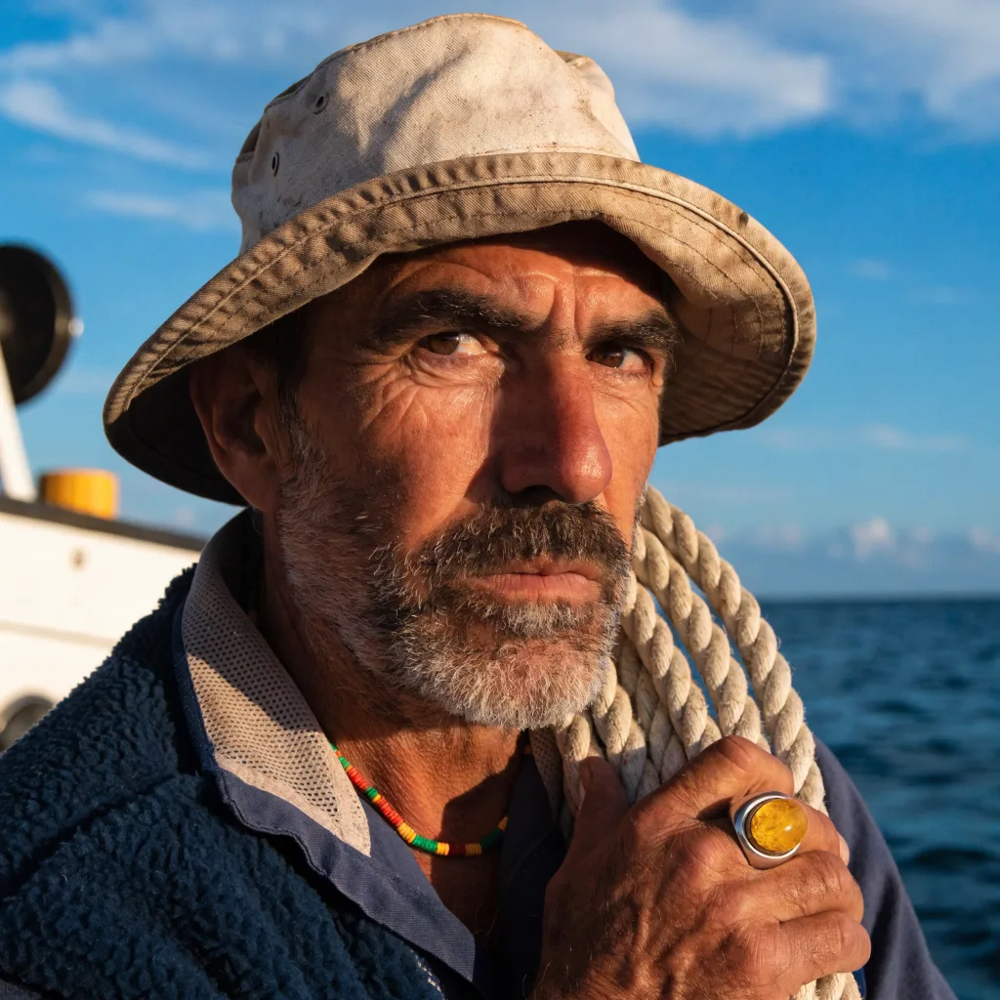

{/* GENERATED by scripts/model-hub-prerender.js. Edit the generator, not this file. */}

<Visibility for="humans">
<link rel="preload" href="https://venice.ai/fonts/Aeonik-Regular.otf" as="font" type="font/otf" crossOrigin="anonymous" /><link rel="preload" href="https://venice.ai/fonts/AeonikFono-Regular.otf" as="font" type="font/otf" crossOrigin="anonymous" /><link rel="preload" href="/data/model-hub.bundle.json?v=5d4d92a48b14" as="fetch" crossOrigin="anonymous" /><link rel="preload" href="/data/model-catalog.json?v=bdf57ff6d43a" as="fetch" crossOrigin="anonymous" />

<aside id="vx-filters" className="vx-side vx-filters" aria-label="Filters">

Filters<button type="button" className="vx-btn vx-btn-sm vx-rail-done">Done</button>

<button type="button" className="vx-fgroup-head" aria-expanded="true">Modality<svg className="vx-icon" width="14" height="14" viewBox="0 0 24 24" fill="none" stroke="currentColor" strokeWidth="1.8" strokeLinecap="round" strokeLinejoin="round" aria-hidden="true"><path d="m6 9 6 6 6-6"></path></svg></button>
<label className="vx-check vx-radio"><input type="radio" name="vx-modality" />All277</label><label className="vx-check vx-radio"><input type="radio" name="vx-modality" />Text125</label><label className="vx-check vx-radio is-checked"><input type="radio" name="vx-modality" defaultChecked />Image50</label><label className="vx-check vx-radio"><input type="radio" name="vx-modality" />Video56</label><label className="vx-check vx-radio"><input type="radio" name="vx-modality" />Text to speech15</label><label className="vx-check vx-radio"><input type="radio" name="vx-modality" />Speech to text5</label><label className="vx-check vx-radio"><input type="radio" name="vx-modality" />Music &amp; sound effects15</label><label className="vx-check vx-radio"><input type="radio" name="vx-modality" />Embeddings9</label><label className="vx-check vx-radio"><input type="radio" name="vx-modality" />Decisions2</label>

<button type="button" className="vx-fgroup-head" aria-expanded="true">Privacy<svg className="vx-icon" width="14" height="14" viewBox="0 0 24 24" fill="none" stroke="currentColor" strokeWidth="1.8" strokeLinecap="round" strokeLinejoin="round" aria-hidden="true"><path d="m6 9 6 6 6-6"></path></svg></button>
<label className="vx-check is-disabled" title="Prompts are encrypted on your device and only decrypted inside an attested hardware enclave. Neither Venice nor the GPU provider can read them."><input type="checkbox" disabled /><svg className="vx-icon" width="11" height="11" viewBox="0 0 24 24" fill="none" stroke="currentColor" strokeWidth="1.8" strokeLinecap="round" strokeLinejoin="round" aria-hidden="true"><path d="M20 6 9 17l-5-5"></path></svg>End-to-end encrypted0</label><label className="vx-check is-disabled" title="Runs inside a hardware-secured enclave with cryptographic attestation. No prompt data is stored or accessible outside the enclave."><input type="checkbox" disabled /><svg className="vx-icon" width="11" height="11" viewBox="0 0 24 24" fill="none" stroke="currentColor" strokeWidth="1.8" strokeLinecap="round" strokeLinejoin="round" aria-hidden="true"><path d="M20 6 9 17l-5-5"></path></svg>Trusted execution0</label><label className="vx-check" title="Zero data retention, enforced by contract. Prompts and outputs are processed for inference only and not retained after the request completes."><input type="checkbox" /><svg className="vx-icon" width="11" height="11" viewBox="0 0 24 24" fill="none" stroke="currentColor" strokeWidth="1.8" strokeLinecap="round" strokeLinejoin="round" aria-hidden="true"><path d="M20 6 9 17l-5-5"></path></svg>Zero data retention14</label><label className="vx-check" title="Proxied to the upstream provider without your identity. The provider may retain prompt data; use a Private, TEE or E2EE model for sensitive work."><input type="checkbox" /><svg className="vx-icon" width="11" height="11" viewBox="0 0 24 24" fill="none" stroke="currentColor" strokeWidth="1.8" strokeLinecap="round" strokeLinejoin="round" aria-hidden="true"><path d="M20 6 9 17l-5-5"></path></svg>Anonymized proxy36</label>

<button type="button" className="vx-fgroup-head" aria-expanded="true">Task<svg className="vx-icon" width="14" height="14" viewBox="0 0 24 24" fill="none" stroke="currentColor" strokeWidth="1.8" strokeLinecap="round" strokeLinejoin="round" aria-hidden="true"><path d="m6 9 6 6 6-6"></path></svg></button>
<label className="vx-check"><input type="checkbox" /><svg className="vx-icon" width="11" height="11" viewBox="0 0 24 24" fill="none" stroke="currentColor" strokeWidth="1.8" strokeLinecap="round" strokeLinejoin="round" aria-hidden="true"><path d="M20 6 9 17l-5-5"></path></svg>Generate47</label><label className="vx-check"><input type="checkbox" /><svg className="vx-icon" width="11" height="11" viewBox="0 0 24 24" fill="none" stroke="currentColor" strokeWidth="1.8" strokeLinecap="round" strokeLinejoin="round" aria-hidden="true"><path d="M20 6 9 17l-5-5"></path></svg>Edit32</label><label className="vx-check"><input type="checkbox" /><svg className="vx-icon" width="11" height="11" viewBox="0 0 24 24" fill="none" stroke="currentColor" strokeWidth="1.8" strokeLinecap="round" strokeLinejoin="round" aria-hidden="true"><path d="M20 6 9 17l-5-5"></path></svg>Upscale1</label><label className="vx-check is-disabled"><input type="checkbox" disabled /><svg className="vx-icon" width="11" height="11" viewBox="0 0 24 24" fill="none" stroke="currentColor" strokeWidth="1.8" strokeLinecap="round" strokeLinejoin="round" aria-hidden="true"><path d="M20 6 9 17l-5-5"></path></svg>Remove background0</label>

<button type="button" className="vx-fgroup-head" aria-expanded="true">Output resolution<svg className="vx-icon" width="14" height="14" viewBox="0 0 24 24" fill="none" stroke="currentColor" strokeWidth="1.8" strokeLinecap="round" strokeLinejoin="round" aria-hidden="true"><path d="m6 9 6 6 6-6"></path></svg></button>

<button type="button" role="radio" aria-checked="true" className="vx-seg-btn is-active">Any</button><button type="button" role="radio" aria-checked="false" className="vx-seg-btn" title="2K available">2K</button><button type="button" role="radio" aria-checked="false" className="vx-seg-btn" title="4K available">4K</button>

<button type="button" className="vx-fgroup-head" aria-expanded="true">Features<svg className="vx-icon" width="14" height="14" viewBox="0 0 24 24" fill="none" stroke="currentColor" strokeWidth="1.8" strokeLinecap="round" strokeLinejoin="round" aria-hidden="true"><path d="m6 9 6 6 6-6"></path></svg></button>
<label className="vx-check"><input type="checkbox" /><svg className="vx-icon" width="11" height="11" viewBox="0 0 24 24" fill="none" stroke="currentColor" strokeWidth="1.8" strokeLinecap="round" strokeLinejoin="round" aria-hidden="true"><path d="M20 6 9 17l-5-5"></path></svg>Web-grounded generation3</label><label className="vx-check"><input type="checkbox" /><svg className="vx-icon" width="11" height="11" viewBox="0 0 24 24" fill="none" stroke="currentColor" strokeWidth="1.8" strokeLinecap="round" strokeLinejoin="round" aria-hidden="true"><path d="M20 6 9 17l-5-5"></path></svg>Multi-image editing22</label>

<button type="button" className="vx-fgroup-head" aria-expanded="true">Attributes<svg className="vx-icon" width="14" height="14" viewBox="0 0 24 24" fill="none" stroke="currentColor" strokeWidth="1.8" strokeLinecap="round" strokeLinejoin="round" aria-hidden="true"><path d="m6 9 6 6 6-6"></path></svg></button>
<label className="vx-check is-disabled" title="The default model used by the Venice app."><input type="checkbox" disabled /><svg className="vx-icon" width="11" height="11" viewBox="0 0 24 24" fill="none" stroke="currentColor" strokeWidth="1.8" strokeLinecap="round" strokeLinejoin="round" aria-hidden="true"><path d="M20 6 9 17l-5-5"></path></svg>App Default0</label><label className="vx-check"><input type="checkbox" /><svg className="vx-icon" width="11" height="11" viewBox="0 0 24 24" fill="none" stroke="currentColor" strokeWidth="1.8" strokeLinecap="round" strokeLinejoin="round" aria-hidden="true"><path d="M20 6 9 17l-5-5"></path></svg>Open weights7</label><label className="vx-check"><input type="checkbox" /><svg className="vx-icon" width="11" height="11" viewBox="0 0 24 24" fill="none" stroke="currentColor" strokeWidth="1.8" strokeLinecap="round" strokeLinejoin="round" aria-hidden="true"><path d="M20 6 9 17l-5-5"></path></svg>Uncensored15</label><label className="vx-check"><input type="checkbox" /><svg className="vx-icon" width="11" height="11" viewBox="0 0 24 24" fill="none" stroke="currentColor" strokeWidth="1.8" strokeLinecap="round" strokeLinejoin="round" aria-hidden="true"><path d="M20 6 9 17l-5-5"></path></svg>Added in the last 30 days4</label>

<button type="button" className="vx-fgroup-head" aria-expanded="true">Provider<svg className="vx-icon" width="14" height="14" viewBox="0 0 24 24" fill="none" stroke="currentColor" strokeWidth="1.8" strokeLinecap="round" strokeLinejoin="round" aria-hidden="true"><path d="m6 9 6 6 6-6"></path></svg></button>
<label className="vx-check"><input type="checkbox" /><svg className="vx-icon" width="11" height="11" viewBox="0 0 24 24" fill="none" stroke="currentColor" strokeWidth="1.8" strokeLinecap="round" strokeLinejoin="round" aria-hidden="true"><path d="M20 6 9 17l-5-5"></path></svg>Alibaba Qwen11</label><label className="vx-check"><input type="checkbox" /><svg className="vx-icon" width="11" height="11" viewBox="0 0 24 24" fill="none" stroke="currentColor" strokeWidth="1.8" strokeLinecap="round" strokeLinejoin="round" aria-hidden="true"><path d="M20 6 9 17l-5-5"></path></svg>OpenAI6</label><label className="vx-check"><input type="checkbox" /><svg className="vx-icon" width="11" height="11" viewBox="0 0 24 24" fill="none" stroke="currentColor" strokeWidth="1.8" strokeLinecap="round" strokeLinejoin="round" aria-hidden="true"><path d="M20 6 9 17l-5-5"></path></svg>Community5</label><label className="vx-check"><input type="checkbox" /><svg className="vx-icon" width="11" height="11" viewBox="0 0 24 24" fill="none" stroke="currentColor" strokeWidth="1.8" strokeLinecap="round" strokeLinejoin="round" aria-hidden="true"><path d="M20 6 9 17l-5-5"></path></svg>ByteDance Seed4</label><label className="vx-check"><input type="checkbox" /><svg className="vx-icon" width="11" height="11" viewBox="0 0 24 24" fill="none" stroke="currentColor" strokeWidth="1.8" strokeLinecap="round" strokeLinejoin="round" aria-hidden="true"><path d="M20 6 9 17l-5-5"></path></svg>Google4</label><label className="vx-check"><input type="checkbox" /><svg className="vx-icon" width="11" height="11" viewBox="0 0 24 24" fill="none" stroke="currentColor" strokeWidth="1.8" strokeLinecap="round" strokeLinejoin="round" aria-hidden="true"><path d="M20 6 9 17l-5-5"></path></svg>Krea4</label><label className="vx-check"><input type="checkbox" /><svg className="vx-icon" width="11" height="11" viewBox="0 0 24 24" fill="none" stroke="currentColor" strokeWidth="1.8" strokeLinecap="round" strokeLinejoin="round" aria-hidden="true"><path d="M20 6 9 17l-5-5"></path></svg>Black Forest Labs3</label><label className="vx-check"><input type="checkbox" /><svg className="vx-icon" width="11" height="11" viewBox="0 0 24 24" fill="none" stroke="currentColor" strokeWidth="1.8" strokeLinecap="round" strokeLinejoin="round" aria-hidden="true"><path d="M20 6 9 17l-5-5"></path></svg>Ideogram2</label><label className="vx-check"><input type="checkbox" /><svg className="vx-icon" width="11" height="11" viewBox="0 0 24 24" fill="none" stroke="currentColor" strokeWidth="1.8" strokeLinecap="round" strokeLinejoin="round" aria-hidden="true"><path d="M20 6 9 17l-5-5"></path></svg>Luma AI2</label><label className="vx-check"><input type="checkbox" /><svg className="vx-icon" width="11" height="11" viewBox="0 0 24 24" fill="none" stroke="currentColor" strokeWidth="1.8" strokeLinecap="round" strokeLinejoin="round" aria-hidden="true"><path d="M20 6 9 17l-5-5"></path></svg>Recraft2</label><button type="button" className="vx-link-btn vx-more">Show all 16</button>

</aside>
<header className="vx-hero">
<h1 className="vx-h1">Image Models</h1>
Image generation, editing, upscaling and background removal, priced per image.

<a className="vx-btn vx-btn-tertiary" href="/api-reference/endpoint/models/list">Models API</a>
</header>
<button type="button" className="vx-btn vx-rail-toggle" aria-expanded="false" aria-controls="vx-filters">Filters</button>
<svg className="vx-icon" width="16" height="16" viewBox="0 0 24 24" fill="none" stroke="currentColor" strokeWidth="1.8" strokeLinecap="round" strokeLinejoin="round" aria-hidden="true"><circle cx="11" cy="11" r="7"></circle><path d="m20 20-3.5-3.5"></path></svg><input type="search" defaultValue="" placeholder="Search by name, ID or provider" aria-label="Search models" /><kbd aria-hidden="true">/</kbd>
<select className="vx-select" defaultValue="name" aria-label="Sort"><option value="name">Name A–Z</option><option value="newest">Newest</option><option value="price">Price, low to high</option></select>
<button type="button" role="radio" aria-checked="false" className="vx-seg-btn">List</button><button type="button" role="radio" aria-checked="false" className="vx-seg-btn">Table</button><button type="button" role="radio" aria-checked="true" className="vx-seg-btn is-active">Gallery</button>

<section className="vx-results" aria-label="Models">
<strong>50 families</strong>&#32;·&#32;80 model IDsUpdated&#32;Nov 10, 2026

<article className="vx-card">

<a className="vx-card-name" href="/models/anime" title="Anime">Anime</a>

<strong>&#36;0.01</strong>&#32;/ imagePrivate

</article><article className="vx-card">

<a className="vx-card-name" href="/models/chroma" title="Chroma">Chroma</a>

<strong>&#36;0.01</strong>&#32;/ imagePrivate

</article><article className="vx-card">

<a className="vx-card-name" href="/models/firered" title="FireRed">FireRed</a>

<strong>&#36;0.04</strong>&#32;/ editPrivate

</article><article className="vx-card">

<a className="vx-card-name" href="/models/flux-2-max" title="Flux 2 Max">Flux 2 Max</a>

<strong>&#36;0.09</strong>&#32;/ imageAnonymized

</article><article className="vx-card">

<a className="vx-card-name" href="/models/flux-2-pro" title="Flux 2 Pro">Flux 2 Pro</a>

<strong>&#36;0.03</strong>&#32;/ imageAnonymized

</article><article className="vx-card">

<a className="vx-card-name" href="/models/flux-3-image" title="Flux 3">Flux 3</a>

<button type="button" className="vx-tip-anchor" aria-describedby="vx-tip-30">from&#32;<strong>&#36;0.12</strong>&#32;/ image1K&#36;0.12 / image2K&#36;0.29 / image4K&#36;0.98 / image</button>Anonymized

</article><article className="vx-card">

<a className="vx-card-name" href="/models/gpt-image-1-5" title="GPT Image 1.5">GPT Image 1.5</a>

<strong>&#36;0.26</strong>&#32;/ imageAnonymized

</article><article className="vx-card">

<a className="vx-card-name" href="/models/gpt-image-2" title="GPT Image 2">GPT Image 2</a>

<button type="button" className="vx-tip-anchor" aria-describedby="vx-tip-32">from&#32;<strong>&#36;0.26</strong>&#32;/ image1K&#36;0.26 / image2K&#36;0.50 / image4K&#36;0.83 / image</button>Anonymized

</article><article className="vx-card">

<a className="vx-card-name" href="/models/gpt-image-2-5-flare" title="GPT Image 2.5 Flare">GPT Image 2.5 Flare</a>

<button type="button" className="vx-tip-anchor" aria-describedby="vx-tip-33">from&#32;<strong>&#36;0.07</strong>&#32;/ image1K&#36;0.07 / image2K&#36;0.15 / image4K&#36;0.23 / image</button>Anonymized

</article><article className="vx-card">

<a className="vx-card-name" href="/models/gpt-image-2-5-sunburst" title="GPT Image 2.5 Sunburst">GPT Image 2.5 Sunburst</a>

<button type="button" className="vx-tip-anchor" aria-describedby="vx-tip-34">from&#32;<strong>&#36;0.07</strong>&#32;/ image1K&#36;0.07 / image2K&#36;0.15 / image4K&#36;0.23 / image</button>Anonymized

</article><article className="vx-card">

<a className="vx-card-name" href="/models/gpt-image-2-6-flare" title="GPT Image 2.6 Flare">GPT Image 2.6 Flare</a>New

<button type="button" className="vx-tip-anchor" aria-describedby="vx-tip-35">from&#32;<strong>&#36;0.09</strong>&#32;/ image1K&#36;0.09 / image2K&#36;0.15 / image4K&#36;0.24 / image</button>Anonymized

</article><article className="vx-card">

<a className="vx-card-name" href="/models/gpt-image-2-6-sunburst" title="GPT Image 2.6 Sunburst">GPT Image 2.6 Sunburst</a>New

<button type="button" className="vx-tip-anchor" aria-describedby="vx-tip-36">from&#32;<strong>&#36;0.09</strong>&#32;/ image1K&#36;0.09 / image2K&#36;0.15 / image4K&#36;0.24 / image</button>Anonymized

</article><article className="vx-card">

<a className="vx-card-name" href="/models/grok-imagine-image" title="Grok Imagine">Grok Imagine</a>

<button type="button" className="vx-tip-anchor" aria-describedby="vx-tip-37">from&#32;<strong>&#36;0.03</strong>&#32;/ image1K&#36;0.03 / image2K&#36;0.04 / image</button>Private

</article><article className="vx-card">

<a className="vx-card-name" href="/models/grok-imagine-2-0" title="Grok Imagine 2.0">Grok Imagine 2.0</a>

<button type="button" className="vx-tip-anchor" aria-describedby="vx-tip-38">from&#32;<strong>&#36;0.07</strong>&#32;/ image1K&#36;0.07 / image2K&#36;0.10 / image</button>Private

</article><article className="vx-card">

<a className="vx-card-name" href="/models/hunyuan-image-3-0" title="Hunyuan Image 3.0">Hunyuan Image 3.0</a>

<strong>&#36;0.09</strong>&#32;/ imagePrivate

</article><article className="vx-card">

<a className="vx-card-name" href="/models/ideogram-v4" title="Ideogram V4">Ideogram V4</a>

<strong>&#36;0.06</strong>&#32;/ imageAnonymized

</article><article className="vx-card">

<a className="vx-card-name" href="/models/ideogram-v4-5" title="Ideogram V4.5">Ideogram V4.5</a>

<strong>&#36;0.26</strong>&#32;/ imageAnonymized

</article><article className="vx-card">

<a className="vx-card-name" href="/models/krea-2-turbo" title="Krea 2 Turbo">Krea 2 Turbo</a>

<button type="button" className="vx-tip-anchor" aria-describedby="vx-tip-42">from&#32;<strong>&#36;0.04</strong>&#32;/ image1K&#36;0.04 / image2K&#36;0.06 / image</button>Private

</article><article className="vx-card">

<a className="vx-card-name" href="/models/krea-3" title="Krea 3">Krea 3</a>New

<button type="button" className="vx-tip-anchor" aria-describedby="vx-tip-43">from&#32;<strong>&#36;0.07</strong>&#32;/ image1K&#36;0.07 / image2K&#36;0.10 / image4K&#36;0.15 / image</button>Anonymized

</article><article className="vx-card">

<a className="vx-card-name" href="/models/krea-v2-large" title="Krea v2 Large">Krea v2 Large</a>

<strong>&#36;0.07</strong>&#32;/ imageAnonymized

</article><article className="vx-card">

<a className="vx-card-name" href="/models/krea-v2-medium" title="Krea v2 Medium">Krea v2 Medium</a>

<strong>&#36;0.04</strong>&#32;/ imageAnonymized

</article><article className="vx-card">

<a className="vx-card-name" href="/models/luma-uni-1" title="Luma Uni-1">Luma Uni-1</a>

<strong>&#36;0.05</strong>&#32;/ imageAnonymized

</article><article className="vx-card">

<a className="vx-card-name" href="/models/luma-uni-1-max" title="Luma Uni-1 Max">Luma Uni-1 Max</a>

<strong>&#36;0.12</strong>&#32;/ imageAnonymized

</article><article className="vx-card">

<a className="vx-card-name" href="/models/lustify-sdxl" title="Lustify SDXL">Lustify SDXL</a>

<strong>&#36;0.01</strong>&#32;/ imagePrivate

</article><article className="vx-card">

<a className="vx-card-name" href="/models/lustify-v7" title="Lustify v7">Lustify v7</a>

<strong>&#36;0.01</strong>&#32;/ imagePrivate

</article><article className="vx-card">

<a className="vx-card-name" href="/models/lustify-v8" title="Lustify v8">Lustify v8</a>

<strong>&#36;0.01</strong>&#32;/ imagePrivate

</article><article className="vx-card">

<a className="vx-card-name" href="/models/muse-image" title="Muse Image">Muse Image</a>

<strong>&#36;0.02</strong>&#32;/ imageAnonymized

</article><article className="vx-card">

<a className="vx-card-name" href="/models/nano-banana-2" title="Nano Banana 2">Nano Banana 2</a>

<button type="button" className="vx-tip-anchor" aria-describedby="vx-tip-52">from&#32;<strong>&#36;0.10</strong>&#32;/ image1K&#36;0.10 / image2K&#36;0.14 / image4K&#36;0.19 / image</button>Anonymized

</article><article className="vx-card">

<a className="vx-card-name" href="/models/nano-banana-2-lite" title="Nano Banana 2 Lite">Nano Banana 2 Lite</a>

<strong>&#36;0.06</strong>&#32;/ imageAnonymized

</article><article className="vx-card">

<a className="vx-card-name" href="/models/nano-banana-2-1" title="Nano Banana 2.1">Nano Banana 2.1</a>

<button type="button" className="vx-tip-anchor" aria-describedby="vx-tip-54">from&#32;<strong>&#36;0.10</strong>&#32;/ image1K&#36;0.10 / image2K&#36;0.14 / image4K&#36;0.19 / image</button>Anonymized

</article><article className="vx-card">

<a className="vx-card-name" href="/models/nano-banana-pro" title="Nano Banana Pro">Nano Banana Pro</a>

<button type="button" className="vx-tip-anchor" aria-describedby="vx-tip-55">from&#32;<strong>&#36;0.18</strong>&#32;/ image1K&#36;0.18 / image2K&#36;0.23 / image4K&#36;0.35 / image</button>Anonymized

</article><article className="vx-card">

<a className="vx-card-name" href="/models/qwen-edit-uncensored" title="Qwen Edit Uncensored">Qwen Edit Uncensored</a>

<strong>&#36;0.04</strong>&#32;/ editPrivate

</article><article className="vx-card">

<a className="vx-card-name" href="/models/qwen-image" title="Qwen Image">Qwen Image</a>

<strong>&#36;0.03</strong>&#32;/ imageAnonymized

</article><article className="vx-card">

<a className="vx-card-name" href="/models/qwen-image-2" title="Qwen Image 2">Qwen Image 2</a>

<strong>&#36;0.05</strong>&#32;/ imageAnonymized

</article><article className="vx-card">

<a className="vx-card-name" href="/models/qwen-image-2-pro" title="Qwen Image 2 Pro">Qwen Image 2 Pro</a>

<strong>&#36;0.10</strong>&#32;/ imageAnonymized

</article><article className="vx-card">

<a className="vx-card-name" href="/models/qwen-image-2-1-pro" title="Qwen Image 2.1 Pro">Qwen Image 2.1 Pro</a>

<strong>&#36;0.05</strong>&#32;/ imageAnonymized

</article><article className="vx-card">

<a className="vx-card-name" href="/models/qwen-image-2-1-turbo" title="Qwen Image 2.1 Turbo">Qwen Image 2.1 Turbo</a>

<strong>&#36;0.02</strong>&#32;/ imageAnonymized

</article><article className="vx-card">

<a className="vx-card-name" href="/models/qwen-image-3" title="Qwen Image 3">Qwen Image 3</a>

<strong>&#36;0.04</strong>&#32;/ imageAnonymized

</article><article className="vx-card">

<a className="vx-card-name" href="/models/qwen-image-3-pro" title="Qwen Image 3 Pro">Qwen Image 3 Pro</a>

<button type="button" className="vx-tip-anchor" aria-describedby="vx-tip-63">from&#32;<strong>&#36;0.05</strong>&#32;/ image1K&#36;0.05 / image2K&#36;0.09 / image</button>Anonymized

</article><article className="vx-card">

<a className="vx-card-name" href="/models/recraft-v4" title="Recraft V4">Recraft V4</a>

<strong>&#36;0.05</strong>&#32;/ imageAnonymized

</article><article className="vx-card">

<a className="vx-card-name" href="/models/recraft-v4-pro" title="Recraft V4 Pro">Recraft V4 Pro</a>

<strong>&#36;0.29</strong>&#32;/ imageAnonymized

</article><article className="vx-card">

<a className="vx-card-name" href="/models/seedream-v4-5" title="Seedream V4.5">Seedream V4.5</a>

<strong>&#36;0.05</strong>&#32;/ imageAnonymized

</article><article className="vx-card">

<a className="vx-card-name" href="/models/seedream-v5-lite" title="Seedream V5 Lite">Seedream V5 Lite</a>

<strong>&#36;0.05</strong>&#32;/ imageAnonymized

</article><article className="vx-card">

<a className="vx-card-name" href="/models/seedream-v5-pro" title="Seedream V5 Pro">Seedream V5 Pro</a>

<button type="button" className="vx-tip-anchor" aria-describedby="vx-tip-68">from&#32;<strong>&#36;0.06</strong>&#32;/ image1K&#36;0.06 / image2K&#36;0.11 / image</button>Anonymized

</article><article className="vx-card">

<a className="vx-card-name" href="/models/seedream-v5-5" title="Seedream V5.5">Seedream V5.5</a>New

<button type="button" className="vx-tip-anchor" aria-describedby="vx-tip-69">from&#32;<strong>&#36;0.03</strong>&#32;/ image1K&#36;0.03 / image2K&#36;0.05 / image</button>Anonymized

</article><article className="vx-card">

<a className="vx-card-name" href="/models/upscaler" title="Upscaler">Upscaler</a>

<strong>&#36;0.02</strong>&#32;/ 2xPrivate

</article><article className="vx-card">

<a className="vx-card-name" href="/models/venice-sd35" title="Venice SD35">Venice SD35</a>

<strong>&#36;0.01</strong>&#32;/ imagePrivate

</article><article className="vx-card">

<a className="vx-card-name" href="/models/wan-2-7-image" title="Wan 2.7">Wan 2.7</a>

<strong>&#36;0.0375</strong>&#32;/ imageAnonymized

</article><article className="vx-card">

<a className="vx-card-name" href="/models/wan-2-7-pro" title="Wan 2.7 Pro">Wan 2.7 Pro</a>

<strong>&#36;0.0938</strong>&#32;/ imageAnonymized

</article><article className="vx-card">

<a className="vx-card-name" href="/models/z-image-turbo" title="Z-Image Turbo">Z-Image Turbo</a>

<strong>&#36;0.01</strong>&#32;/ imagePrivate

</article>
<footer className="vx-explorer-foot"><nav aria-label="Related pages"><a href="/models/methodology">Methodology</a><a href="/overview/deprecations">Deprecations</a><a href="/overview/beta-models">Beta models</a></nav></footer></section>

</Visibility>
