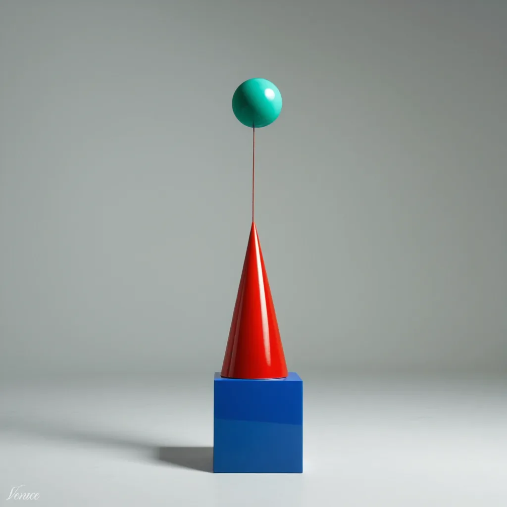
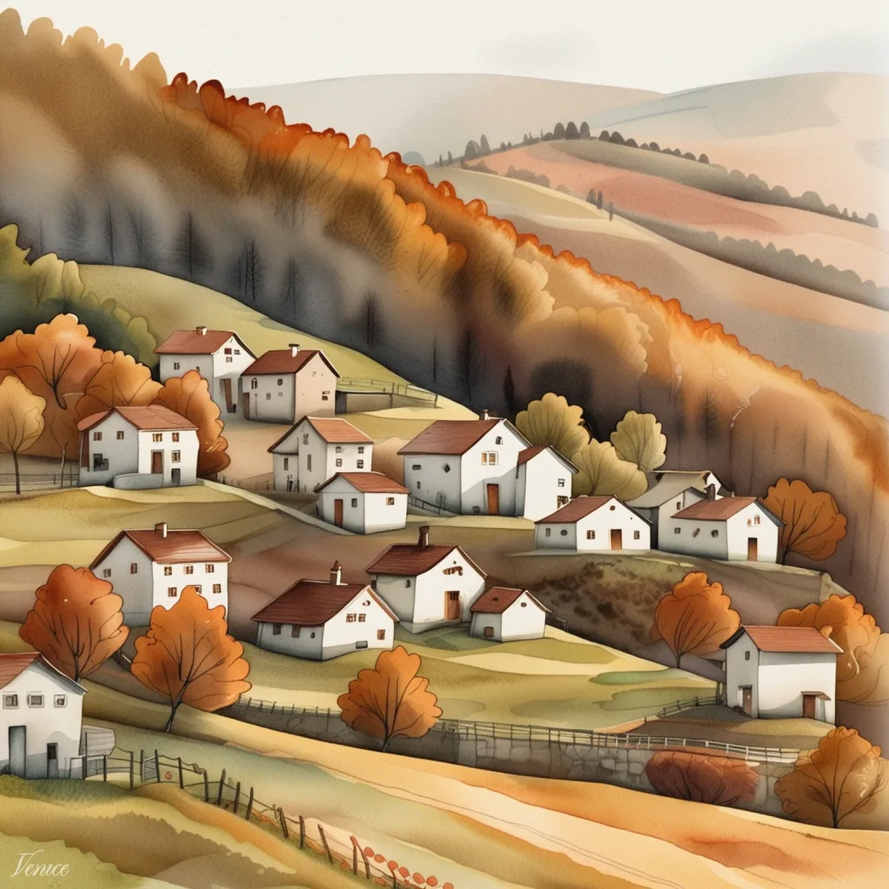

{/* GENERATED by scripts/model-hub-prerender.js. Edit the generator, not this file. */}

<Visibility for="humans">
<link rel="preload" href="https://venice.ai/fonts/Aeonik-Regular.otf" as="font" type="font/otf" crossOrigin="anonymous" /><link rel="preload" href="https://venice.ai/fonts/AeonikFono-Regular.otf" as="font" type="font/otf" crossOrigin="anonymous" /><link rel="preload" href="/data/model-hub.bundle.json?v=1138f500aa34" as="fetch" crossOrigin="anonymous" />

<aside className="vx-side">
<nav className="vx-crumbs" aria-label="Breadcrumb"><a href="/models/overview">Models</a><svg className="vx-icon" width="12" height="12" viewBox="0 0 24 24" fill="none" stroke="currentColor" strokeWidth="1.8" strokeLinecap="round" strokeLinejoin="round" aria-hidden="true"><path d="m9 18 6-6-6-6"></path></svg>Lustify v8</nav><nav className="vx-side-nav" aria-label="On this page"><a href="#overview" className="is-active" aria-current="location"><svg className="vx-icon" width="16" height="16" viewBox="0 0 24 24" fill="none" stroke="currentColor" strokeWidth="1.8" strokeLinecap="round" strokeLinejoin="round" aria-hidden="true"><circle cx="12" cy="12" r="10"></circle><path d="M12 16v-4M12 8h.01"></path></svg>Overview</a><a href="#pricing" className=""><svg className="vx-icon" width="16" height="16" viewBox="0 0 24 24" fill="none" stroke="currentColor" strokeWidth="1.8" strokeLinecap="round" strokeLinejoin="round" aria-hidden="true"><path d="M12 2v20M17 5H9.5a3.5 3.5 0 0 0 0 7h5a3.5 3.5 0 0 1 0 7H6"></path></svg>Pricing</a><a href="#examples" className=""><svg className="vx-icon" width="16" height="16" viewBox="0 0 24 24" fill="none" stroke="currentColor" strokeWidth="1.8" strokeLinecap="round" strokeLinejoin="round" aria-hidden="true"><rect x="3" y="3" width="18" height="18" rx="2"></rect><circle cx="9" cy="9" r="2"></circle><path d="m21 15-3.1-3.1a2 2 0 0 0-2.8 0L6 21"></path></svg>Examples</a><a href="#specs" className=""><svg className="vx-icon" width="16" height="16" viewBox="0 0 24 24" fill="none" stroke="currentColor" strokeWidth="1.8" strokeLinecap="round" strokeLinejoin="round" aria-hidden="true"><path d="M4 21v-7M4 10V3M12 21v-9M12 8V3M20 21v-5M20 12V3M1 14h6M9 8h6M17 16h6"></path></svg>Specs</a><a href="#capabilities" className=""><svg className="vx-icon" width="16" height="16" viewBox="0 0 24 24" fill="none" stroke="currentColor" strokeWidth="1.8" strokeLinecap="round" strokeLinejoin="round" aria-hidden="true"><path d="m12 3 1.9 5.1L19 10l-5.1 1.9L12 17l-1.9-5.1L5 10l5.1-1.9zM19 16l.7 1.8 1.8.7-1.8.7L19 21l-.7-1.8-1.8-.7 1.8-.7z"></path></svg>Capabilities</a><a href="#api" className=""><svg className="vx-icon" width="16" height="16" viewBox="0 0 24 24" fill="none" stroke="currentColor" strokeWidth="1.8" strokeLinecap="round" strokeLinejoin="round" aria-hidden="true"><path d="m16 18 6-6-6-6M8 6l-6 6 6 6"></path></svg>API</a><a href="#privacy" className=""><svg className="vx-icon" width="16" height="16" viewBox="0 0 24 24" fill="none" stroke="currentColor" strokeWidth="1.8" strokeLinecap="round" strokeLinejoin="round" aria-hidden="true"><path d="M12 22s8-4 8-10V5l-8-3-8 3v7c0 6 8 10 8 10z"></path></svg>Privacy</a><a href="#related" className=""><svg className="vx-icon" width="16" height="16" viewBox="0 0 24 24" fill="none" stroke="currentColor" strokeWidth="1.8" strokeLinecap="round" strokeLinejoin="round" aria-hidden="true"><path d="M10 13a5 5 0 0 0 7.5.5l3-3a5 5 0 0 0-7-7l-1.7 1.7M14 11a5 5 0 0 0-7.5-.5l-3 3a5 5 0 0 0 7 7l1.7-1.7"></path></svg>Related models</a></nav>
<a className="vx-side-link" href="https://civitai.com/models/573152/lustify-sdxl-nsfw-checkpoint" target="_blank" rel="noopener noreferrer">Source<svg className="vx-icon" width="12" height="12" viewBox="0 0 24 24" fill="none" stroke="currentColor" strokeWidth="1.8" strokeLinecap="round" strokeLinejoin="round" aria-hidden="true"><path d="M15 3h6v6M10 14 21 3M18 13v6a2 2 0 0 1-2 2H5a2 2 0 0 1-2-2V8a2 2 0 0 1 2-2h6"></path></svg></a>

</aside>
<header id="overview" className="vx-model-head">
CommunityAdded Mar 30, 2026Image generationPrivateUncensored
<h1 className="vx-h1">Lustify v8</h1>
Lustify v8 is version 8 of the Lustify community SDXL checkpoint, built for uncensored, adult-oriented photorealistic images. It accepts prompts of up to 1,500 characters.

<code title="lustify-v8">lustify-v8</code><button type="button" className="vx-id-copy" aria-label="Copy model ID lustify-v8">Copy</button>POST&#32;https&#58;//api.venice.ai/api/v1/image/generate
</header>

Price per image

&#36;0.01

Prompt limit

1,500

characters

<section id="pricing" className="vx-section" aria-labelledby="pricing-title">
<h2 id="pricing-title" className="vx-h2">Pricing</h2>USD per image

Per image

&#36;0.01

Optional upscale&#58;&#32;&#36;0.02 at 2x and &#36;0.08 at 4x.
</section><section id="examples" className="vx-section" aria-labelledby="examples-title">
<h2 id="examples-title" className="vx-h2">Examples</h2>

<figure noZoom className="vx-shot"><button type="button" className="vx-shot-media" aria-label="Open Instruction-following sample"></button><figcaption>Instruction-followingA small red cube balanced on top of a large glossy blue sphere, with a green cone to the right, plain light-grey studio background</figcaption></figure><figure noZoom className="vx-shot"><button type="button" className="vx-shot-media" aria-label="Open Photorealism sample"></button><figcaption>PhotorealismPhotorealistic close-up portrait of a weathered fisherman at golden hour, 85mm lens, shallow depth of field, natural skin texture</figcaption></figure><figure noZoom className="vx-shot"><button type="button" className="vx-shot-media" aria-label="Open Illustration style sample"></button><figcaption>Illustration styleCozy watercolor illustration of a hillside village in autumn, warm tones, soft paper texture</figcaption></figure><figure noZoom className="vx-shot"><button type="button" className="vx-shot-media" aria-label="Open In-image text sample"></button><figcaption>In-image textA retro travel poster with the bold headline “VENICE” in large condensed serif type, sunset color palette, clean layout</figcaption></figure>
</section><section id="specs" className="vx-section" aria-labelledby="specs-title">
<h2 id="specs-title" className="vx-h2">Specs</h2>
<dl className="vx-kv vx-specs">
<dt>Model ID</dt><dd><code>lustify-v8</code></dd>

<dt>Endpoint</dt><dd><code>POST&#32;/api/v1/image/generate</code></dd>

<dt>Prompt limit</dt><dd>1,500 characters</dd>

<dt>Steps</dt><dd>default 30, max 50</dd>

<dt>Added</dt><dd>Mar 30, 2026</dd>
</dl></section><section id="capabilities" className="vx-section" aria-labelledby="capabilities-title">
<h2 id="capabilities-title" className="vx-h2">Capabilities</h2>

Modalities
<dl>
<dt>Text</dt><dd className="is-on">Input</dd>

<dt>Image</dt><dd className="is-on">Output</dd>
</dl>

Features
<dl>
<dt>Image editing</dt><dd className="is-off">Not supported</dd>

<dt>Multi-image editing</dt><dd className="is-off">Not supported</dd>

<dt>Web-grounded generation</dt><dd className="is-off">Not supported</dd>

<dt>Style references</dt><dd className="is-off">Not supported</dd>

<dt>Upscale</dt><dd className="is-on">2x and 4x</dd>
</dl>

</section><section id="api" className="vx-section" aria-labelledby="api-title">
<h2 id="api-title" className="vx-h2">API</h2>
<a className="vx-link-btn" href="https://venice.ai/settings/api" target="_blank" rel="noopener">Get an API key</a>

<button type="button" role="radio" aria-checked="true" className="vx-seg-btn is-active">Generate image</button><button type="button" role="radio" aria-checked="false" className="vx-seg-btn">OpenAI-compatible images</button>

POST<code>/api/v1/image/generate</code>Recommended

<button id="vx-code-tab-curl" data-key="curl" type="button" role="tab" aria-selected="true" aria-controls="vx-code-panel" tabIndex="0" className="vx-code-tab is-active">cURL</button><button id="vx-code-tab-python" data-key="python" type="button" role="tab" aria-selected="false" aria-controls="vx-code-panel" tabIndex="-1" className="vx-code-tab">Python</button><button id="vx-code-tab-typescript" data-key="typescript" type="button" role="tab" aria-selected="false" aria-controls="vx-code-panel" tabIndex="-1" className="vx-code-tab">TypeScript</button>
<button type="button" className="vx-btn vx-btn-sm" aria-label="Copy"><svg className="vx-icon" width="14" height="14" viewBox="0 0 24 24" fill="none" stroke="currentColor" strokeWidth="1.8" strokeLinecap="round" strokeLinejoin="round" aria-hidden="true"><rect x="9" y="9" width="13" height="13" rx="2"></rect><path d="M5 15H4a2 2 0 0 1-2-2V4a2 2 0 0 1 2-2h9a2 2 0 0 1 2 2v1"></path></svg>Copy</button>
<pre id="vx-code-panel" className="vx-code-body" role="tabpanel" aria-labelledby="vx-code-tab-curl" tabIndex="0"><code>curl https&#58;//api.venice.ai/api/v1/image/generate &#92;   -H `"`Authorization&#58; Bearer &#36;VENICE&#95;API&#95;KEY`"` &#92;   -H `"`Content-Type&#58; application/json`"` &#92;   -d `'`&#123;     `"`model`"`&#58; `"`lustify-v8`"`,     `"`prompt`"`&#58; `"`A retro travel poster with the bold headline &#92;`"`VENICE&#92;`"` in large condensed serif type, sunset color palette`"`   &#125;`'`</code></pre>
</section><section id="privacy" className="vx-section" aria-labelledby="privacy-title">
<h2 id="privacy-title" className="vx-h2">Privacy</h2>

Tier&#32;1

Anonymized

Included

Tier&#32;2&#32;· this model

Private

Zero data retention, enforced by contract. Prompts and outputs aren’t stored.

Tier&#32;3

TEE

Not available

Tier&#32;4

End-to-end encrypted

Not available

</section><section id="related" className="vx-section" aria-labelledby="related-title">
<h2 id="related-title" className="vx-h2">Related models</h2>

<h3 className="vx-related-head">Other versions</h3><ul className="vx-related-list"><li>C<a href="/models/lustify-v7">Lustify v7</a>Community&#36;0.01&#32;per image</li></ul>

<h3 className="vx-related-head">Similar price and capability</h3><ul className="vx-related-list"><li><a href="/models/z-image-turbo">Z-Image Turbo</a>Alibaba Qwen&#36;0.01&#32;per image</li><li>C<a href="/models/chroma">Chroma</a>Community&#36;0.01&#32;per image</li><li><a href="/models/venice-sd35">Venice SD35</a>Stability AI&#36;0.01&#32;per image</li><li><a href="/models/muse-image">Muse Image</a>Meta&#36;0.02&#32;per image</li></ul>

</section>

</Visibility>
